## I · Introduction

*Columba*, in Irish Colum Cille, "dove of the church", is one of the few figures of sixth-century Ireland and Britain whose life can be told from a source written within a century of his death, and one of the very few around whom an artistic culture can be gathered. He produced no works of art that can be identified. What he left was an institution: a federation of monasteries, the *familia Columbae*, governed from the small island of Iona off the west coast of Scotland, whose houses for two centuries made, kept and venerated books, shrines and crosses. The earliest decorated Irish manuscript, the Cathach, was believed to be in his hand; the Book of Durrow carried a colophon invoking a scribe named Columba; and the Book of Kells, the most celebrated of all Insular books, was known in the Middle Ages as the "great Gospel of Colum Cille".

This paper looks at that world through its sources and its surviving objects. It separates what the early texts say from what later tradition added, follows the history of the federation from Iona to Kells, and examines the works that can be connected to the Columban houses with reasonable confidence. The Book of Kells, which has its own page, is mentioned only where the argument needs it.

## II · The sources

Three bodies of evidence underlie everything that can be said about Columba. The first and most important is the *Vita Columbae* by Adomnán, ninth abbot of Iona (679–704) and a kinsman of the saint, written around 700. It is not a biography in the modern sense. Its three books are arranged by theme, not by date: prophecies, miracles of power, and apparitions of angels and of heavenly light. Its purpose is to demonstrate sanctity, and its chronology must be reconstructed from scattered remarks. Yet Adomnán wrote on Iona, drew on an earlier book about Columba's miracles by Abbot Cumméne (657–669) and on the memories of the community, and describes the island, its buildings and its daily life with a precision no later source matches. The standard English translation, with a long and careful commentary, is that of <a href="/scholars.html#sharpe-richard">Richard Sharpe</a> (1995).

A copy of the *Vita* made on Iona within a few years of its composition survives. Its scribe, Dorbbéne, who signs the book, is almost certainly the Dorbbéne whose death as abbot-elect of Iona the Annals of Ulster record in 713. The manuscript left Iona in the Middle Ages, reached the Continent, and was found in 1845 at the bottom of a cupboard in the town library of Schaffhausen; it is one of the oldest manuscripts written in Scotland to survive.

<figure>
  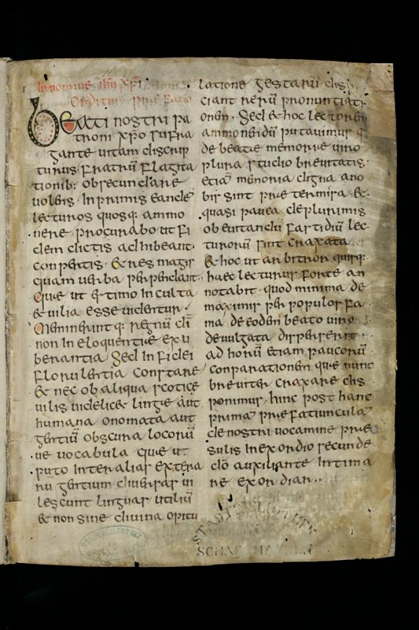
  <figcaption>Dorbbéne, Adomnán's Life of Columba, p. 1, Iona, before 713. Ink on parchment. Schaffhausen, Stadtbibliothek, Gen. 1. Source: e-codices – Virtual Manuscript Library of Switzerland, public domain.</figcaption>
</figure>

The second source is Bede<a href="/endnotes.html#fn-bede" class="footnote">1</a>, whose *Ecclesiastical History of the English People*, finished in 731, gives a short account of Columba and Iona (III.4) and tells the story of the Columban mission to Northumbria at length; the critical edition by <a href="/scholars.html#colgrave-bertram">Bertram Colgrave</a> and R. A. B. Mynors (1969) is the one generally cited. Bede admired the holiness of the Iona monks while deploring their method of calculating Easter, and he wrote from outside the community, sometimes with information different from Adomnán's. The third body of evidence is the Irish annals, compiled from a chronicle kept on Iona until about 740 and later continued in Ireland, which supply the dates of battles, abbots, foundations, raids and relic translations.

Everything else is later. The Old Irish Life of Colum Cille was composed in the tenth or eleventh century, probably at Derry or Kells; poems attributed to Columba belong mostly to the eleventh and twelfth centuries; and the great Irish *Betha Colaim Chille* compiled for Manus O'Donnell in 1532 gathers the legends of four centuries. These texts are valuable for the history of the cult, not for the life of the man.

## III · Columba's life: what is known and what was added

Columba was born around 521 or 522 into the Cenél Conaill, the branch of the northern Uí Néill that dominated what is now Donegal; tradition places his birth at Gartan. His father Fedelmid was a great-grandson of Niall of the Nine Hostages, and his descent placed him among the most powerful families of northern Ireland, a fact that shaped his whole career. Adomnán names among his teachers a bishop he calls Uinniau or Findbarr, generally identified with Finnian of Movilla<a href="/endnotes.html#fn-finnian-movilla" class="footnote">2</a>, and an old Leinster poet, Gemmán. Later tradition added Finnian of Clonard<a href="/endnotes.html#fn-finnian-clonard" class="footnote">3</a>, whose school became in the hagiography the nursery of the "twelve apostles of Ireland"; the link is possible but not documented in the early sources.

In 561 the northern Uí Néill, Columba's kin among them, defeated the high king Diarmait mac Cerbaill at Cúl Dreimne, near Sligo. Adomnán says that Columba left Ireland "in the second year after the battle of Cúl Dreimne, in the forty-second year of his age, wishing to be a pilgrim for Christ", and records that a synod had once moved to excommunicate him, unjustly in his view. Nothing in Adomnán links the two events. The famous story that Columba secretly copied a psalter belonging to Finnian, that King Diarmait ruled "to every cow its calf, to every book its copy", that the dispute caused the battle, and that Columba went into exile in penance for the dead, is found only in much later texts, and in its full form in Manus O'Donnell's Life. It is a legend, attached in the Middle Ages to the Cathach, not a record of how a sixth-century monk came to leave Ireland. Voluntary exile for Christ, *peregrinatio*, was an established form of Irish ascetic life and needs no punishment to explain it.

Around 563 Columba crossed to Britain with twelve companions, a number that deliberately echoes the apostles, and settled on Iona, off the southwest tip of Mull. The island lay within Dál Riata, the Gaelic kingdom that straddled the North Channel between Antrim and Argyll. According to the Irish annals Iona was given to Columba by Conall mac Comgaill, king of Dál Riata; Bede says instead that it was given by the Picts. Columba remained abbot of Iona for thirty-four years, while also governing the monasteries he had founded or that had joined him in Ireland. Durrow, in the midlands, was certainly one of his houses: Bede names it, and Adomnán describes him visiting it. His foundation of Derry, central to later tradition, is less firmly attested in the earliest sources.

Adomnán describes Columba travelling to the fortress of the Pictish king Bridei son of Maelchon, near the river Ness, opening its barred gate with the sign of the cross and confronting the king's magus Broichan. He does not say that Bridei was converted. Bede does say that Columba converted the northern Picts, and the claim has been widely repeated; how far Bridei himself accepted baptism remains uncertain. Columba also kept a hand in Irish politics. He attended with Áed mac Ainmerech, king of the Uí Néill, and Áedán mac Gabráin, king of Dál Riata, the meeting at Druim Cett near Limavady, dated to 575 in the annals and perhaps in fact around 590; and Adomnán shows him ordaining Áedán as king, the earliest account of a Christian royal inauguration in Britain.

He died on Iona in the night between Saturday 8 and Sunday 9 June 597. Adomnán's account of his last day is the most famous passage in the *Vita*. Columba visited the barn, blessed the grain, was greeted by the old white horse that carried the milk pails, and then sat in his hut copying a psalter. When he reached the verse of Psalm 33 (34), "they that seek the Lord shall not want for anything that is good", he said that he would stop there, and that Baithéne, his successor, should write what followed. He went to the church for the night office and died before the altar. The year was also that in which Augustine's mission landed in Kent, but the coincidence is one of the year only; the medieval texts do not make it a coincidence of the day.

Columba was never canonised. Papal canonisation did not exist in his lifetime and was not applied retrospectively to the early Irish saints, whose cults rest on local veneration and on the authority of their communities. His feast on 9 June was kept on Iona from the first, and the cult spread with the federation.

## IV · The familia Columbae

The monasteries that acknowledged Columba as founder formed a federation, the *familia* or *paruchia* of Columba, held together by the founder's cult, by his rule and by the authority of the abbot of Iona, his heir or *comarbae* ("coarb"). For most of the seventh and eighth centuries the abbots of Iona were themselves of Columba's kin, the Cenél Conaill. Power lay with abbots rather than with territorial bishops; bishops were present on Iona and performed ordinations, but they did not govern. This form of organisation, common in Ireland though never exclusive there, distinguished the Columban houses from the diocesan churches of Gaul and Anglo-Saxon England.

The most important extension of the federation was to Northumbria. Oswald<a href="/endnotes.html#fn-oswald-northumbria" class="footnote">4</a>, son of King Æthelfrith, had spent his exile among the Irish of Dál Riata and had been baptised there. After winning the throne in 634 he asked Iona for a bishop, and in 635 Aidan came and established himself on the tidal island of Lindisfarne, near the royal fortress of Bamburgh. For three decades Lindisfarne was a Columban house and the centre of the conversion of Northumbria, and through it of much of Anglo-Saxon England. That came to an end at the Synod of Whitby in 664, when King Oswiu decided for the Roman reckoning of Easter. Bishop Colmán withdrew to Iona with the Irish monks and some of the English, and later founded houses on Inishbofin and in Mayo. Lindisfarne remained, but it was no longer a Columban house. The Lindisfarne Gospels, made there around 700 in honour of St Cuthbert, belong to the Northumbrian church after Whitby, though their art is unthinkable without the Irish inheritance: see the page on the [Lindisfarne Gospels](/Content/Codex/Lindisfarne-Gospels.html).

Iona itself held to its own Easter reckoning for another half century. It changed in 716, persuaded by the English monk Ecgberht, who had lived for years in Ireland; Bede ends his account of the conversion of the English with this event, as the return of the gift the English had received from Iona. The change preceded any Carolingian reform by decades and owed nothing to it.

The Viking age transformed the federation. The Annals of Ulster record in 795 "the devastation of all the islands of Britain by the heathens", in 802 the burning of Iona, and in 806 the killing of sixty-eight members of the community. In 807 they record the building of "the new city of Colum Cille" at Kells, in Co. Meath, on land granted by the southern Uí Néill, and in 814 that Abbot Cellach, having finished the church of Kells, resigned the abbacy. Iona was not abandoned. In 825 the monk Blathmac was killed there for refusing to reveal the hiding place of Columba's shrine, an event commemorated in a Latin poem by Walahfrid Strabo at Reichenau; the news had reached southern Germany within a few years. But the headship of the federation passed in the course of the ninth century to Kells.

The relics followed the political division of the Gaelic world. In 849, according to the Annals of Ulster, Abbot Indrechtach of Iona came to Ireland with "the relics of Colum Cille"; and the Scottish king list records that Kenneth mac Alpin, in the seventh year of his reign, carried relics of Columba to a church he had built, identified as Dunkeld. The idea that Columba's body was buried at Downpatrick with those of Patrick and Brigit belongs to the twelfth century, when the Anglo-Norman John de Courcy and Bishop Malachy of Down announced the discovery of the three saints there in 1185. In the twelfth century the headship passed again, to Derry, whose abbot Flaithbertach Ua Brolcháin was recognised in 1150 as coarb of Colum Cille; around 1200 Iona became a Benedictine abbey under the patronage of Ragnall son of Somerled, lord of the Isles.

## V · Iona: the monastic site

Adomnán's Iona can be partly reconstructed from his text and from archaeology. The monastery lay on the east side of the island, within a great earthwork enclosure, the *vallum*, a bank and ditch that marked off the holy ground; long stretches of it are still visible, and excavation has dated part of the ditch to Columba's lifetime. Within it stood a church of timber, with a side chamber; Columba's own hut on a rise, where he wrote; a guest house, a barn, a kiln and a mill; and the huts of the monks. Adomnán mentions the oak timbers brought by sea for building, and the wattles gathered for a guest house. Nothing of these buildings survives above ground. The medieval abbey that dominates the site today, much restored in the nineteenth and twentieth centuries and rebuilt from 1938 by the Iona Community, is the church of the Benedictines.

<figure>
  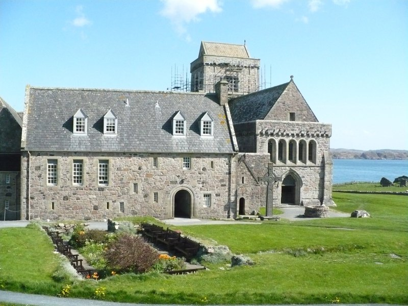
  <figcaption>Iona Abbey from the west, with the replica of St John's Cross in front of the small chapel traditionally called St Columba's Shrine. Photo: WeeHolly, <a href="https://creativecommons.org/licenses/by-sa/4.0/">CC BY-SA 4.0</a>, via Wikimedia Commons.</figcaption>
</figure>

Columba was buried on the island, and the grave became the centre of the cult. A small stone chapel next to the west door of the abbey church, known as St Columba's Shrine, is traditionally held to mark the site; it is of uncertain early date and was rebuilt in the twentieth century. Kings of Dál Riata, of the Scots and of the Isles were brought to Iona for burial in the Middle Ages, a custom that later tradition stretched back to the earliest kings. The *Sràid nam Marbh*, "street of the dead", a paved way leading from the landing place at Martyrs' Bay to the abbey, was the route of these funerals; the name Martyrs' Bay is itself a tradition associated with the killings of 806.

The most important survivors of the early monastery are its stone crosses. Of the many that once stood on the island, St Martin's Cross, set before the abbey church, is still in place and nearly complete. Carved from a single block of epidiorite, it carries on its west face a dense pattern of bosses and serpents, and on its east face, among the bosses, figural panels including the Virgin and Child with angels, Daniel in the lions' den, Abraham's sacrifice of Isaac and David with musicians. It is generally dated to the second half of the eighth century.

<figure>
  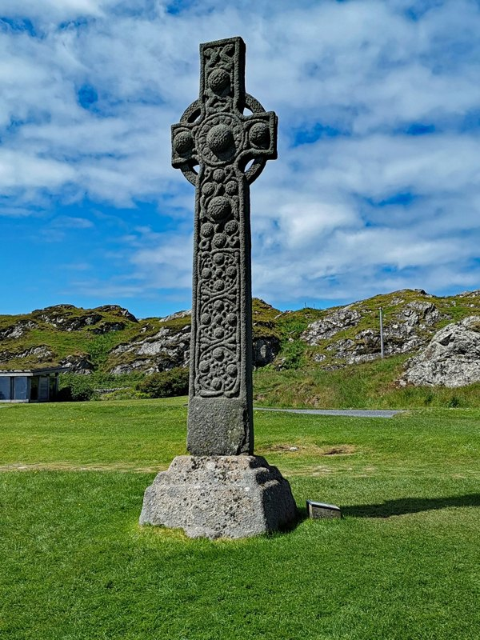
  <figcaption>St Martin's Cross, Iona, second half of the eighth century. Stone. In situ. Photo: PaulT (Gunther Tschuch), <a href="https://creativecommons.org/licenses/by-sa/4.0/">CC BY-SA 4.0</a>, via Wikimedia Commons.</figcaption>
</figure>

St John's Cross, which stood close to the shrine chapel, was an experiment: its span was so wide that its arms broke, and it seems to have been the first cross to receive a supporting ring, possibly a later addition after an early collapse. It has been read as one of the origins of the ringed cross that became the typical form of the Irish high cross. Its fragments were reassembled and are now displayed in the abbey museum; a concrete replica was set up on the original site in 1970. The remains of St Oran's Cross and the shaft of St Matthew's Cross are also in the museum. The decoration of these crosses, with bosses, spiral ornament, interlace and serpents, is the same vocabulary as that of contemporary metalwork and manuscripts, translated into stone.

<figure>
  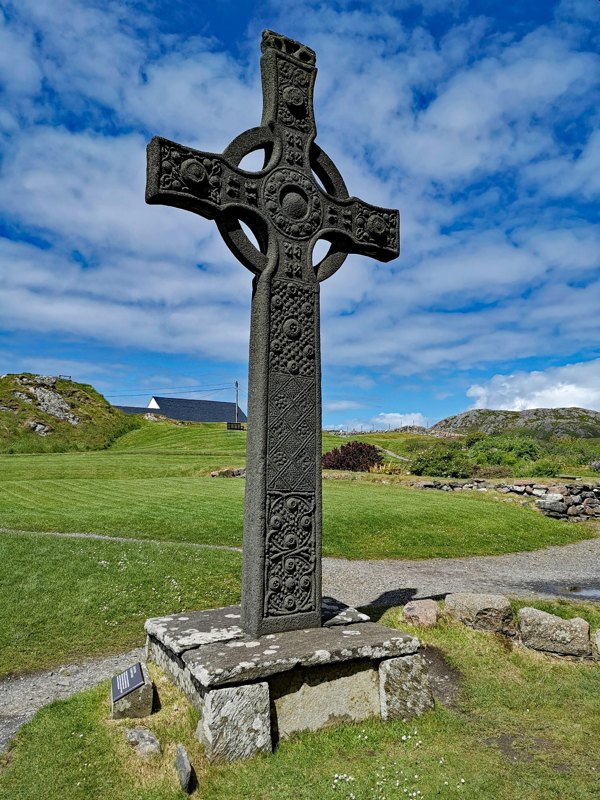
  <figcaption>Replica of St John's Cross, Iona, set up in 1970; the original, of the eighth century, is in the Iona Abbey Museum. Photo: PaulT (Gunther Tschuch), <a href="https://creativecommons.org/licenses/by-sa/4.0/">CC BY-SA 4.0</a>, via Wikimedia Commons.</figcaption>
</figure>

## VI · Columba and the book

Adomnán's Columba is above all a scribe. Besides the psalter he was copying on his last day, the *Vita* mentions books he wrote that survived immersion in water: a book of hymns for the week, in his hand, that fell into a river in a leather satchel and was recovered undamaged, and other books whose pages were untouched when they lay in water. Adomnán tells these stories as miracles of the saint's relics, and that is the point. By about 700 books written by Columba were treated as relics, and the act of copying the Scriptures was bound up with his sanctity. The scene in which a monk calls out from across the strait asking for the saint's blessing, and Columba, writing, knocks over his inkhorn, is told as a prophecy, but it records how the abbot's day was imagined: at a desk, among books.

This identification of the founder with the written page explains much about the Columban houses. A manuscript connected with Columba could become a relic in its own right, enclosed in a shrine, carried on circuits and into battle, used in oath-taking and in healing. The shrine, *cumdach* in Irish, was not a binding: it was a box, often of wood covered with metal, into which the book was closed and from which it was seldom taken. Such shrines are among the most characteristic works of Irish metalwork from the ninth century onward, and the standard survey of them, with the reliquaries of bells, croziers and bones, is that of <a href="/scholars.html#o-floinn-raghnall">Raghnall Ó Floinn</a> (1994).

## VII · The Cathach and its shrine

The Cathach of St Columba (Dublin, Royal Irish Academy, MS 12 R 33) is a fragment of a psalter in the Gallican version, of which fifty-eight leaves survive, containing Psalms 30 to 105. It is written in a heavy Irish majuscule, and its initials are the first examples of the decoration that defines Insular book art: the first letter of each psalm enlarged and outlined in red dots, with spirals, trumpet patterns and occasionally a fish or a cross, and the following letters diminishing in size until they reach the scale of the text, the effect known as *diminuendo*. <a href="/scholars.html#lowe-elias-avery">E. A. Lowe</a> dated the manuscript to about 600, and it is usually placed in the late sixth or early seventh century; some palaeographers would put it a little later. The attribution to Columba himself is traditional. It is possible, but it cannot be proved, and a date after 597 would exclude it.

Its name means "the battler". From the later Middle Ages the O'Donnells, Columba's kin, carried the psalter in its shrine three times sunwise round their army before battle, as a guarantee of victory. In the seventeenth century the shrine went abroad with the family; it was recovered in the early nineteenth century, opened in 1813, and in 1843 deposited by Sir Richard O'Donnell in the Royal Irish Academy. The manuscript is in the Academy; the shrine is in the National Museum of Ireland.

<figure>
  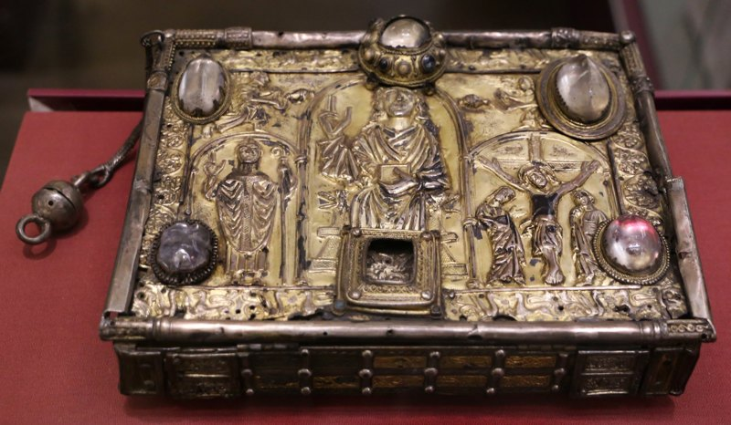
  <figcaption>Shrine of the Cathach, made c. 1062–1098 at Kells, with a front remodelled in the fourteenth century. Silver, gilt silver, copper alloy, rock crystal and glass on a wooden core. Dublin, National Museum of Ireland. Photo: Sailko, <a href="https://creativecommons.org/licenses/by/3.0/">CC BY 3.0</a>, via Wikimedia Commons.</figcaption>
</figure>

The shrine was made in the late eleventh century. An inscription on its sides asks for prayers for Cathbarr Ua Domnaill, who had it made; for Sitric mac Meic Aeda, who made it; and for Domnall Mac Robartaig, coarb of Kells, who died in 1098. The work was therefore done between about 1062 and 1098, at Kells, the head of the Columban federation, for the Cenél Conaill lord whose family were the saint's kin. The front was remodelled in the fourteenth century, when it received the present figures: Christ seated in blessing at the centre, a cleric with a crozier, often identified as Columba, and a Crucifixion. The object thus combines two moments in the cult of the saint: the age of the Kells coarbs and that of the late medieval O'Donnell lords.

For the eleventh-century phase, the closest comparison is the Soiscél Molaise, the shrine of the Gospels of St Molaise of Devenish, made in the early eleventh century by the craftsman Gilla Baíthín for Cennfáelad, coarb of Molaise, who died in 1025. It is not a Columban work, but it shows the type to which the shrine of the Cathach belongs: a box with a front divided by a cross, the four evangelist symbols in the angles, and panels of filigree and openwork.

<figure>
  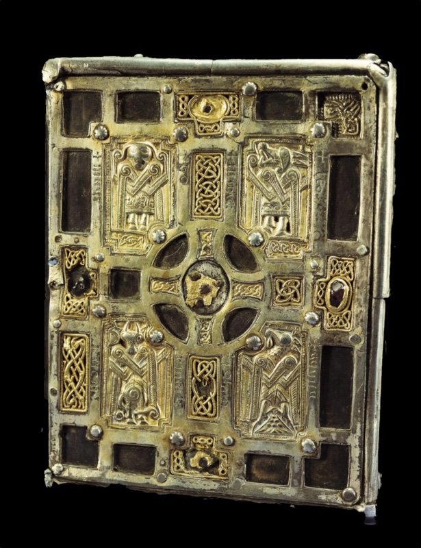
  <figcaption>Soiscél Molaise, shrine of the Gospels of St Molaise of Devenish, early eleventh century, for comparison. Silver-plated and gilt copper alloy on a wooden core. Dublin, National Museum of Ireland.</figcaption>
</figure>

## VIII · The Book of Durrow

The Book of Durrow (Dublin, Trinity College, MS 57) is the earliest surviving fully decorated Insular Gospel book. It has 248 leaves of about 245 by 145 mm, and its decoration comprises six carpet pages, five pages with the evangelist symbols, and decorated incipit and initial pages. It is usually dated to the second half of the seventh century. The book was at Durrow by the late ninth or early tenth century, when King Flann Sinna (879–916) had a shrine made for it; the shrine is lost, but its inscription was recorded in the seventeenth century, and at that time the book was being dipped in water to make a cure for sick cattle. A colophon at the end asks the reader to remember the scribe Columba, who wrote the book in twelve days. It is not Columba's autograph: the colophon was copied from an exemplar, or was later adapted to give the book the saint's authority. Its effect was to make the Gospel book a Columban relic.

Where it was made remains disputed. Durrow itself, Iona and Northumbria have all been proposed, and the question is bound up with the debate on the share of Irish and Anglo-Saxon artists in the formation of the Insular style. The Durrow attribution is the simplest and has never been excluded; Iona would fit the colophon and the Columban history; and the animal ornament of one carpet page is so close to Anglo-Saxon metalwork, such as that from Sutton Hoo, that a Northumbrian origin, or at least a Northumbrian-trained painter, has strong defenders. The monograph by <a href="/scholars.html#meehan-bernard">Bernard Meehan</a>, Keeper of Manuscripts at Trinity College (1996), sets out the evidence; <a href="/scholars.html#henderson-george-david-smith">George Henderson</a>'s *From Durrow to Kells* (1987) and the survey of Insular manuscripts by <a href="/scholars.html#alexander-jonathan-james-graham">J. J. G. Alexander</a> (1978) place the book in its series.

The first carpet page, opposite the four symbols of the evangelists on fol. 2r, is built round a double-armed cross set in a field of interlace. The cross is not an image of the crucifix but a sign laid over the whole page, as in the metalwork crosses of the same period.

<figure>
  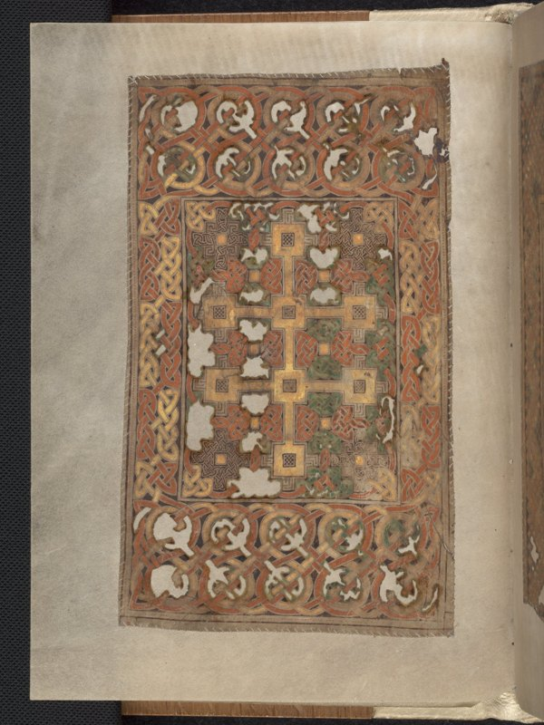
  <figcaption>Book of Durrow, carpet page with a double-armed cross, fol. 1v, second half of the seventh century. Pigments on parchment. Dublin, Trinity College Library, MS 57. Image: The Board of Trinity College Dublin, <a href="https://creativecommons.org/licenses/by/4.0/">CC BY 4.0</a>, via Wikimedia Commons.</figcaption>
</figure>

The Durrow palette is limited, red, yellow, green and the brown-black of the ink, with the vellum left as a ground, and its effects depend on contrast and pattern rather than modelling. The great initial at the beginning of Jerome's letter to Pope Damasus, *Novum opus*, shows the *diminuendo* of the Cathach developed into a page: the first letters swell into a monumental block of spirals and trumpet patterns, outlined in red dots, before the text resumes at normal size.

<figure>
  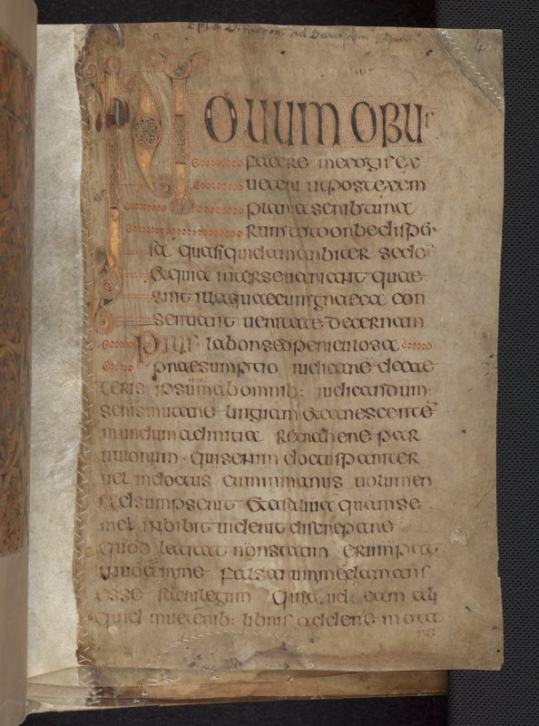
  <figcaption>Book of Durrow, initial page of Jerome's letter Novum opus, fol. 4r. Pigments on parchment. Dublin, Trinity College Library, MS 57. Image: The Board of Trinity College Dublin, <a href="https://creativecommons.org/licenses/by/4.0/">CC BY 4.0</a>, via Wikimedia Commons.</figcaption>
</figure>

Each Gospel is preceded by the symbol of its evangelist on a page of its own. The Man of Matthew is a frontal figure whose body is a bell-shaped cloak covered with a chequered pattern, like millefiori enamel, from which only the head and the feet emerge. It is one of the earliest figure images of Insular art, and it shows how ornament was the starting point and the human figure was made to fit it.

<figure>
  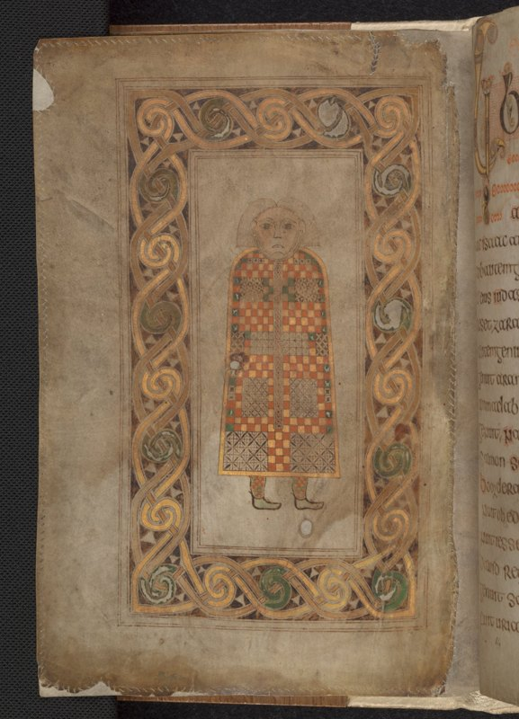
  <figcaption>Book of Durrow, the Man, symbol of Matthew, fol. 21v. Pigments on parchment. Dublin, Trinity College Library, MS 57. Image: The Board of Trinity College Dublin, <a href="https://creativecommons.org/licenses/by/4.0/">CC BY 4.0</a>, via Wikimedia Commons.</figcaption>
</figure>

The book's arrangement follows its own logic. In Durrow the symbols follow the pre-Vulgate order, in which the eagle belongs to Mark and the lion to John, a reminder that the Columban houses drew on older textual traditions alongside the Vulgate text. For a full description of the manuscript, see the page on the [Book of Durrow](/Content/Codex/Book-of-Durrow.html).

## IX · Kells

The monastery built at Kells between 807 and 814 replaced Iona as the head of the federation in the course of the ninth century. Its surviving monuments are later. St Columb's House, a small steep-roofed oratory of stone with a croft between the vault and the roof, belongs to a type of Irish stone-roofed church of the tenth to twelfth centuries; it has traditionally been associated with the foundation of 807, but cannot be dated so early.

<figure>
  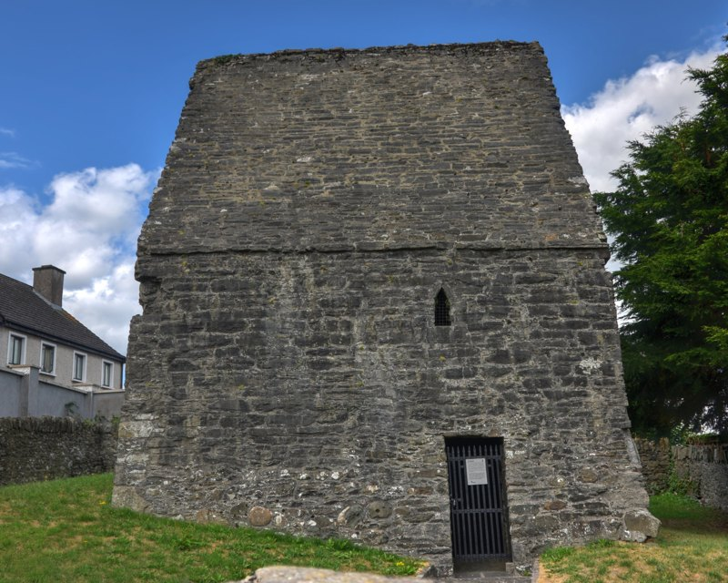
  <figcaption>St Columb's House, Kells, Co. Meath, probably tenth or eleventh century. Stone. Photo: August Schwerdfeger, <a href="https://creativecommons.org/licenses/by/4.0/">CC BY 4.0</a>, via Wikimedia Commons.</figcaption>
</figure>

In the churchyard stand high crosses that continue the Iona tradition, among them the South Cross, whose inscription, *Patricii et Columbe crux*, "the cross of Patrick and Columba", joins the two saints, probably in the ninth century; its panels pair Old Testament scenes of deliverance with images of Christ.

It was at Kells that the great Gospel book now named after the monastery was kept for most of the Middle Ages. Its origin is unresolved: the majority view is that it was made around 800, begun on Iona and finished, or continued, at Kells after 807; others place it entirely at one or the other. The Annals of Ulster record under 1007 that "the great Gospel of Colum Cille" was stolen from the western sacristy of the stone church of Kells and found after two months and twenty days, stripped of its gold and hidden under a sod. The gold was that of its shrine; the manuscript itself contains no gold, and its blues have been shown by analysis to be indigo, not the lapis lazuli long assumed in the literature. The book and its history are treated on the page on the [Book of Kells](/Content/Codex/Book-of-Kells.html).

## X · Metalwork and the wider Insular world

The Columban houses belonged to a wider culture in which manuscripts, metalwork and sculpture shared one ornamental vocabulary. The Ardagh Chalice, found in 1868 at Reerasta, Co. Limerick, is not connected with any Columban house, but it is the finest surviving example of the Irish metalwork of the eighth century, contemporary with the St Martin's Cross and close to the time of the Book of Kells: a bowl and foot of spun silver with applied ornament of gilt filigree, enamel, glass and amber.

<figure>
  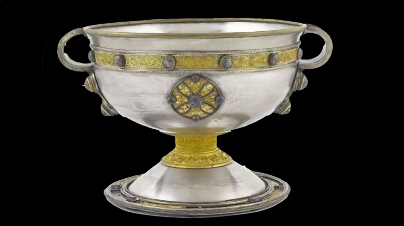
  <figcaption>Ardagh Chalice, eighth century, for comparison. Silver, gilt copper alloy, gold filigree, enamel, glass and amber. Found at Reerasta, Ardagh, Co. Limerick. Dublin, National Museum of Ireland.</figcaption>
</figure>

The sources of that vocabulary were many. The book itself, with its text, prefaces and canon tables, came from the Mediterranean, and Columban scribes worked from Italian and Gaulish exemplars as well as from older Irish copies. The spirals and trumpet patterns continue the late La Tène ornament of Iron Age Ireland and Britain; the interlaced animals of the Book of Durrow come from the Germanic animal ornament of Anglo-Saxon England, encountered through Northumbria; interlace itself had a long history in Mediterranean mosaics and textiles. Connections with Coptic Egypt and the eastern Mediterranean, often invoked, are plausible for some motifs and for monastic ideals, but they are hard to document in detail and are best stated with caution. There is no evidence for Greek refugees from Byzantine iconoclasm in the Columban houses.

Another commonplace needs correction. The Columban sources speak of painted images only rarely. The often-cited "silver cross and an image of the Saviour painted on a panel" carried by Augustine's mission when it met King Æthelberht in 597 comes from Bede (I.25), not from Adomnán, and concerns the Roman mission in Kent, not the Irish world. Adomnán's Columba is surrounded by books, not by panel paintings; the figurative images of the Columban houses that survive are in manuscripts, on crosses and on shrines.

## XI · Survival and conservation

That anything of the Columban world survives is owed in large part to the cult of relics. The Cathach survived because it was kept in its shrine as a battle palladium; the Book of Durrow because it was a relic of Columba at Durrow; the Book of Kells because it was the "great Gospel of Colum Cille". After the Reformation the Book of Kells and the Book of Durrow reached Trinity College Dublin in the seventeenth century through Henry Jones, bishop of Meath. The Cathach and its shrine remained with the O'Donnells until the nineteenth century. The Schaffhausen *Vita* survived because it left Iona and reached a Continental library.

On Iona, the medieval abbey and nunnery fell into ruin after the Reformation, and many of the island's crosses were broken; tradition tells of some three hundred thrown into the sea, an exaggeration but a sign of the scale of the loss. The church was restored for worship in the early twentieth century, and from 1938 the Iona Community rebuilt the monastic buildings. The crosses have been conserved by the state since the twentieth century: St John's Cross was reassembled and moved to the abbey museum, where St Oran's and St Matthew's Cross are also displayed, while St Martin's has remained in the open. Excavation and survey of the *vallum* and of the area around the abbey have shown that much more of the early monastery survives below ground than was once thought.

## XII · Historiography

The modern study of Columba and his houses has developed along three lines: the critical reading of the hagiography, the history of the federation and its cult, and the study of the surviving objects.

The first is represented above all by the work on Adomnán. The edition and translation by A. O. and M. O. Anderson (1961, revised 1991) made the text secure; Richard Sharpe's annotated translation (1995) showed how much historical information can be drawn from a work organised by miracle rather than by event, and how carefully it must be used. Bede's account, read in the edition of Bertram Colgrave and R. A. B. Mynors, provides the essential counterpoint.

The second line concerns the federation as an institution and the cult as a living tradition. <a href="/scholars.html#lacey-brian">Brian Lacey</a>, an archaeologist and historian long based in Derry, has written on the Cenél Conaill, on the Columban houses of the northwest and on the legends of Colum Cille, in *Colum Cille and the Columban Tradition* (1997), *Cenél Conaill and the Donegal Kingdoms* (2006) and *Saint Columba: His Life and Legacy* (2013), and in a translation of Manus O'Donnell's Life (1998). His work shows how closely Columba's career and his cult were bound to the dynastic politics of his kin, and how the later legends were made. <a href="/scholars.html#bourke-cormac">Cormac Bourke</a>, curator of medieval antiquities at the Ulster Museum, edited the volume *Studies in the Cult of Saint Columba* (1997) and has written widely on the relics of the Irish saints, especially bells and shrines, reading them as evidence for how the cult was practised.

The third line, the study of the objects, has been carried by palaeographers and art historians: Lowe for the date of the Cathach, Alexander and Henderson for the place of the Columban books in the Insular series, Meehan for Durrow and Kells, Ó Floinn for the shrines. Its central questions remain open: where the Book of Durrow and the Book of Kells were made, what share Irish and Anglo-Saxon artists had in the Insular style, and how far the books associated with Columba were made, rather than claimed, by his houses. What is no longer open is the separation between the sixth-century abbot of Adomnán's *Vita* and the saint of the later legends. The objects examined here belong to the second as much as to the first: they show not what Columba made, but what his followers made in his name.
