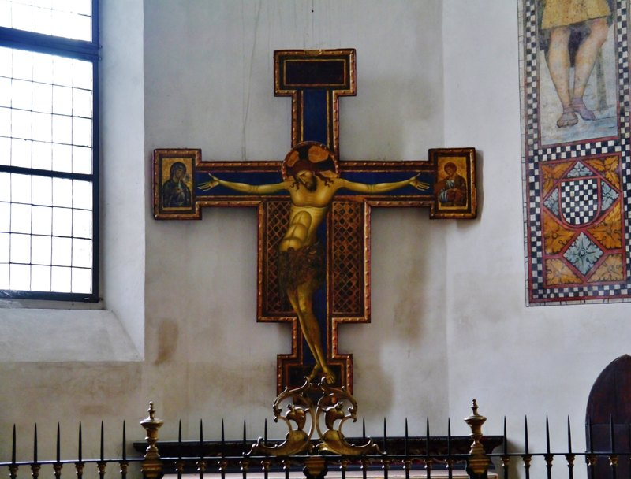
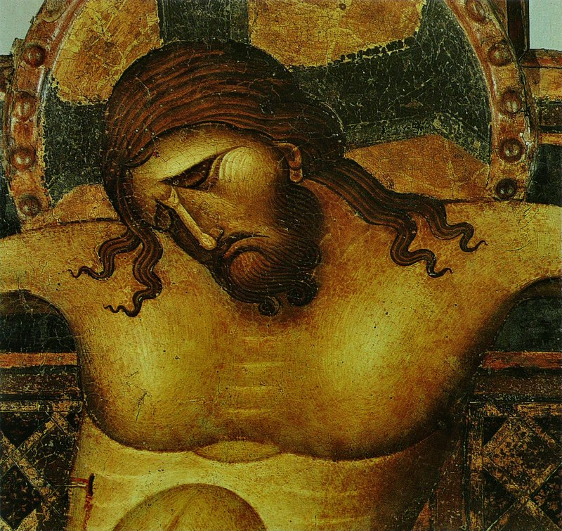
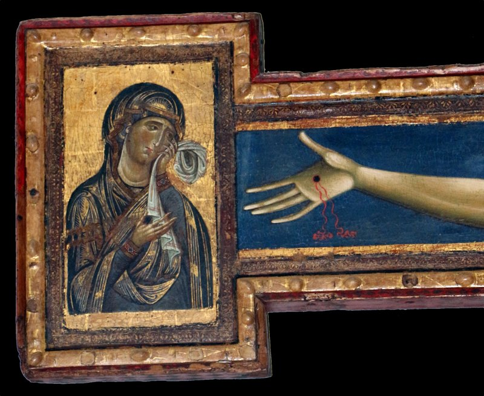
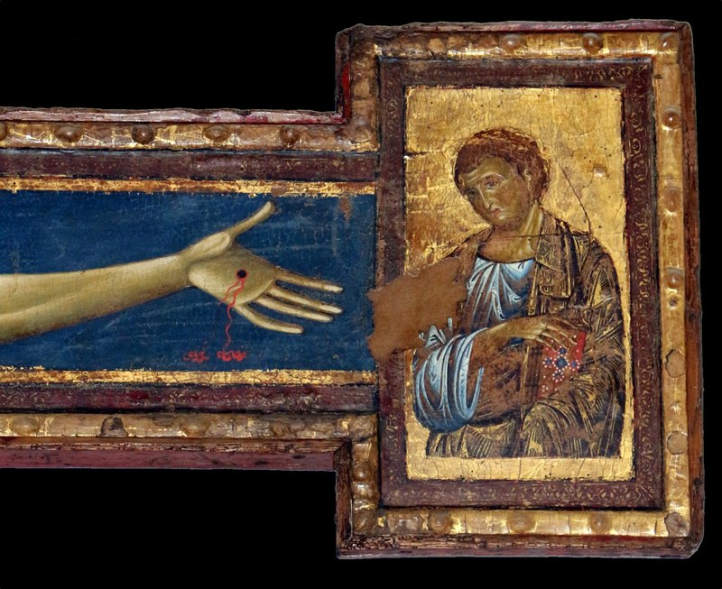
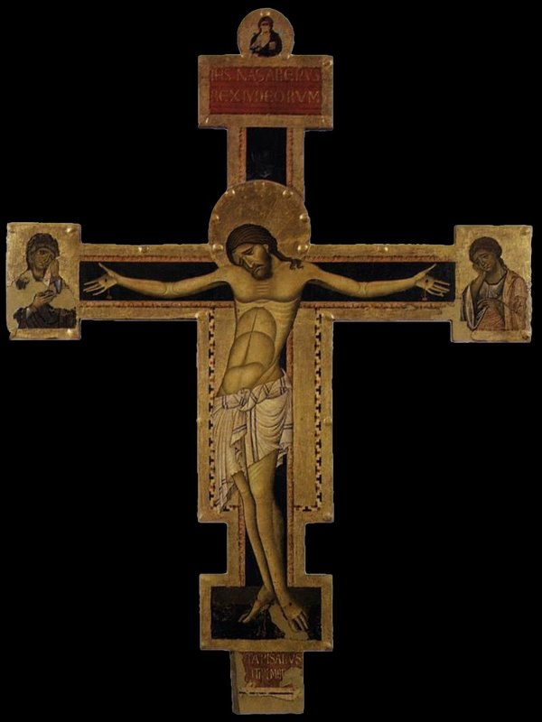

## I · Introduction

The painted cross of the Basilica of San Domenico in Bologna is the largest of the three surviving crosses signed by [Giunta Pisano](/Content/Artists/XIII-c/Giunta-Pisano.html). It shows the dead Christ, the *Christus patiens*, his body swung in a deep arc against the cross, with the mourning Virgin and Saint John at the ends of the arms.

It is signed at its foot: CUIUS DOCTA MANUS ME PINXIT IUNTA PISANUS, "Giunta of Pisa, whose learned hand painted me". The inscription came to light only in the restoration of the mid-1930s; before then the cross had been mentioned only in passing, and given to a Florentine painter.

<figure>
  
  <figcaption>Giunta Pisano, painted cross, tempera and gold on panel. Bologna, Basilica of San Domenico. Photo: Sailko, <a href="https://creativecommons.org/licenses/by/3.0/">CC BY 3.0</a>, via Wikimedia Commons.</figcaption>
</figure>

The cross is undated, and its date is the central question of its critical history. Cesare Brandi, who studied it after the restoration, placed it at the end of Giunta's career, around the middle of the century, and his reading became the traditional one. Miklós Boskovits moved it to the 1230s; Angelo Tartuferi, in his monograph of 1991, made it the earliest of Giunta's surviving works, perhaps painted before 1230.

The question is not a technicality. On the traditional chronology the Bologna cross is the calm conclusion of a career that moved, in Brandi's words, "in a lyrical rather than a dramatic sense"; on Tartuferi's, it is the starting point of a growing expressive intensity that culminates in the cross from San Ranierino in Pisa.

The previous version of this entry was some 17,000 words long. It repeated the same ideas in fourteen chapters, called the cross a "dossal", described a post-Tridentine relocation without date, place or source, and presented a restoration directed by Cesare Brandi in 1935–1936 as fact. It gave the date 1250–1254 as settled, and listed George Henry Edgell and Adolfo Venturi among its scholars without any reference to their writings on the cross.

The present version follows Tartuferi's catalogue entry (1991, pp. 32–37), which reviews the literature from Toesca to Toscano. It sets out what is documented of the painter, describes the cross and its parts, compares it with Giunta's other signed crosses and with Cimabue's cross in Arezzo, and presents the three chronologies proposed for it.

## II · Giunta Pisano

Giunta di Capitino, called Giunta Pisano, was the leading painter of Pisa in the second quarter of the thirteenth century. His true name is known from a document of 1254 and from the fragmentary signature of the Assisi cross.

Tartuferi lists the dates that can be referred to him with certainty. In 1236 he signed and dated the cross painted for Brother Elias, minister general of the Franciscans, for the basilica of San Francesco at Assisi. In May 1239 his son and an assistant are named in two documents that place the painter in Rome. In January 1241 he appears as the owner of land at Calci, near Pisa.

On 28 August 1254 "Juncta Capitinus pictor" is listed among the nobles of Pisa who swore fealty to Archbishop Federico Visconti. Since his son, a priest, could already act as a witness in 1239, Tartuferi places Giunta's birth at the end of the twelfth century or in the very first years of the thirteenth.

The cross of 1236 is lost. Its inscription, recorded before it disappeared, read: FRATER HELIAS FIERI FECIT / IESU CHRISTE PIE / MISERERE PRECANTIS HELIE / IUNCTA PISANUS ME PINXIT / ANNO DOMINI MCCXXXVI / INDICTIONE NONA. It was probably made for the lower church, later moved above the screen of the upper church, and lost in 1624, when the screen was removed.

Three signed crosses survive: one in Santa Maria degli Angeli at Assisi, one from the church of San Ranierino in Pisa, now in the Museo Nazionale di San Matteo, and the cross of San Domenico in Bologna. None is dated. A dossal with Saint Francis and four stories, in the Museo di San Matteo, completes the core of his work.

All three crosses show the *Christus patiens*. Tartuferi stresses that Giunta did not introduce the type into Italy, as older historiography claimed; the dead Christ is already present in Pisa in the anonymous Cross no. 20 of the Museo di San Matteo. What Giunta did was simplify the image, removing the narrative scenes of the Passion, and give it a new humanity.

His career links Pisa with Assisi, Rome and Bologna, and with both mendicant orders. He worked for the Franciscans at Assisi and for the Dominicans at Bologna, and the devotion to the suffering Christ that both orders promoted was the setting in which his crosses were made and understood.

## III · The Dominicans in Bologna and the Church of San Domenico

The Dominicans settled in Bologna in 1219, at the church of San Nicolò delle Vigne. Dominic died there in 1221 and was buried in the church, which became the mother house of the order and the place of his cult.

In 1233 the friars translated his relics to a new tomb, and in 1234 Pope Gregory IX canonised him. The church was enlarged and rebuilt in the following decades, and in 1251 it was consecrated.

The consecration of 1251 has been one of the supports of the traditional date of the cross, together with its supposed influence on the cross painted in 1272 by the Master of Saint Francis, now in Perugia. Tartuferi questions both arguments. A cross need not follow a consecration: Giunta's cross for Brother Elias, dated 1236, preceded by seventeen years the consecration of San Francesco at Assisi in 1253.

If the cross was painted in the 1230s, or before 1230 as Tartuferi proposes, it belongs to the years of the building works at San Nicolò, of the translation of the founder's relics and of the canonisation. No document connects the cross with any of these events, and the place where it first stood is not recorded.

Large painted crosses of this kind were made to hang high in the church, often above the screen that divided the friars' choir from the nave, as the cross of 1236 did at Assisi. The previous version of this entry called the Bologna cross a "dossal", which it is not: a dossal is a horizontal panel set behind an altar.

Its later movements within the church are not recorded in the sources consulted for this entry. Today it hangs on a wall of the basilica, above an altar enclosed by a railing.

<figure>
  
  <figcaption>Giunta Pisano's cross in the Basilica of San Domenico, Bologna, in its present setting. Photo: Zairon, <a href="https://creativecommons.org/licenses/by-sa/4.0/">CC BY-SA 4.0</a>, via Wikimedia Commons.</figcaption>
</figure>

## IV · The Cross

The cross measures 316 by 285 centimetres, almost twice the height of Giunta's crosses at Assisi (174 × 131 cm) and Pisa (184 × 134 cm). Other figures are found in the literature, including 336 by 285 in the previous version of this entry. It is painted in tempera on a shaped panel, with gold on the frame and in the backgrounds of the mourners.

Its design is reduced to essentials. The upright and the arms are painted dark blue; the panel beside the body is filled with a lattice of gold lozenges on a dark ground; a broad frame studded with raised gilt bosses runs around the whole. At the top a titulus panel carries the inscription of the cross, now faint.

There are no narrative scenes. The Romanesque crosses of Tuscany had filled the panel beside the body with episodes of the Passion; Giunta suppressed them, so that nothing competes with the body of Christ. Tartuferi notes that the central panel is wider than in Giunta's other crosses, a feature he reads as archaic.

The body of Christ swings in a deep arc to the left: the head falls on the right shoulder, the torso bends, the abdomen bulges outward over the edge of the upright, and the legs descend in a long returning curve to the feet, crossed and nailed with a single nail.

The anatomy is drawn in strong, almost geometric divisions: the ribs as parallel curves, the abdomen in three swelling lobes, the arms as long smooth cylinders. The tripartite abdomen and the hair divided into four locks are among the features that Tartuferi links to Berlinghiero of Lucca.

The loincloth, dark and patterned, falls from the hips to the knees. Its transparent folds, painted over the body, are among the passages of the cross most affected by time.

At the foot of the cross, below the feet, is the signature: CUIUS DOCTA MANUS ME PINXIT IUNTA PISANUS. The verse claims for the painter a "learned hand", an unusually proud assertion for a painter of the thirteenth century. It was hidden until the restoration of the mid-1930s.

## V · The Head of Christ

<figure>
  
  <figcaption>Giunta Pisano, painted cross, the head of Christ. Bologna, Basilica of San Domenico. Photo: from L. Bellosi, <i>Cimabue</i>, 1998, public domain, via Wikimedia Commons.</figcaption>
</figure>

The head of Christ lies on his right shoulder, within a gold halo marked with a cross and edged with raised bosses. The eyes are closed, the face long, the nose long and thin; a dark beard curls at the chin, and the hair falls in wavy strands over both shoulders.

The face is modelled in warm ochre with dark shadows along the nose and under the cheekbone. The closed eye, drawn as a long curve under a heavy lid, gives the face the stillness of death.

Brandi's description of this head, written in 1936, remains in Tartuferi's view the finest analysis of the cross, even though he rejects its chronology. "Never has Giunta been more subtle and refined," Brandi wrote: the slender forms of Christ, a technique "as careful as in a miniature", a line of "portentous ductility".

Brandi saw in the curls of the beard the rigour of an ornamental stylisation, and at the same time a sinuous, serpentine movement, "as in the lobes of a starfish". In every detail, he concluded, the features of a human face had been enriched "not by an exacerbation of naturalism" but by the logic of figurative language itself.

The chest below is broad and smooth, its surface modelled in large planes of light and shadow. The contrast between the small, inclined head and the great curve of the body gives the figure its pathos.

The detail shows the quality of the painting at close range: the fine modelling of the face, the precision of the hair and the beard, and the subtle transitions of the flesh tones, which are invisible from the floor of the church.

## VI · The Mourners

<figure>
  
  <figcaption>Giunta Pisano, painted cross, the Virgin in the left terminal. Bologna, Basilica of San Domenico. Photo: Sailko, <a href="https://creativecommons.org/licenses/by/3.0/">CC BY 3.0</a>, via Wikimedia Commons (detail).</figcaption>
</figure>

<figure>
  
  <figcaption>Giunta Pisano, painted cross, Saint John in the right terminal. Bologna, Basilica of San Domenico. Photo: Sailko, <a href="https://creativecommons.org/licenses/by/3.0/">CC BY 3.0</a>, via Wikimedia Commons (detail).</figcaption>
</figure>

The Virgin and Saint John appear in the terminals of the arms, as half-length figures on a gold ground. They replace the full-length mourners of the older crosses and the narrative scenes beside the body.

The Virgin, at the left, inclines her head and wipes her tears with a white veil held in her right hand, raising her left hand in a gesture of grief. Her dark blue mantle is striated with fine gold lines, the chrysography of Byzantine icons.

Tartuferi reads the graphic subtlety of this Virgin alongside the work of the Lucchese painter Berlinghiero, while its courtly Byzantine accents point back to Pisan culture of the first quarter of the thirteenth century, visible also in the sculpture of the architrave of the Pisa Baptistery.

Saint John, at the right, is young and beardless, with short hair and an inclined head. He wears a blue tunic and a brown mantle striated with gold, and holds a book wrapped in a fold of the mantle, a sign of reverence for the Gospel.

The hands of Christ extend towards them along the blue bands of the arms, open and pierced by the nails, with drops of blood falling from the wounds. The gesture links the dead Christ with the two witnesses of his death.

The terminals are framed by mouldings set with raised gilt bosses, which run around the whole cross. A loss of paint crosses John's left arm; the Virgin is well preserved.

## VII · Giunta's Signed Crosses

<figure>
  
  <figcaption>Giunta Pisano, painted cross, signed. Assisi, Santa Maria degli Angeli. Photo: Web Gallery of Art, public domain, via Wikimedia Commons.</figcaption>
</figure>

<figure>
  
  <figcaption>Giunta Pisano, painted cross from San Ranierino, signed. Pisa, Museo Nazionale di San Matteo. Photo: Miguel Hermoso Cuesta, <a href="https://creativecommons.org/licenses/by-sa/4.0/">CC BY-SA 4.0</a>, via Wikimedia Commons.</figcaption>
</figure>

The three signed crosses share a design: the dead Christ on a dark upright, the mourners in the terminals, a titulus at the top, and no narrative scenes. The crosses of Assisi and Pisa also preserve a roundel at the top with the bust of Christ; the Bologna cross has none in its present state.

The cross of Santa Maria degli Angeli at Assisi carries a fragmentary signature, reconstructed by Pèleo Bacci in 1922 as [IU]NTA PISANUS [CAP]ITINI ME F[ECIT]. Its Christ is the most restrained of the three: the body inclines rather than bends, and the loincloth, white with blue stripes, falls straight. Its priority over the Pisa cross has been accepted since Bacci; Tartuferi dates it to the first half of the 1230s, close to the dossal of Saint Francis.

The cross from San Ranierino in Pisa is signed IUNCTA PISANUS ME FECIT. It was found in 1793 by Alessandro Da Morrona high on a smoke-blackened wall in the kitchen of the monastery of Sant'Anna. Its Christ is the least idealised of the three, modelled in a true chiaroscuro; Boskovits and Tartuferi date it around 1240 and see in it Giunta's turn towards a neo-Hellenistic style, perhaps prompted by manuscripts illuminated in the Holy Land.

The place of the Bologna cross among these is the point of disagreement. In Brandi's chronology, followed by Garrison, Todini, Marques and Toscano, the sequence runs Assisi, Pisa, Bologna: the Bologna cross is the late, serene masterpiece, and its calm is the sign of a career that moved "in a lyrical rather than a dramatic sense".

Boskovits (1973) placed Bologna between Assisi and Pisa, in the 1230s, on the strength of its affinities with the paintings of the Third Master of Anagni in the chapel of San Gregorio at the Sacro Speco of Subiaco, dated 1228, and with Roman painting of those years.

Tartuferi (1991) went further and put Bologna first. He saw it as the work closest to the Cross no. 20 of the Museo di San Matteo and to Berlinghiero, with the wider central panel as a further archaic feature, and proposed a date perhaps before 1230. In his reading Giunta's development runs exactly opposite to Brandi's: from the solemn classicism of Bologna, through Assisi, to the dramatic intensity of Pisa.

None of these chronologies rests on documents. The only fixed date in Giunta's career as a painter, 1236, belongs to a lost cross, and the three surviving crosses must be ordered by style alone.

## VIII · Cimabue at Arezzo

<figure>
  
  <figcaption>Cimabue, painted cross, c. 1265–1270, tempera and gold on panel. Arezzo, San Domenico. Photo: Senet, perspective correction by Paolo Villa, <a href="https://creativecommons.org/licenses/by-sa/4.0/">CC BY-SA 4.0</a>, via Wikimedia Commons.</figcaption>
</figure>

[Cimabue](/Content/Artists/XIII-c/Cimabue.html)'s cross for the church of San Domenico in Arezzo, datable around 1265–1270, is his first interpretation of the dead Christ. It was made, like Giunta's cross in Bologna, for a Dominican church.

The design is Giunta's: the body swung in a deep arc to the left, the head fallen on the shoulder, the abdomen bulging over the edge of the upright, the legs returning to crossed feet, the mourners in the terminals and an ornamental pattern beside the body. The resemblance to the Bologna cross is visible at a glance.

Tartuferi, however, connects Cimabue above all with Giunta's late, neo-Hellenistic phase, the phase of the San Ranierino cross. From Giunta, he writes, Cimabue learned to show the Crucifixion suspended between painful reality and an abstract, timeless synthesis, and to give the body of Christ a solemn formal beauty without excessive naturalism.

Cimabue changed the details. His loincloth is pink and transparent, the pattern beside the body red and gold, and his mourners, each resting a cheek on one hand, show a more intimate grief. He kept the roundel with the bust of Christ and the inscribed titulus at the top, as in Giunta's crosses at Assisi and Pisa.

Through Cimabue's crosses at Arezzo and at Santa Croce in Florence, Giunta's type passed to the painters of the late thirteenth century. The dead Christ with the swinging body remained the standard image of the painted cross until Giotto replaced it with a new, vertical figure.

## IX · Critical History

Before its restoration the cross attracted little attention. [Pietro Toesca](/scholars.html#toesca-pietro) (1927) gave it to a Florentine painter. [Evelyn Sandberg Vavalà](/scholars.html#sandberg-vavala-evelyn), in her study of the Italian painted cross (1929), noted its stylistic difference from the other Bolognese crosses and dated it to the end of the century.

The restoration of the mid-1930s revealed the signature, and in 1936 [Cesare Brandi](/scholars.html#brandi-cesare) published the study that established the cross as Giunta's masterpiece. Reviewing the painter's whole activity, Brandi placed it in his late period, around the middle of the century, and codified the chronology of Giunta's crosses. His interpretation was accepted almost unanimously. The previous version of this entry presented Brandi as the director of the restoration; the sources consulted here confirm his study, not his part in the work.

[Roberto Longhi](/scholars.html#longhi-roberto), who did not love Giunta or Duecento painting in general, gave the cross in 1948 one of his finest verbal equivalents: "a huge and unctuous shark, nailed at its last convulsion".

[Edward B. Garrison](/scholars.html#garrison-edward), in his *Italian Romanesque Panel Painting* (1949), accepted the late date and narrowed it to the first half of the 1250s; he also saw in the cross the intervention of an assistant.

[Miklós Boskovits](/scholars.html#boskovits-miklos) (1973) was the first to question the traditional date, placing the cross between Assisi and Pisa, in the 1230s. Carli (1974) recorded his proposal without comment, while Todini (1986), Luiz Marques (1987) and Toscano (1990) kept the traditional date.

[Angelo Tartuferi](/scholars.html#tartuferi-angelo), in his monograph *Giunta Pisano* (1991, pp. 32–37), proposed that the Bologna cross is the earliest of Giunta's surviving works, perhaps before 1230, and that the painter's development should be read in the opposite direction to Brandi's. The catalogue of the Fondazione Zeri, which records the cross under the name of Giunta di Capitino, gives the traditional date 1250–1255.

The question remains open. Whatever its date, the cross is the most monumental of Giunta's works, and its signature, with its claim of a "learned hand", is among the earliest Italian inscriptions in which a painter praises his own skill.
