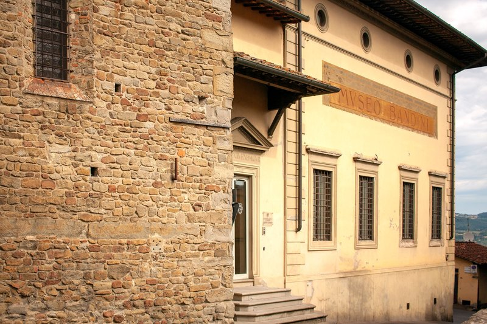
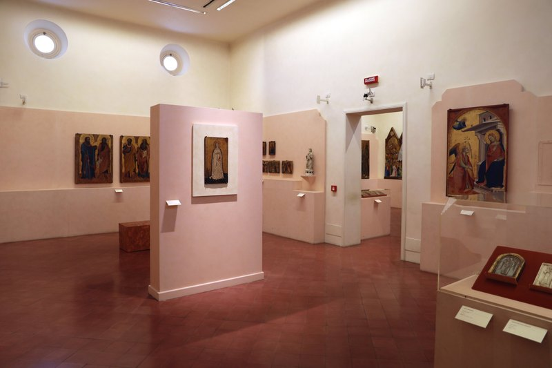
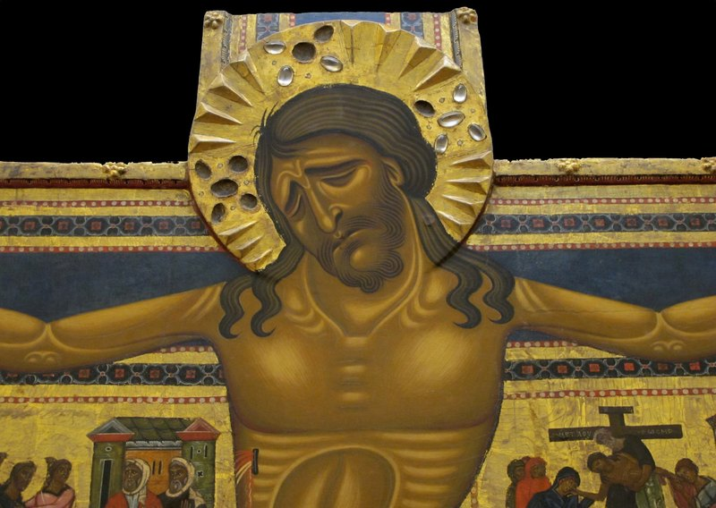
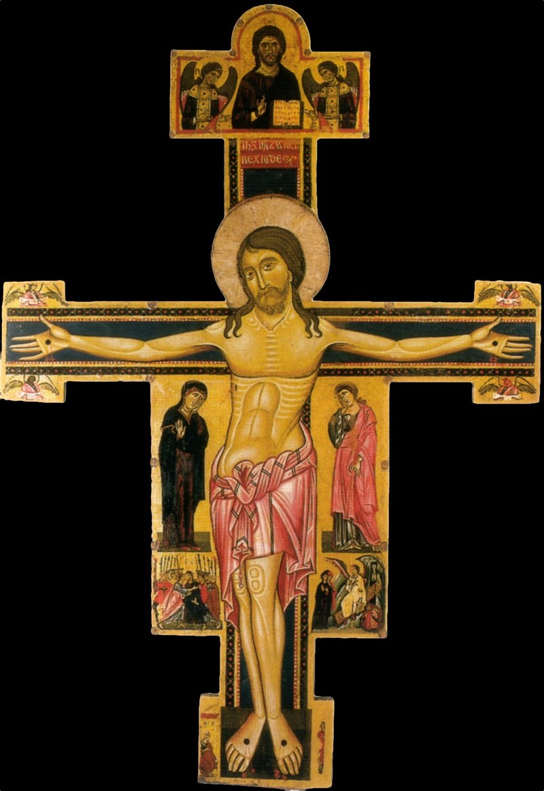
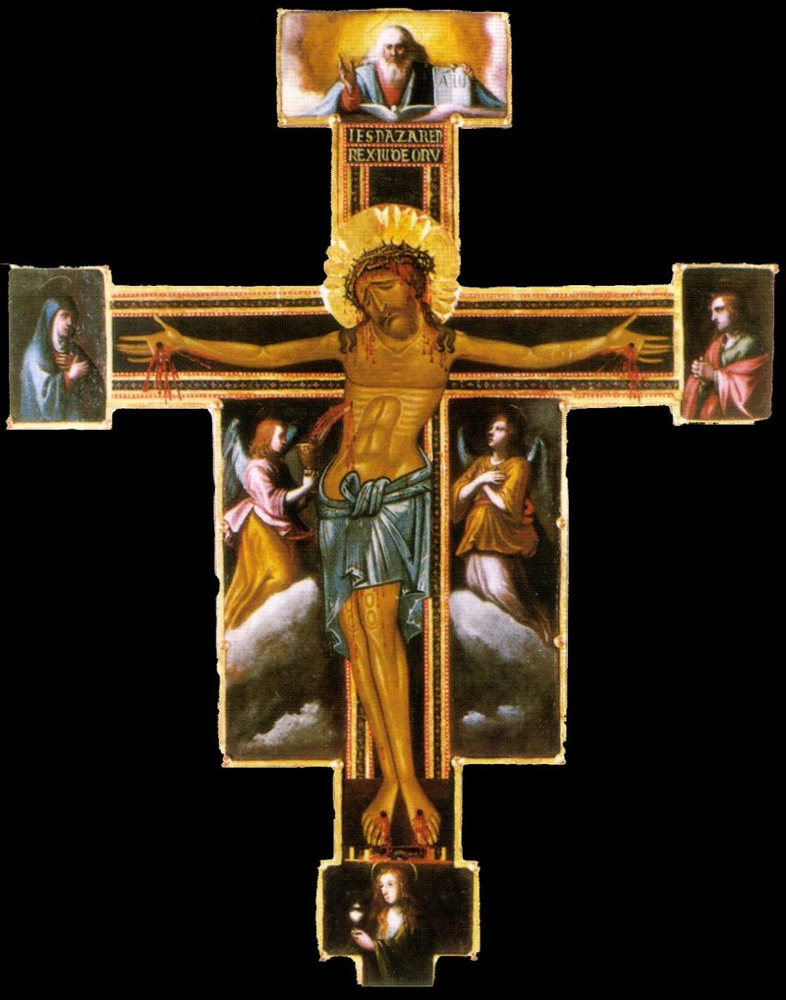

## I · Introduction

<figure>
  
  <figcaption>Master of the Cross 434, painted cross with Saint Peter and the cock, c. 1230–1240, tempera on panel, 89 × 69 cm. Fiesole, Museo Bandini. Image: public domain, via Wikimedia Commons.</figcaption>
</figure>

The Bandini Crucifix is a small painted cross of the thirteenth century in the Museo Bandini at Fiesole. It measures 89 × 69 cm, about a third of the size of the great crosses that hung over the choirs of Tuscan churches. It shows Christ alive on the cross, with his eyes open, and beside him, on the panel behind his body, Saint Peter and the cock that crowed after his denial.

The cross is the work of the anonymous painter known as the Master of the Cross 434, named after the painted cross no. 434 of the Uffizi. The museum dates it to about 1230–1240, which makes it one of his earliest works and one of the oldest Florentine paintings to survive.

Its fame comes less from its painting than from its history. For seven centuries it lay hidden. A second cross was painted over it at the end of the thirteenth century, and in the eighteenth century the whole was repainted again and built into a rectangular altarpiece. In 1952 the restorers of the Florentine Soprintendenza removed the later layers and separated the two thirteenth-century paintings, so that each survives as a work in its own right.

Each layer belongs to a different moment in the life of the image. The first painting, of the 1230s, made the cross; the second, of the 1280s, renewed it when it had been damaged; the third, of the eighteenth century, turned it into something else, an altarpiece in the taste of its own time. Only the first two are medieval, and only they were kept when the cross was restored.

<figure>
  
  <figcaption>Master of Gagliano, painted cross with the Virgin between two angels, the mourners and two prophets, tempera on panel, 140 × 110 cm, dated c. 1250–1260 by the museum. Fiesole, Museo Bandini. Photo: Francesco Bini, <a href="https://creativecommons.org/licenses/by-sa/4.0/">CC BY-SA 4.0</a>, via Wikimedia Commons.</figcaption>
</figure>

The name needs a word of caution. The Museo Bandini owns another thirteenth-century cross, larger and later, by the painter known as the Master of Gagliano (c. 1250–1260, 140 × 110 cm), and the museum's own guide calls that cross the "Croce Bandini". In this entry the name refers to the small cross of the Master of the Cross 434, as it does in most of the literature on the restoration.

The Gagliano cross is also a *Christus triumphans*, but of a fuller kind. The Virgin and Saint John stand beside the body, the Virgin in glory between two angels fills the top panel, and two half-length prophets, now headless and fragmentary, occupied the ends of the arms; one still holds a scroll with the words of the prophecy of the lamb led to the slaughter, *Sicut ovis ad occisionem*. Once attributed to Meliore, it is now given to the anonymous painter named after a Madonna at Gagliano in the Mugello, a painter close to the Master of the Bigallo and to the Master of the Cross 434. According to the museum's guide, Bandini himself placed it in the sacristy of Sant'Ansano.

Both crosses belong to the most characteristic form of Tuscan painting before 1300, the shaped painted cross. Its parts had their own names: the long upright with the body of Christ, the wide panel behind the body, called the *tabellone*, the ends of the arms, the panel at the top, and the small panel at the foot. Each could carry its own images, and the choice of images changed the meaning of the whole.

In the years when the Bandini cross was painted, the image of Christ on such crosses was changing. The older type showed him alive and victorious, the *Christus triumphans*; the newer type, spread in Tuscany from the 1230s by Giunta Pisano, showed him dead, the *Christus patiens*, his head bowed and his body bent. The Bandini cross belongs to the older type, and its painter would adopt the newer one a few years later in the great cross now in the Uffizi.

The chapters that follow describe the museum, the altarpiece of the eighteenth century, the restoration of 1952, the cross itself and the later cross separated from it, and then place the work among the other crosses of its painter.

The entry rests on a small number of sources: Procacci's article of 1953 with Tintori's technical report, the catalogue of the restoration exhibition of the same year, the attribution published by Miklós Boskovits in 1977, the studies of Angelo Tartuferi, the guide of the Museo Bandini, and the account of the restoration published by the museum in 2023. Where they disagree, or where they are silent, the text says so.

## II · Angelo Maria Bandini and His Museum

Angelo Maria Bandini (1726–1803) was a librarian and scholar, head of the Biblioteca Laurenziana in Florence and a canon of San Lorenzo. He collected antiquities, Della Robbia terracottas and, unusually for his time, the gold-ground paintings of the thirteenth and fourteenth centuries that later collectors would call the "primitives".

Bandini was born in Florence on 25 September 1726. Orphaned in infancy, he was raised by his uncle, the lawyer Giuseppe Bandini, and schooled by the Jesuits. In 1747 he went to Vienna as secretary to the bishop of Volterra, and in those years published his *Specimen litteraturae Florentinae*.

He then took holy orders and settled in Rome, where he worked in the Vatican Library and in the libraries of Cardinals Passionei and Corsini, and published a study of the obelisk of Augustus. Back in Florence, he became librarian of the Biblioteca Marucelliana.

In 1756 he was appointed librarian of the Laurenziana, succeeding Antonio Maria Biscioni, and he held the post for more than forty years. His great work was the catalogue of its manuscripts, Greek, Latin and Italian, published in eight volumes between 1764 and 1778, still used by scholars today.

<figure>
  
  <figcaption>The Museo Bandini, Fiesole, built by Giuseppe Castellucci and opened in 1913, beside the medieval wall of the cathedral. Photo: Macieklew, <a href="https://creativecommons.org/licenses/by-sa/4.0/">CC BY-SA 4.0</a>, via Wikimedia Commons.</figcaption>
</figure>

In 1795 he bought the complex of Sant'Ansano, an oratory of the eleventh century near the cathedral of Fiesole, and turned it into a "museo sacro" for his collection. He lived there until his death in 1803 and was buried in the oratory. By his will he left the collection to the Chapter of the cathedral of Fiesole.

His collecting was unusual for its time. In the eighteenth century the paintings of the Duecento and Trecento were generally regarded as curiosities of a rude age, and many were discarded, cut up or repainted. Bandini gathered them with the same antiquarian interest he gave to manuscripts and inscriptions, as documents of the early history of Tuscan art and devotion.

On his deathbed he founded a public school and left the rest of his estate to charitable causes. His collection went to the Chapter of Fiesole, in the words of his will for public decorum, instruction and charity.

The collection remained at Sant'Ansano through the nineteenth century. In 1913 the Chapter moved it to a new building by the architect Giuseppe Castellucci, near the cathedral, which opened on 5 May 1913. Damaged in the Second World War, the museum reopened in 1954 and was rearranged in the late 1980s and again in 2004.

<figure>
  
  <figcaption>A room of the Museo Bandini with gold-ground panels of the fourteenth and fifteenth centuries. Fiesole. Photo: Francesco Bini, <a href="https://creativecommons.org/licenses/by-sa/4.0/">CC BY-SA 4.0</a>, via Wikimedia Commons.</figcaption>
</figure>

The crosses of the thirteenth century are shown in the first room, with the oldest works of the collection. The small cross of the Master of the Cross 434 and the cross separated from it hang there with the larger cross of the Master of Gagliano.

How the cross came into Bandini's hands is not recorded in the sources consulted for this entry, nor is the church for which it was first painted. Its history before the eighteenth century can be read only in its layers of paint.

## III · The Altarpiece of the Eighteenth Century

<figure>
  
  <figcaption>Lorenzo di Bicci, Saint James the Greater and Saint Nicholas of Bari, c. 1395–1400, tempera and gold on panel, side panels of a dismembered polyptych, attached in the eighteenth century to the sides of the cross. Fiesole, Museo Bandini. Photo: Szilas, public domain, via Wikimedia Commons.</figcaption>
</figure>

When the cross entered the museum it no longer looked like a medieval cross. In the late eighteenth century it had been repainted with a new image of the Crucifixion and enlarged with added boards into a rectangular altarpiece. Its sides were formed by two panels of about 1395–1400 by the Florentine painter Lorenzo di Bicci, Saint James the Greater and Saint Nicholas of Bari, which served as shutters.

The eighteenth-century painter did not respect the shape of the medieval cross. He covered its whole surface with a new Crucifixion, painted in the manner of his own time, and boards were added around the arms and the upright to turn the cross into a rectangle. The result was a single picture in which nothing of the Duecento could be seen.

Such transformations were common in the centuries after the Middle Ages. Shaped crosses no longer fitted the altars and the taste of the time, and their gold or silver grounds looked old-fashioned; it was cheaper to adapt an old panel than to commission a new one. Many medieval crosses survive only because they were reused in this way, and many others were lost because they were not.

The two saints come from a dismembered polyptych and have nothing to do with the cross. Saint James, young and long-haired, holds the pilgrim's staff and a book; Saint Nicholas, an old bishop with a mitre and crosier, holds a book with the three golden balls of his legend. Their gold grounds and Gothic arches belong to the end of the fourteenth century.

Lorenzo di Bicci, born in Florence about 1350 and dead about 1427, was one of the most productive painters of late fourteenth-century Florence. He belonged to the painters' guild by 1370, worked in the circle of Andrea and Jacopo di Cione, and founded a workshop that his son Bicci di Lorenzo and his grandson Neri di Bicci carried on for more than a century.

His works include a Saint Martin painted in 1380 for the wine-merchants' guild at Orsanmichele and a triptych and a Crucifixion of 1399 now in the museum of the Collegiata at Empoli. The guide of the Museo Bandini suggests, without confirmation, that the Empoli Crucifixion might have been the centre of the polyptych to which the two Fiesole saints belonged.

The two saints are typical of his manner: clear colours, simple poses, careful drawing and calm, round faces. Their haloes are tooled with punched patterns, and the borders of Saint James's mantle and the orphreys of Saint Nicholas's cope, decorated with tiny figures of saints, are painted with care. In the eighteenth century they served only to widen the altarpiece.

Ugo Procacci, who studied the altarpiece before the restoration, called it an "unusual patchwork". The eighteenth-century painting over the cross was coarse, and nothing in the assemblage suggested that it hid a work of the Duecento.

The dismantling of 1989 followed the principle that each work should be shown as it was made. The cross and the two saints, joined for two centuries by chance, became again three separate works by three painters of three different periods.

After the restoration of 1952, the two saints were put back on either side of the cross, facing each other. The assemblage was finally dismantled in 1989, and the saints now hang in the second room of the museum as independent works. The guide of the museum suggests that they may belong to the same polyptych as a Saint Julian and a bishop saint in the Galleria dell'Accademia in Florence, a hypothesis not yet confirmed.

## IV · The Restoration of 1952

The restoration was carried out in 1952 by the Gabinetto dei restauri of the Florentine Soprintendenza, the laboratory directed by [Ugo Procacci](/scholars.html#procacci-ugo). The work on the cross was done by the restorer [Leonetto Tintori](/scholars.html#tintori-leonetto).

Procacci (1905–1991) was the art historian who led the Florentine conservation laboratory for decades. Tintori (1908–2000), born in Prato, was the restorer of his laboratory, who worked on paintings by Giotto, Masaccio, Piero della Francesca and Andrea del Castagno, and in 1983 opened a laboratory for the study of fresco technique at Vainella, near Prato.

Small losses in the eighteenth-century paint showed traces of an older painting of better quality beneath, and an X-ray confirmed it. When the late repainting was removed, a thirteenth-century cross appeared. But in two places, on the lower legs, where the paint had been knocked off by candlesticks and scorched by flames, and on the loincloth, where a candle had burnt it, the restorers saw a second, still older layer of paint under the first. The cross held two medieval paintings, one exactly over the other.

The two paintings had the same outline and the same figure type, because the later painter had followed the earlier cross line by line. This is why the X-ray had not revealed the older painting: the contours coincided.

Tintori decided to separate the two layers, so that both paintings could survive. He had noticed that a solvent barely strong enough to soften a varnish became far more effective when warmed, and had already used the method to remove large repaintings from panels of the fourteenth and fifteenth centuries. From there, he wrote in his technical report, the attempt to split two paintings had been only "a matter of courage".

After trials, pyridine at about 50–60 °C proved able to dissolve the varnish between the two layers without harming either tempera. The method was tested first on a small rectangle of the forearm, then on a whole arm and hand.

For the full separation the surface was cleaned of varnish and faced with a light canvas, glued with a paste of rabbit-skin glue and gilder's gesso; the canvas was soaked with pyridine under blotting paper and tinfoil, and after sixteen hours a small warm iron was passed over the whole surface. The varnish dissolved, and the canvas came away carrying the upper painting with it, leaving the older painting on its original panel. The upper painting was then transferred to a new support of the same shape.

The operation succeeded. The older cross, of about 1230–1240, remained on its own panel; the later cross, of about 1280–1290, became a second object. The silver-leaf ground of the older painting did not survive: according to Tintori it had already flaked away before the cross was painted over, and the pale, worn ground visible today is the preparation beneath it.

Procacci published the restoration in the Bollettino d'Arte in 1953, in an article on the "separation of superimposed tempera paintings of the Duecento". The two crosses were shown together the same year in Florence, at the seventh Mostra di opere d'arte restaurate, held from April to June 1953. The case became one of the classic examples of the Florentine school of conservation in the decades after the war, when Procacci and Tintori also developed the techniques for detaching wall paintings.

The restorers made one compromise. The cock beside Saint Peter belonged to the later painting. Rather than leave the older scene without it, they kept it on the older cross, where it still stands, so that the image of the denial remained complete.

## V · The Cross of the 1230s

The older cross shows Christ alive on the cross, the *Christus triumphans* of the Romanesque tradition. He stands upright, his head held straight within a halo, his eyes open and looking out. His arms are horizontal, his body frontal, his feet side by side on a footrest, each pierced by its own nail.

The body is drawn as a set of clear zones: curved lines for the ribs and the chest, a deep oval for the abdomen, rounded shapes for the knees. This geometric treatment of the body comes from Lucca, from the workshop of Berlinghiero and his sons, which was the main source of the Master's style.

Christ wears a dark blue loincloth, knotted at the waist and falling to the knees, with stripes of red. The arms of the cross carry a dark blue band edged with rows of small white dots. The halo is worn, and the ground around the figure, once silver, is now pale and uneven.

Unlike most crosses of the period, this one has no mourners. The Virgin and Saint John, who usually stand beside Christ on the panel behind his body, are absent. In their place the painter set a single episode of the Passion: the denial of Peter.

On the right stands Saint Peter, with a red halo, in front of a domed building, the house of the high priest where he denied Christ. He holds his hand to his chest. On the left a tall tower rises beside Christ's body, and on top of it stands the cock whose crowing made Peter remember Christ's words and weep. The cock, as Tintori showed, belongs to the later painting; it was left in place so that the scene would remain whole.

The episode is told in all four Gospels. During the night of Christ's arrest, Peter followed him to the house of the high priest and, questioned by servants and bystanders, three times denied knowing him. Then the cock crowed, and Peter remembered the words of Jesus, "Before the cock crow, thou shalt deny me thrice"; Luke adds that the Lord turned and looked upon Peter, and Matthew, Mark and Luke end the scene with his tears.

The choice of Peter is unusual. It turns the cross from an image of the Passion alone into an image of repentance: the apostle who denied Christ and wept stands beside the crucified, as a model for the viewer. Why the painter or his patron chose this theme is not known, and the original setting of the cross does not survive to explain it.

The painter reduced the story to two signs, the apostle and the bird, set on either side of the crucified. The viewer standing before the cross saw Christ between the man who had denied him and the sound that had recalled him to repentance: a sermon in images on sin and forgiveness, addressed to those who prayed before it.

The size of the cross, 89 × 69 cm, suggests that it was made for an altar or a small chapel rather than to hang over a choir screen. It is an intimate object, meant to be seen at close range.

Its original appearance must have been very different from today's. The silver leaf behind the figure would have shone like metal, bright in candlelight but liable to tarnish, and it framed the body and the small figures of Peter and the tower against a cold, glittering field. What the visitor now sees, the pale preparation and the darkened colours, is the cross after seven centuries and two repaintings, framed at its edges by modern strips of wood.

## VI · The Upper Cross

The cross painted over the first, about fifty years later, is the work of a different painter. The museum dates it to about 1280–1290. It repeats the size, outline and figure type of the older cross, because its painter worked directly on top of it, but its style is that of a later generation.

Its modelling is softer, with stronger contrasts of light and shade and highlights that follow the forms of the body. The museum's guide connects these features with Cimabue, and attributes the cross, with caution, to a painter of the circle of Ristoro d'Arezzo.

These features mark the distance of half a century. In the 1260s and 1270s Cimabue had transformed the painted cross, softening the hard geometry of the body with gradual shading and giving it a new weight. The painter of the upper cross knew this manner and applied it to a figure whose outline he could not change.

Why the older cross was painted over within two generations is not recorded. Tintori proposed a likely reason: the whole silver ground had flaked off, taking with it the cock, probably painted on the silver, and the varnish and paint from the ankles upward had been blackened and scorched by long exposure to the heat of candles. A damaged image would have been a reason to renew it, and painting a new cross on the old panel was cheaper than making a new one.

The scorching points to the way the cross was used. Candles and lamps burned before it for a long time, and close enough to blacken its surface: the image was the object of an active devotion, not a decoration. When the damage became too great, the community that owned it chose to renew it rather than to replace it.

The choice was a conservative one. In the 1280s a painter asked to make a new cross would have painted the dead Christ of the *Christus patiens* type, by then the rule in Tuscany. The upper cross kept the living Christ of the 1230s because it was not a new cross but the old one repainted: its patrons wanted the same image, restored, not a different one.

The renewal also kept the memory of the denial. The painter of the 1280s painted a cock on the new surface, probably where the original bird, painted on the silver, had been lost with it. Whatever else the older image had shown, the sign of Peter's repentance passed from one painting to the next.

The two crosses now hang in the same room. They show, side by side, how the image of the crucified Christ changed in Tuscany between the 1230s and the 1280s, from the hard geometry of the Lucchese tradition to the softer modelling learned from Cimabue.

The separation of 1952 left the upper cross without the cock it had painted, since the restorers left the bird on the older panel. Each cross is thus incomplete in its own way: the older one lacks its silver and carries a cock painted fifty years after it, the later one lacks the cock its painter added.

The upper cross has received less attention than the older one. It is known chiefly through the account of the restoration and the museum's entry, and its attribution to the circle of Ristoro d'Arezzo is offered only as a hypothesis.

## VII · The Master of the Cross 434

<figure>
  
  <figcaption>Master of the Cross 434, painted cross no. 434 with eight stories of the Passion, c. 1240–1245, tempera and gold on panel, 247 × 202 cm. Florence, Galleria degli Uffizi. Image: public domain, via Wikimedia Commons.</figcaption>
</figure>

The painter of the Bandini cross takes his name from the large painted cross no. 434 of the Uffizi. It is a cross of a different kind: the dead Christ, the *Christus patiens*, with his head bowed and his eyes closed, and eight small scenes of the Passion on either side of his body, from Christ before the high priests to the supper at Emmaus.

The Uffizi cross measures 247 × 202 cm, nearly three times the height of the Bandini cross, and its origin is unknown. It is recorded in the storerooms of the Uffizi in the inventory of 1881, as no. 40 of its category; by 1888 it was shown in the first corridor of the Gallery, and in the inventory of 1890 it received the number 434 that gave the painter his name.

On the left of Christ's body, from the top, are Christ before the Sanhedrin, Christ mocked and crowned with thorns, the Flagellation and the ascent to Calvary; on the right, the Deposition, the Entombment, the women at the tomb with the angel, and the supper at Emmaus. The panels at the ends of the arms are lost.

<figure>
  
  <figcaption>Master of the Cross 434, painted cross no. 434, detail of the head and chest of Christ. Florence, Galleria degli Uffizi. Photo: Francesco Bini, <a href="https://creativecommons.org/licenses/by-sa/4.0/">CC BY-SA 4.0</a>, via Wikimedia Commons.</figcaption>
</figure>

The comparison with the Bandini cross shows the same painter at two moments. The geometry of the body is the same: the curved lines of the chest, the oval of the abdomen, the rounded knees. But in the Uffizi cross the body bends, the head falls on the shoulder and the face is marked by suffering. The painter has moved from the living Christ of the Romanesque tradition to the dead Christ that Giunta Pisano was spreading in Tuscany in the same years.

The Uffizi describes the painter's manner as one of strong contrasts of light and shade on a framework of conventional Byzantine models. Historiated crosses of this kind, with small scenes of the Passion beside the body, were common in Tuscany in the twelfth and thirteenth centuries; many were made for the churches of religious communities, where the scenes could guide meditation on the Gospel.

<figure>
  
  <figcaption>Master of the Cross 434 and Bonaventura Berlinghieri (attributed), painted cross, c. 1240. Tereglio (Lucca), Santa Maria Assunta. Image: public domain, via Wikimedia Commons.</figcaption>
</figure>

The Master's Lucchese roots are clearest in the cross of Tereglio, in the hills north of Lucca, which some scholars give to him and others to Bonaventura Berlinghieri with his collaboration. It is a *Christus triumphans* like the Bandini cross, but larger and complete with the mourners, the Christ blessing in the top panel and small scenes below.

At Tereglio Christ hangs upright with open eyes against a gold ground. The top panel shows Christ blessing, with a book, between two angels, above the inscription IHS NAZARENUS REX IUDEORUM; the Virgin and Saint John stand beside the body, and below them two small scenes, the Capture of Christ and the holy women at the tomb. The symbols of the four Evangelists occupy the ends of the arms, and the denial of Peter is painted at the foot, beside the feet of Christ. The catalogue of Italian cultural heritage dates it after 1235.

The three crosses, Fiesole, Tereglio and the Uffizi, show the range of the painter: a small cross with a single motif of the Passion, a larger triumphant cross with mourners and narrative scenes, and a great historiated cross with the dead Christ. They share the drawing of the body, the large eyes and the sharp contrast of light and dark.

The works now grouped under the Master's name include, besides the crosses of Fiesole, Tereglio and the Uffizi, a Madonna at Rosano, a Saint Francis receiving the stigmata in the Uffizi and a large Madonna with seventeen stories of the Virgin in the Pushkin Museum in Moscow. They are discussed in the entry on the [Master of the Cross 434](/Content/Artists/XIII-c/Maestro-della-Croce-434.html).

Their chronology runs from about 1230, the date proposed for the Rosano Madonna and the Bandini cross, to about 1255–1260 for the Moscow Madonna. Within this span the Bandini cross stands at the beginning, before the turn to the *Christus patiens* and the larger narrative programmes of the later works.

## VIII · A Second Repainted Cross

<figure>
  
  <figcaption>Master of the Cross 434, painted cross, c. 1240–1245, repainted in the age of the Counter-Reformation. Florence, Villa La Quiete. Image: public domain, via Wikimedia Commons.</figcaption>
</figure>

The fate of the Bandini cross was not unique. Another cross by the same painter, now at the Villa La Quiete, the house of the Montalve sisters outside Florence and formerly in their church of San Jacopo di Ripoli, was also repainted in a later century, in the age of the Counter-Reformation.

The cross is dated to about 1240–1245. Unlike the Bandini cross, it shows the dead Christ, the *Christus patiens*, his head bowed and his eyes closed. The medieval figure of the body is still visible under the later additions.

The Montalve, a community of women founded in Florence in the seventeenth century, kept at their villa outside the city a group of medieval works that had come to them from older religious houses. The guide published for the villa notes that several of these works were heavily repainted to suit the religious climate of the Counter-Reformation, so that only the body of Christ was spared.

Here the later painting was never removed. The body of Christ keeps its medieval form, but everything around it was renewed: God the Father in the top panel, the Virgin and Saint John in the ends of the arms, two angels on clouds beside the body, one catching the blood from his side in a chalice, and Mary Magdalene at the foot. The figure of Christ himself was given a crown of thorns and streams of blood.

The new images give the cross a different meaning. The angel catching the blood in a chalice turns the Crucifixion into an image of the Eucharist, a theme dear to the Counter-Reformation; God the Father above and the Magdalene with her jar of ointment below add the Father who offers the Son and the model of the penitent sinner. The medieval cross became the support of a new devotional programme.

The same guide records that another cross at La Quiete, by the Master of the Bigallo, was completely repainted and awaits restoration, and that a large painted cross by Lippo di Benivieni, found in a chapel of the villa, has been restored by the Opificio delle Pietre Dure. Repainting was a common fate of the medieval crosses of Florence.

Seen together, the two crosses show what the restorers of 1952 found at Fiesole: medieval crosses were not treated as fixed works of art, but as devotional images to be renewed when they became damaged or old-fashioned. At Fiesole this happened twice, in the 1280s and in the eighteenth century; at La Quiete it happened once and was left in place.

The decision whether to remove such repaintings is not simple. At Fiesole the eighteenth-century painting was coarse and the medieval layers beneath were of high quality; the restorers could remove it and, by separating the two medieval paintings, lose nothing of value. At La Quiete the later painting is itself a historical document of devotion, and removing it would destroy one work to recover another.

The two cases also show the limits of what can be known. The Bandini cross was recognised only because its later paint was damaged and an X-ray confirmed what the damage revealed; how many other early crosses still lie hidden under later layers cannot be said.

For the history of the Master of the Cross 434, the La Quiete cross adds a further work of the 1240s and confirms the painter's turn to the dead Christ in those years. For the history of the Bandini cross, it shows that what happened at Fiesole was not an accident but a pattern.

## IX · Critical History

The Bandini cross entered the history of art only after 1952. Before the restoration it was a repainted altarpiece of no interest; afterwards it was one of the few Florentine paintings of the second quarter of the thirteenth century.

No study of the cross before the restoration is known. As an eighteenth-century altarpiece it had no place in the history of medieval painting, and it was the restoration itself that created the object of study.

Procacci's article of 1953 presented the restoration and the two crosses, with Tintori's technical report, and Tintori's role in the separation became part of the history of conservation. The older cross was at first dated around the middle of the century and recognised as a Florentine work drawing on Lucchese models. In 1977 [Miklós Boskovits](/scholars.html#boskovits-miklos), in an essay on Coppo di Marcovaldo, gave it to the Master of the Cross 434. The attribution was followed by [Angelo Tartuferi](/scholars.html#tartuferi-angelo), who has written on the painter in his studies of Florentine painting of the first half of the Duecento, including his catalogue of the Uffizi's early paintings (2007), and it is accepted by the museum.

Boskovits's attribution appeared in a volume of essays in honour of Procacci, the scholar who had restored the cross a quarter of a century earlier. It was made in passing, in a note to an essay on Coppo di Marcovaldo, but it placed the Bandini cross for the first time within the corpus of a defined painter.

Tartuferi's studies of 1990 and 2007 set the Master of the Cross 434 among the painters active in Florence in the second quarter of the century, together with the Master of the Bigallo and the Master of Santa Maria Primerana.

The Master himself remains a debated figure. [Luciano Bellosi](/scholars.html#bellosi-luciano) proposed that his works represent an early phase of Coppo di Marcovaldo, the leading Florentine painter of the next generation; the proposal has not been generally accepted. Others have linked him with the Master of the Bardi Saint Francis and with the Master of Santa Maria Primerana, whose image is also in Fiesole.

The Uffizi presents the question in the same open terms: some scholars identify the Master with the Master of Santa Maria Primerana, others with the young Coppo, and no proposal has prevailed. The name of the Master of the Cross 434 thus remains a convention for a group of works, not the name of a known painter.

The museum's guide describes him as a painter born in Lucca and trained probably in the workshop of Bonaventura Berlinghieri, whose style was important for the young Coppo. In this reading, the Bandini cross stands at the point where the Lucchese manner reached Florence, a generation before Cimabue.

For the history of conservation the cross has a further importance. Its separation in 1952 belongs to the same years in which Procacci and Tintori developed the methods of detaching wall paintings that they would show in the exhibitions of detached frescoes held in Florence from 1957. The Bandini cross, shown at the restoration exhibition of 1953, was an early public demonstration of the laboratory's skill.

In 2023 the Musei di Fiesole published a new account of the restoration by Silvia Borsotti, which retold the story of the two crosses and the cock for a wider public. The small cross from Fiesole thus remains, seventy years after its recovery, as much a story of its rediscovery as a work of the Duecento.

## Catalogue Entry

**Object:** Painted cross with Christus triumphans, Saint Peter and the cock of the denial.

**Painter:** Master of the Cross 434.

**Date:** c. 1230–1240.

**Technique and size:** Tempera on panel, originally on a silver-leaf ground (lost before the repainting of c. 1280–1290); 89 × 69 cm.

**Location:** Fiesole, Museo Bandini, first room.

**History:** Painted over c. 1280–1290 by a Tuscan painter influenced by Cimabue; repainted and enlarged into an altarpiece in the eighteenth century, with two saints by Lorenzo di Bicci as its sides; in the collection of Angelo Maria Bandini; restored in 1952 by Ugo Procacci and Leonetto Tintori, who separated the two thirteenth-century paintings; the assemblage dismantled in 1989.

**Related works in the museum:** The upper cross separated in 1952 (c. 1280–1290); Lorenzo di Bicci, Saint James the Greater and Saint Nicholas of Bari (c. 1395–1400); Master of Gagliano, painted cross (c. 1250–1260).

**Bibliography:** U. Procacci, "Distacco di tempere duecentesche sovrapposte", *Bollettino d'Arte*, 38, 1953, no. 1, pp. 31–37 (with the technical report of L. Tintori); U. Baldini (ed.), *Mostra di opere d'arte restaurate*, 7th exhibition, Florence, 1953, pp. 13–14; M. Boskovits, "Intorno a Coppo di Marcovaldo", in *Scritti di storia dell'arte in onore di Ugo Procacci*, I, Milan, 1977, p. 104, n. 18; A. Tartuferi, *La pittura a Firenze nel Duecento*, 1990; A. Tartuferi, *Il Maestro del Bigallo e la pittura della prima metà del Duecento agli Uffizi*, 2007; Museo Bandini di Fiesole, guide of the museum (Piccoli Grandi Musei); Musei di Fiesole, "Una questione di coraggio. Storia di un restauro, due Crocifissi e un gallo".
