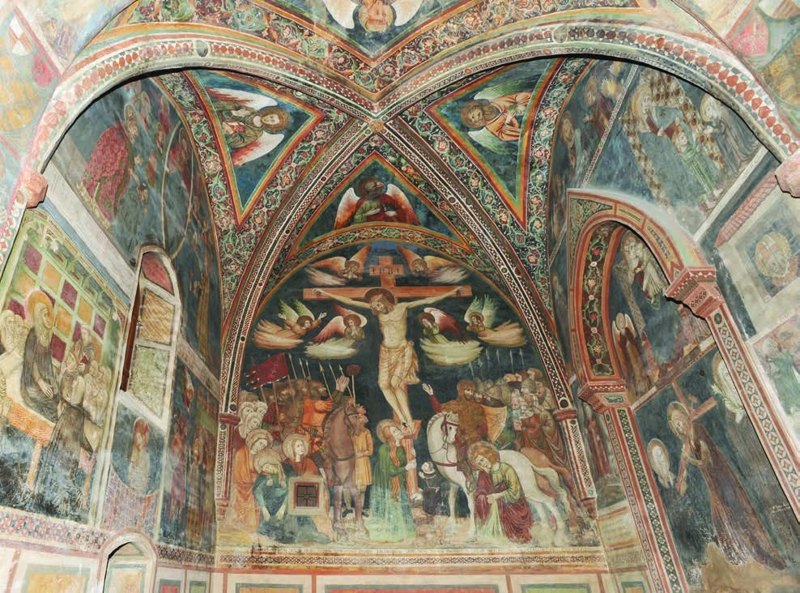
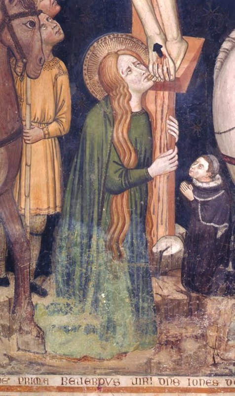
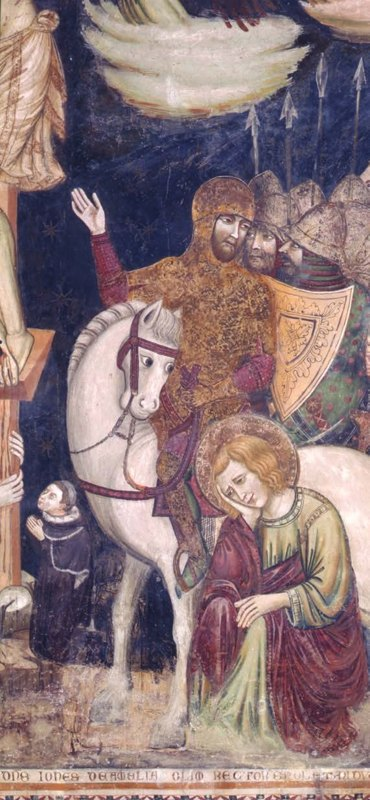
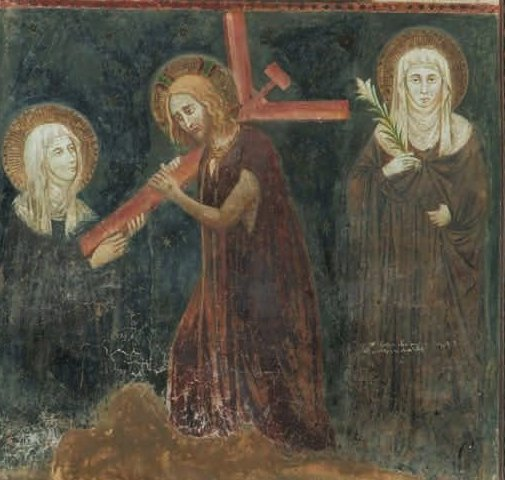
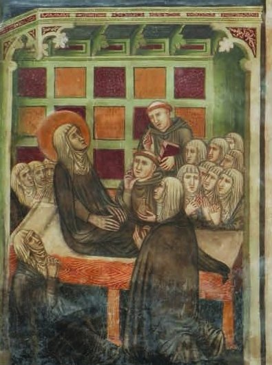
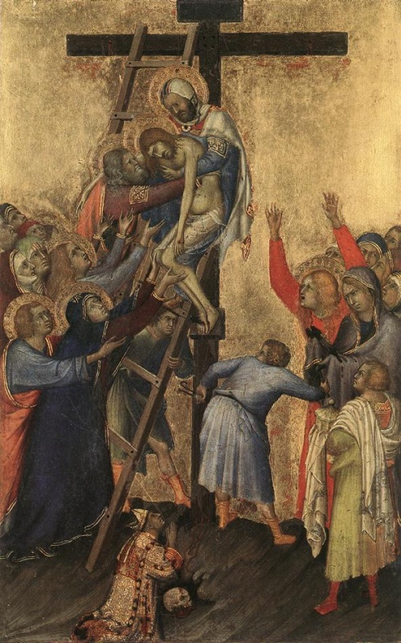
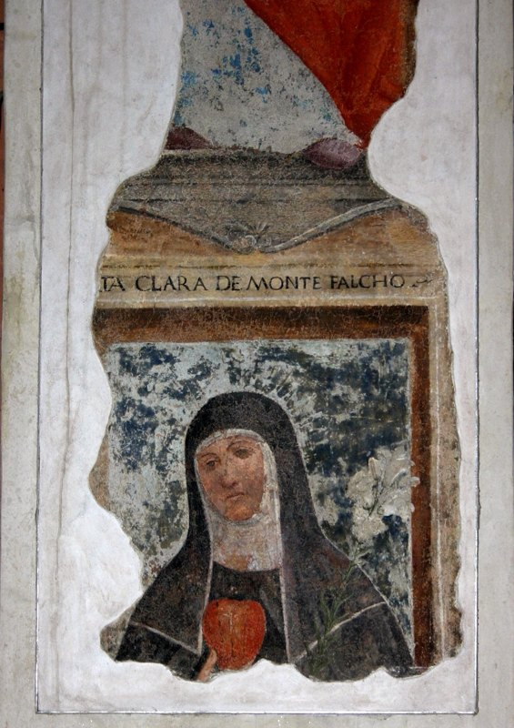

## Introduction: A Small Town, a Large Dossier

Few figures of late medieval Italian religion combine so slight a personal biography with so dense a documentary survival as *Chiara di Damiano of Montefalco*. She was born in 1268 in a small hill town of the Spoleto valley and spent almost her whole life behind the walls of a reclusorium that became a monastery. She died there on 17 August 1308, about forty years old. She left no writings; her sayings survive only as extracted from hagiographic and judicial sources. Yet within days of her death her body had become the object of a notarised civic inquiry, then an episcopal verification, then a curial examination, and eventually an apostolic process. That process produced hundreds of sworn depositions and a final report by three cardinals. Enrico Menestò, editor of both the apostolic process and Berengario's Vita, reckons the procedural road from the diocesan inquiry of 1309 to the canonisation of 1881 at "ben 572 anni".

Her case requires three layers to be kept apart: what the documentary record attests, what the hagiographic tradition from Berengario onward claims, and what modern scholarship reconstructs or still debates. Three modern scholars have shaped the field. Enrico Menestò edited the process and the Vita. <a href="/scholars.html#leonardi-claudio">Claudio Leonardi</a> gave the most widely followed reading of her hagiography. <a href="/scholars.html#nessi-silvestro">Silvestro Nessi</a>, the historian of Montefalco, did the archival work that underlies much of what is known of her family, her monastery and her cult.

## Montefalco and the "Holy Valley"

Montefalco overlooks the plain of the Valle Umbra between Foligno, Trevi and Spoleto. In the later thirteenth century it was a modest commune, but one densely provided with religious institutions. The commune granted the church of San Giovanni Battista to the Augustinian friars in 1275, and they rebuilt it as Sant'Agostino. The Franciscans had a convent there, and their influence on the town was by every account very strong. When Chiara's elder sister Giovanna founded a new house of recluses, the town already supported older communities living on alms. The hostility her foundation met, documented in Berengario's Vita, was framed in exactly these terms: another group of mendicant women would compete for the same charity.

Female religious life in this region around 1270–1290 took many forms. Recluses, penitents, tertiaries and informal communities of pious women coexisted with houses gradually drawn under a recognised rule, often under the spiritual guidance of the friars. The Dizionario Biografico degli Italiani entry on Chiara (1980) describes Giovanna's foundation as at first "not very dissimilar" from the many recluse communities of central Italy. Its members bound themselves to poverty, chastity, obedience and humility, to the fasts prescribed by the Church, and to silence, but apparently followed no precise rule. Giovanna appears in contemporary sources simply as "rectrix". This fluid, pre-regular phase is essential for understanding Chiara. She experienced no "conversion" in the hagiographic sense: she entered a reclusion as a child and then lived through its institutionalisation.

The valley was also what Claudio Leonardi called an "extraordinary chronotope" between the thirteenth and fourteenth centuries. It was punctuated by women of overwhelming mystical experience and crossed by the leaders of the Spiritual wing of the Franciscan order. Angela of Foligno is the inevitable comparison. Born around 1248 and widowed, she passed into a penitential life in the Franciscan orbit, dictated her experiences to a Franciscan confessor, and died on 4 January 1309, a few months after Chiara. Jacopone da Todi died in 1306.

Menestò stresses that a genuine "cenacolo" formed around Chiara, as around Angela. Strikingly, the same great figures of the age frequented both: the cardinals Giacomo<a href="/endnotes.html#fn-giacomo-colonna" class="footnote">1</a> and Pietro Colonna<a href="/endnotes.html#fn-pietro-colonna" class="footnote">2</a>, Napoleone Orsini<a href="/endnotes.html#fn-cardinal-napoleone-orsini" class="footnote">3</a> and Giovanni da Morrovalle; the Dominican Niccolò da Prato, bishop of Spoleto from 1299 and cardinal from 1303; and Ubertino da Casale. Nessi opened the 1981 Spoleto congress with a study of the triangle formed by Chiara, Angela and Jacopone. The contrasts are as telling as the parallels. Angela was a lay penitent whose confessor recorded a text of high mystical theology. Chiara was an enclosed abbess who wrote nothing, whose voice survives only through her sisters, visitors and judges. "Holy valley" is therefore only a shorthand for what the sources actually show: a dense network of women's communities, friars, curial prelates and civic authorities, within which sanctity was observed, contested, recorded and negotiated.

A frequent confusion must be cleared away at once. Chiara da Montefalco is not Clare of Assisi<a href="/endnotes.html#fn-chiara-assisi" class="footnote">4</a> (d. 1253), companion of Francis<a href="/endnotes.html#fn-francis-assisi" class="footnote">5</a> and foundress of the Poor Clares. The two belong to different generations, towns and institutional worlds; Chiara of Montefalco's feast is 17 August, and her monastery received the Rule of St Augustine<a href="/endnotes.html#fn-augustine-of-hippo" class="footnote">6</a>. The confusion nevertheless has a history of its own. According to Nessi's research, as summarised in the Dizionario Biografico, fifteenth-century Montefalco believed, or wished to believe, that its saint had been Franciscan. Benozzo Gozzoli's mid-century frescoes in San Francesco placed her among the order's saints in a Minorite habit, which was replaced with the Augustinian one only after 1577, following a papal decision. Inside the monastery itself, nuns wishing to follow the Augustinian rule were opposed by others who wanted to become Poor Clares. A papal provision of 1492 settled the dispute by assigning the monastery to the Augustinian hermits and granting the hermitage of San Leonardo to the Franciscan party.

## A Life as Documented: Family, Reclusion, Rule and Abbacy

The facts of Chiara's family are relatively secure, thanks above all to Nessi's archival appendix to Menestò's edition of the process. She was the second child of Damiano and Iacopa (or Giacoma), a family apparently among the more prosperous of the town and deeply religious. The eldest was Giovanna. A younger sister, Teodoruccia, died in infancy. A brother, Francesco, became a Friar Minor, studied theology, and rose to provincial minister and inquisitor "heretice pravitatis" in the Duchy of Spoleto. His career places the family firmly within the Minorite orbit that dominated Umbrian religion, and he later testified in his sister's process.

The chronology of Chiara's entry into reclusion and of the community's early years varies between sources. All agree that she joined her sister at the age of six, which with a 1268 birth implies about 1274. The New Catholic Encyclopedia gives 1275 and modern Augustinian sources about 1273. Giovanna's own beginnings are dated variously. The present community places them shortly after 1260, in a small house outside the walls (now Santa Illuminata) where she lived with a companion named Andreola. A devotional entry gives 1271, and the Dizionario Biografico calls the first reclusion the hermitage of San Leonardo. The phrase "first reclusion of c. 1268" found in some summaries conflates Chiara's birth year with Giovanna's beginnings and should be avoided.

As Menestò analyses it, Berengario's Vita divides her life into three periods. The first, to 1281, is childhood in a reclusion without a rule. The second, 1282–1290, follows the move to a new reclusion, still without a rule but under Giovanna's obedience and episcopal supervision. The third, 1291–1308, covers the house's institutionalisation as a monastery and Chiara's abbacy. The move to Santa Croce is therefore conventionally dated around 1281. The Vita is frank about the town's hostility. It records insults, stones thrown at the building, physical violence and finally the blackmail of hunger, so that no one dared give the recluses alms. Chiara went out begging with her companion Marina, but after eight outings she was stopped, "quia frequenter Clara raptus et elevationes habebat etiam huiusmodi servitia faciendo": she often fell into raptures even while doing such service. She resisted "cum multo lacrimarum ymbre", with a shower of tears, but then obeyed, and thereafter "continue usque ad obitum in monasterio reclusa permansit".

The move from reclusion to monastery is one of the best-dated events in the dossier. In 1290 Giovanna asked to profess a monastic rule, and in June Gerardo, bishop of Spoleto, granted the community the Rule of St Augustine. Bibliotheca Sanctorum and the present monastery give 10 June 1290, the document being issued from the pieve of San Fortunato. In disciplinary terms Chiara was therefore unquestionably an Augustinian nun, and John XXII<a href="/endnotes.html#fn-john-xxii" class="footnote">7</a> called her "ordinis sancti Augustini" in 1317. But the Dizionario Biografico warns that neither the process nor the Vita proves a link to the male Order of the Hermits of St Augustine. The sources mention the spiritual guidance of the Friars Minor, and no mendicant order requested her canonisation. The claim repeated in English-language summaries that she had been a "Franciscan tertiary" is a later attribution, not a documented fact; it belongs to the long polemic between the two orders.

Giovanna died in 1291; the date 22 November is given in the hagiographical reference literature. Chiara, about twenty-three, was elected abbess despite trying by every means to refuse. The Dizionario Biografico calls her a severe superior who never imposed on others duties she would not take on herself. Berengario notes that she "que ante sororis obitum rarissime et parcissime loquebatur", who had spoken very rarely and briefly before her sister's death, now "discrete et disertissime alias dominas instruebat", instructed the sisters with discretion and great eloquence. The community stayed small: in 1308 the podestà made seventeen nuns swear to the prodigies. In 1303 Chiara promoted a church dedicated to the Holy Cross, whose apse survives as the present Cappella di Santa Croce.

Her reputation for counsel is well attested. Citing the process folios, the Dizionario Biografico records meetings with Cardinal Pietro Colonna and Niccolò da Prato, and correspondence with Giacomo Colonna, who sent her a large sum in gold as alms. A deposition of 1309 by Giovanna, the abbess who succeeded Chiara, preserved in the Vatican fragment, reports that Bishop Niccolò showed her great reverence, that Giacomo Colonna and Orsini often sent their chaplains, and that Pietro Colonna "hic ad istam gratem genuflexit ante eam, et voluit sibi obedientiam promittere": he knelt before her at this very grille and wished to promise her obedience. At the apostolic process the knight Giovanni di Masseo of Spoleto said he had heard Pietro Colonna declare that he would not give up having spoken with her for his best horse and a thousand gold florins. The process also records that around 1306 she helped broker a truce between Trevi and Montefalco (Proc., f. 262).

These friendships had political weight. Menestò emphasises her involvement with the Colonna cardinals' opposition to Boniface VIII<a href="/endnotes.html#fn-pope-boniface-viii" class="footnote">8</a>, who deposed and excommunicated them in 1297. Berengario records that she foretold Giacomo Colonna's deposition, having seen him "sine cappello rubeo, quasi hominem profugum", without his red hat, like a fugitive. A local notary, ser Stefano, refused to return the monastery's documents and threatened to denounce her to Boniface for continuing to see the Colonna. The only hostile voice at the apostolic process was the Franciscan Tommaso Boni of Foligno, who accused her of admitting a girl named Clarutia without a dowry, against the "sextum decretale Bonifatii". Details of this kind, which hagiography normally suppresses, are one reason the dossier is so valuable.

## Spirituality and Mysticism: Cross, Love, Doctrine

Chiara's spirituality, as Berengario and the process present it, joins an austere ascetic regime to a visionary life of exceptional intensity. The asceticism follows the female models of the age: rigorous chastity, almost inhuman austerity, absolute poverty, the hair shirt and flagellation to the point of blood. The early modern biographer Isidoro Mosconi (Bologna, 1600–1601) judged her "magis admiranda quam imitanda", more to be admired than imitated.

Berengario describes her raptures with near-clinical precision. They came once or several times a day, and occasionally lasted for days. Her face turned red or pale; her limbs moved "motu celerrimo" or stayed rigid; her body stood "erectum ut statua", upright like a statue. Her sisters feared she would die in them. Her ecstatic utterances are among the few words that can be attributed to her: "Omnia ardent, omnia ardent", all things are burning; and "Quod servitium faciunt tibi sancti, amor mi? Faciunt tibi servitium de cantibus", what service do the saints do you, my love? They serve you with songs. During Mass she once saw "Deum in se et se in Deo velut in speculo", God in herself and herself in God as in a mirror. Yet before the divine infinity she seemed to herself like "unum beccerium in medio maris mersum", a basin sunk in the middle of the sea, full of water and swallowed in it.

The Vita also narrates a long trial. Having described a vision of the Passion to a sister who had none, Chiara "se aliquid reputavit", thought herself something. In punishment, Berengario says, the clarity of her revelations was largely withdrawn "per annos undecim", for eleven years of "fortissimum quemdam tribulationum conflictum". Modern devotional chronologies end this dryness in the 1290s; the Vita's internal chronology is the only basis for doing so.

The centre of her mysticism is the Cross. In the Vita (ch. 18), Christ tells her: "Ego quero locum fortem, in quo possim crucem fundare, et pro crucis fundatione hic reperio locum aptum". I seek a strong place in which I may set up the cross, and here I find a fitting place to set it. He adds, "Si vis esse filia, moriaris in cruce": if you wish to be my daughter, die on the cross. During her final illness, the Vita says, she declared five times that she had Christ's cross in her heart.

In the process, witnesses report the vision more circumstantially, with Christ carrying the cross on his shoulder. One witness dates it "XV annis vel plus" before her death. Her brother Francesco testified that he had heard the account from Giovanna, to whom Chiara had told it. If the sister Giovanna, who died in November 1291, was the intermediary, the vision cannot be later than 1291. That sits uneasily with the date "early 1294" in modern Augustinian accounts, a discrepancy that the published sources do not resolve. Recent literary scholarship argues that the encounter with the "pulcerrimus" young Christ is modelled on the Song of Songs: Christ takes the bride's part, searching until he finds her, and unites himself to her by planting his cross in her heart.

In her last days the conviction became a refrain. Berengario (ch. 56) reports that, asked in ecstasy whether she was afraid, she answered: "Ego nullum timorem habeo, quia crucem Domini mei Iesu Christi crucifixi in corde meo porto." I have no fear, because I carry in my heart the cross of my Lord Jesus Christ crucified. When a Giovanna (necessarily the later abbess, since the sister had died in 1291) made the sign of the cross over her, she said: "Soror, quare me signas? Ego exteriori cruce non egeo, quia crucem Domini mei Iesu Christi crucifixi impressam habeo cordi meo." Sister, why do you sign me? I need no exterior cross, for I have the cross of my Lord impressed upon my heart. These are the verified textual foundations of the later devotion. By contrast, the epigram most often quoted today as her "motto", "If you seek the cross of Christ, take my heart; there you will find the suffering Lord", does not appear in the edited sources and should be treated as a traditional attribution.

Leonardi's reading, formulated at the 1981 Spoleto congress, identified three distinguishing features in Berengario's portrait. Chiara represents a significant moment of the "dialettica laico-monaco", and she lived "con intensità straordinaria" two realities: a nuptial mysticism of love, and a mysticism of the cross, of the "dolore-di-Dio". His formula for her public role has become classic: "Se misticamente è piantata nella croce, o meglio se la croce è piantata in lei, storicamente Chiara è una carismatica pubblica." If mystically she is planted in the cross, or rather the cross in her, historically Chiara is a public charismatic. Berengario names her two charisms "claritas doctrine, profeticus spiritus". Though "mulier licterata non esset", she interpreted the Scriptures "supra intellectum humanum". The Dizionario Biografico adds a sober corrective: the process calls her "illicterata", yet she read the breviary and taught her sisters to read, so the word means without Latin learning.

Menestò has refined Leonardi on one point. Leonardi stressed Berengario's lack of literary preparation, offset by his "diligenza documentaria". Now that the process can be read, Menestò argues that Berengario steered the depositions through the "articuli interrogatorii" he drafted from 1309, turning "una vita di donna, di monaca" into "una vita di santa". The hagiographer was not a neutral recorder but an architect of the procedure that produced his evidence.

## Doctrinal Firmness: Chiara and the "Spirit of Liberty"

The most historically consequential episode of her public life is her confrontation with Bentivenga da Gubbio and the sect the sources call "secta spiritus libertatis". The Dizionario Biografico summarises the documented core. Bentivenga, once a follower of Gherardo Segarelli at Parma, had joined the Friars Minor and enjoyed a great reputation for sanctity when he met Chiara around 1306. In the conversations reported in the process, she used considerable dialectical skill to refute his "quietism", above all the claim that God could will evil, so that men's sins too should be attributed to him. She then denounced him, first to local inquisitors and then to the cardinal legate Napoleone Orsini.

Berengario devotes a long chapter (43) to the dispute. It ends: "virgo Clara, zelatrix catholice fidei, in persecutionem dicte secte hereseos sic fideliter laboravit, quod eos et credentes eisdem quamplures denuntiavit". She reported them to the Franciscan superiors, to prelates of the Duchy and to cardinals then present, "donec super predicto crimine fuit formata inquisitio contra illos et reperti culpabiles condempnati fuerunt perpetuo carceri mancipari": until an inquisition was opened and those found guilty were condemned to perpetual imprisonment. Menestò stresses that the Vita and the apostolic testimony agree in crediting Chiara with the discovery, denunciation and elimination of the sect between late 1306 and 1307. The apostolic articles themselves (article CXII) asked witnesses whether she had disputed with heretics.

Three points of assessment matter. First, the hagiographer's account is corroborated by procedural documentation. The basic study and edition of sources on the sect, De secta spiritus libertatis in Umbria saec. XIV: disquisitio et documenta (Rome, 1943), also printed the relevant parts of the cardinals' report (pp. 121–126), and Clement V<a href="/endnotes.html#fn-clement-v" class="footnote">9</a>'s bull Dilectus Domini of April 1311 suggests the sect survived the condemnation. Second, a 2025 article in the journal SCRIPTA shows that "before being denounced, the inquisites assiduously frequented the monastery as chaplains and confessors of the nuns", discussing the spiritual life with them boldly. Her orthodoxy was tested within her own community's pastoral care, and the cardinals' report records that she promptly dismissed chaplains whose familiarity with a nun might be dangerous. Third, the episode tied her to the Spiritual Franciscans in a way that later proved ambiguous. Ubertino da Casale, then Orsini's chaplain, met her several times around 1306–1307. The same 2025 SCRIPTA article states that the friars denounced by Chiara were tried and condemned as heretics by Ubertino himself at Arezzo in 1307 ("da lui processati e condannati come eretici"). The paradox is plain. Her most celebrated act of orthodoxy ran through the networks of the Colonna, Orsini and Ubertino, which may later have made her suspect to John XXII, persecutor of the Spirituals.

## Death and the Opening of the Body

Chiara died on 17 August 1308, having asked to be carried on a portable bed into the oratory of her church. A few older works, including the Catholic Encyclopedia of 1913, give 18 August, but the earliest documentation supports the seventeenth, which is also the liturgical date. Her last words in the Vita (ch. 57) express the nuptial strand Leonardi identified: "Obviavit anima mea dilecto meo fidelissimo Iesu Christo, qui michi etiam dixit quod veniam ad eum." My soul has gone to meet my most faithful beloved Jesus Christ, who has told me to come to him. Shortly before, she had said "Video omnia quod sunt bona", I see that all things are good.

What followed is reconstructed from the nuns' sworn testimony and from Berengario. <a href="/scholars.html#park-katharine">Katharine Park</a>'s article in *Renaissance Quarterly* (1994) presents the opening as part of an embalming, in which the nuns "proceeded to the next step in contemporary embalming practice, which was evisceration." In Sister Francesca of Montefalco's words at the process, the nuns agreed that the body "should be preserved on account of her holiness and because God took such pleasure in her body and her heart". The town apothecary testified that they sent to him for "balsam and myrrh and other preservatives". Evisceration followed, as in contemporary practice: the heart was set aside in a box and the viscera placed in the oratory. The decisive deposition concerns the next evening: "After vespers or thereabouts, the said Francesca, Margherita, Lucia, and Caterina went to get the heart, which was in the box... And the said Francesca of Foligno cut open the heart with her own hand, and opening it, they found in the heart a cross, or the image of the crucified Christ." Over the next two days the nuns cut into the heart again and found further signs, all formed of flesh: the crown of thorns, the whip and column, the rod and sponge, and tiny nails. They then examined the gallbladder and found three small round stones.

Some details vary between accounts. Two Francescas appear, Francesca of Montefalco as a principal witness and Francesca of Foligno as the nun who made the incision, and popular accounts often merge them. The extract above names four nuns, while an Augustinian account lists seven: Francesca, Marina, Illuminata, Elena, Lucia, Caterina and Margherita, probably conflating those present at different moments. The interval before the opening also varies. Menestò writes that the nuns acted "subito", immediately; the anglophone analysis, reading the same testimony, has the body lying uncorrupted for five days before embalming was decided. The main sequence is clear: death, decision to embalm, evisceration, opening of the heart, discovery of the stones, and the civic inquiry of 22 August.

The inventory of signs is consistent in the earliest sources. Menestò summarises it as the crucifix, scourge, column, crown of thorns, three nails and lance, and rod with sponge. In the gallbladder were "tre globi di ugual misura, peso e colore, disposti a forma di triangolo", three globes of equal size, weight and colour arranged in a triangle, as a symbol of the Trinity. Berengario describes the signs "in forma di duri nervi di carne", as hard sinews of flesh, on the two sides of the heart, and says the stones represented "verosimilmente", in all likelihood, the Trinity.

Several popular details are later elaboration. One is the claim that each stone weighed as much as the other two, or all three. The Dizionario Biografico mentions it only as a quality the stones "would have possessed", and in the same passage misplaces them in the liver ("fegato"). Others are the thumb-sized crucifix with a red lance-wound, a heart "as large as a small child's head", and the anecdote that Berengario pricked his finger on the miniature lance and was converted. None of these appears in the edited sources. Bibliotheca Sanctorum (1963) is notably reserved, speaking of "una tradizione leggendaria, fondata su una accesa pietà e su una ingenua nozione dell'anatomia". That verdict predates the edition of the process and is an interpretation, not a datum, but it shows that scepticism has a place within Catholic reference scholarship itself.

## Verification: Civic Oath, Episcopal Suspicion, Curial Examination

What distinguishes Chiara's case is not that her body was opened but how quickly and formally the opening was verified. On 22 August 1308, Menestò records, the podestà of Montefalco, Gentile dei Gilberti of Spoleto, came with his officials to inspect the prodigies. He made the seventeen nuns and Chiara's physician, Simone da Spello, swear that there had been no invention or artifice and that the facts "ita fuisse ut [...] est narratum". The oath was recorded with full legal formality, and the subscription of the notary Angelus Ioannilli survives. Menestò regards this lay intervention as the first true process.

The ecclesiastical response began in suspicion. Three days after the death the Franciscan Pietro di Salomone went to Spoleto on his own initiative. He told the episcopal vicar, Berengario of Saint-Affrique, what had happened and how religion might be offended if the signs were a deceit of the nuns. Berengario, who had never met Chiara, "accensus indignatione et suspicatus quod malitiose esset facta, equitavit ad Montefalcum", intending to proceed against the sisters as severely as he could. He summoned "multas personas solempnes, et specialiter fratres Minores et iudices et advocatos et rectores ecclesiarum" to the oratory, examined the heart, and concluded that the signs were made "non per finctionem humanam, sed miraculose per operationem divinam". The common claim that "a Franciscan accused the nuns of planting the signs" therefore distorts the record: the Franciscan raised fraud as a pastoral worry, and the hostile party was the vicar.

Berengario was a Frenchman newly appointed to the vicariate, and not a priest. Nessi has also corrected a long-standing error about his bishop. Older literature, Bibliotheca Sanctorum included, names the bishop of Spoleto as "Pietro Paolo Trinci". No such bishop existed. The see was held by Pietro da Monticchiello, a Sienese long resident at the Avignon curia who was for years only bishop-elect and governed through vicars such as Berengario.

The relics soon travelled. According to the Vita (ch. 84), Cardinal Giacomo Colonna asked for the heart "ac predictos tres lapides". In Rome in November 1308 he examined them with Napoleone Orsini "una cum pluribus honorabilibus et fide dignis personis". Among those present was Ubertino da Casale, who, Berengario reports, was then healed of a long-standing inguinal hernia. Orsini's Dizionario Biografico entry confirms that he inspected the heart with Giacomo Colonna in autumn 1308 and conducted a first examination of witnesses.

Three medieval frames help interpret these relics. The first is the heart as the seat of love and of the soul: Chiara located the cross "in corde", and the finding literalised language she had used for years. The second is the holy female body as a site of production. Park argues that holy women's bodies were imagined as containing precious things, so that Chiara's heart became a "fertile" organ generating relics. The third is the history of anatomy. Her article shows that there was no general medieval taboo against opening the dead: "From at least the early twelfth century, opening the body was a common funerary practice, as the examples of Chiara of Montefalco and Margarita of Citta di Castello indicate", and autopsy entered Italian legal and medical practice by the early 1300s. It also finds that the "holy anatomies" of this period were performed on women's bodies, not men's.

This corrects a formula often repeated: that Chiara's was "the earliest documented autopsy of a saint performed for devotional verification". The opening was, in origin, an embalming evisceration. What is precocious and well documented is the combination: a devotional search inside the organ, a sworn civic verification within five days, an examination by a sceptical vicar, and within three months an examination by cardinals in Rome. It is safer to call it one of the earliest and best documented cases.

## The Canonisation Dossier

The diocesan inquiry. On 18 June 1309 Berengario obtained his bishop's delegation to begin an inquiry, "ne in futurum memoria deperiret", lest memory perish. Only one gathering of twenty-six folios survives from its register. Edited in 2002 as the "Vatican fragment", it holds depositions taken at the monastery on 18 June 1309. This first phase ran to April 1310; on 15 April 1310 Berengario's successor as vicar gave him faculty to continue. In 1724 documents were removed from Santa Croce, and in 1734 the Roman librarian Domenico Giorgi reported on them, mentioning depositions received "inter annum Domini 1309 et 1316". This shows a supplementary phase up to about 1315–1316.

The Vita. Berengario's Vita sancte Clare de Cruce survives in four manuscripts and is divided into 106 uneven chapters. After a prologue it narrates her life in three periods. It then treats her virtues: ecstasies and charity, prophecy (chs 25–42), the dispute with the heretics (43), revelations and visions (44–55), the last week (56–65) and the signs in her heart (66–76). It ends with a Franciscan's vision of her (77) and a loose "tractatus de miraculis" (78–106). In the prologue Berengario states his method: "testes examinavi aliquos de receptis, licet paucos de pluribus. Et de dictis testium compilavi que in subsequentibus continentur."

The date of the Vita is disputed. Seventeenth-century writers placed it in 1310, its first modern editor in 1315–1316. Nessi first proposed 1310–1315, then fixed it "negli anni 1309-1310, particolarmente dopo il 15 aprile 1310". Another scholar holds that the surviving text is a second version postdating Orsini's inquiry of 1316–1317. Menestò once dated it 1315 to after 1317 but now inclines to 1310, since the passages he had attributed to Orsini's inquiry were Berengario's own eyewitness accounts. The Vita was edited in 1884–1885 from MS Casanatense 21, and in 1908 and 1944 from the Montefalco manuscript. Menestò's critical edition, with Rossana Guglielmetti's translation, appeared in 2018, and a pocket version of the translation in 2023. Leonardi's judgement that this is a case "in cui processo di canonizzazione e agiografia tendono a coincidere" remains the best short description.

From Avignon to Montefalco. In October–November 1316 Berengario presented the diocesan results to John XXII, privately and then in public consistory, and asked for canonisation in the name of the whole province of Umbria. Orsini carried out a first curial review. A papal letter of October 1317 (Reg. Vat. 67, f. 86r, no. 311; dated 25 October in recent work) to the bishops of Perugia and Orvieto and the rector of the Duchy authorised a formal process "auctoritate apostolica". Augustinian sources add a papal letter of 22 March 1318 capping the commissioners' fees at two florins a day each; the letter has not been checked against the registers.

The apostolic process opened at Montefalco on 6 September 1318 and finished taking testimony in July 1319. The number of witnesses is given as "more than four hundred", "about 470" and "486 depositions". Since the acts are incomplete, the difference probably reflects different ways of counting, and no single figure should be presented as certain. Menestò's edition fills pages 1–513 of Il processo di canonizzazione di Chiara da Montefalco (1984; reprinted Spoleto 1991), with Leonardi's preface and Nessi's appendix. It preserves the voices of nuns, townspeople, friars, physicians, apothecaries, notaries and knights. The classic survey of late medieval sainthood, La sainteté en Occident aux derniers siècles du Moyen Âge d'après les procès de canonisation et les documents hagiographiques (Rome, École française de Rome, 1981), reportedly regards it as among the richest documentation available. The secondary literature also attributes to that survey the claim that hers was the first process to examine a candidate's visions and revelations at length; the claim is reported without page reference and should be cited with that reservation.

The cardinals' report and the failure. Menestò names the three examining cardinals as Napoleone Orsini, Pierre d'Arrablay and Bertrand de la Tour. Their "Relazione dei tre cardinali" is datable to about 1330. Orsini's Dizionario Biografico entry says he largely drafted it and that it recommended canonisation in 1331. Augustinian sources attribute the delay to the deaths of commissioners and their successors.

No canonisation followed, and here an error must be corrected. The scholarly and reference literature knows no "1328 bull of John XXII suspending the process". The Dizionario Biografico, Menestò and Bibliotheca Sanctorum all describe a cause that simply failed to conclude, which "per cause del tutto esterne non poté tuttavia aver seguito". The dates 1328 and 1333 attached to a "suspension" in popular accounts seem to derive from the commission's working period. After John XXII died in 1334 the cause lay dormant. The Dizionario Biografico suggests the pope's probable opposition, perhaps because of her evident links to the Colonna and through them to the Italian Spirituals, and perhaps from distrust of a visionary spirituality "always at the limit of orthodoxy". The editors of the 2023 translation call the Vita "la diretta documentazione di un insuccesso, il cui senso resta ancora da comprendere a fondo". The suggestion that Montefalco's proximity to rebellious Spoleto harmed the cause has no support in the sources and should be treated as conjecture.

The long dormancy and the modern conclusion. The Augustinians sought a reopening in 1497 without result. Urban VIII<a href="/endnotes.html#fn-urban-viii" class="footnote">10</a> granted an Office and Mass in 1624, to the Order on 14 August and to the diocese of Spoleto on 28 September. Clement X had her name inserted in the Roman Martyrology on 19 April 1673. The removal of documents in 1724 is described by Menestò as the second resumption of the cause. Clement XII ordered the cause resumed in 1736. On 13 April 1737 the Congregation of Rites approved her cult "ab immemorabili", which the Dicastery for the Causes of Saints lists as her beatification. A new apostolic process from 1738 was ratified on 17 September 1743. The Dizionario Biografico records a reopening in 1846 that stalled over procedure; Bibliotheca Sanctorum records a further process from 22 October 1850 to 21 November 1851, approved on 25 September 1852. On 8 December 1881 Leo XIII, formerly bishop of Perugia, canonised her in St Peter's, together with Benedict Joseph Labre, Giovanni Battista de' Rossi and Lorenzo da Brindisi.

The common errors can therefore be named precisely. Clement X did not beatify her in 1624/1625; that act was Urban VIII's. She was not "canonised in 1728", as one French scholarly note says. She was not "beatified on 1 April 1828 by Clement XII", who died in 1740. And her process was not "initiated in 1328".

## Body, Relics and Cult

Chiara's body stayed in the church of Santa Croce until the new church was completed in 1430. The present building is a rebuilding of 1615–1643 attributed to Valentino Martelli; guides that credit him with the 1430 church conflate the two phases. Local sources say the silver urn was sent in 1612, through the general of the Jesuits, by an anonymous donor in thanksgiving for a grace. It rests on a fourteenth-century base at an altar built around 1600 by Fabio Tempestivi of Montefalco, later archbishop of Ragusa. Two niches opened in 1718 hold a silver bust reliquary containing her heart and a silver cross reliquary containing the "mysteries of the Passion" found in it and the three stones.

The condition of the body is described inconsistently. Official and devotional Italian sources speak of the "corpo incorrotto". Some English-language sources say the body is now reduced to bones and that pilgrims see a figure. No authoritative report of a modern recognition has been published, so the present state of the remains should be left open. Claims of later prodigies, such as liquefying blood, belong to the history of the cult, not the medieval record. The Augustinian community has kept the relics continuously, surviving the Napoleonic and Italian suppressions. Devotion remains strongly local, centred on the feast of 17 August with its evening procession of lamps; Cardinal Matteo Petrucci died at Montefalco in 1701 after coming to visit the body.

Her iconographic attributes formed slowly. The earliest images show the Augustinian nun, Christ planting the cross in her breast, and scenes of her childhood and death. Later images add the crucifix held to the breast, the heart with the cross, the lily and the scales. In San Giacomo alla Lungara in Rome she holds a balance with one stone in one pan and three in the other, perfectly level: the visual form of the Trinitarian reading of the stones, and probably the source of the later weight legend. The Dizionario Biografico also records a Rubens in the Augustinian church at Antwerp, a product of the Counter-Reformation revival of her cult.

## Chiara in Fourteenth-Century Art: The Cappella di Santa Croce

The earliest visual dossier is the decoration of the former apse of Santa Croce, the church Chiara built in 1303 and where she chose to die. An inscription beneath the Crucifixion on the altar wall records that the frescoes were commissioned in 1333 by Jean d'Amiel, the French rector of the Duchy of Spoleto. He appears three times as donor, once presented by St Blaise. Local historians note that Chiara's brother Francesco was then inquisitor in the Spoleto valley (documented in 1326) and served on embassies to Avignon.

Art historians distinguish two anonymous painters. The first, the Primo Maestro della Beata Chiara da Montefalco, painted the Crucifixion of the end wall and the right wall, with the scenes of Chiara's childhood and the appearance of Christ with the cross above the place of her tomb. The second painted the left wall, with the martyrdom of Saint Catherine and the death of Chiara. A dossal attributed to the Primo Maestro, with the Crucifixion and stories of Saints Catherine and Blaise, was probably made for the chapel's altar at d'Amiel's commission; it was removed in 1925 and is now in the Vatican Museums. The frescoes are described in the Catalogue Entry below.

The cycle is significant in three ways. First, a papal rector commissioned a life cycle of a woman the papacy had not canonised, a quarter-century after her death and shortly after the cardinals' report of about 1330–1331 had recommended her canonisation. Calling it "one of the earliest hagiographic cycles devoted to a then-uncanonised woman" is reasonable; claiming it as the earliest would need systematic comparison. Second, the scenes track the written dossier: childhood reclusion under Giovanna, the visions of her childhood, the gift of the cross, and death in the oratory. The images formed a parallel brief for her sanctity, addressed to nuns, townspeople and visitors rather than to the curia. Third, recent literary-historical work observes that the painted scene of the cross restrains the erotic suggestion of the Song of Songs model on which the written vision draws.

Her diffusion in Trecento painting beyond Montefalco is harder to document. The Primo Maestro's hand has been recognised at Santa Maria di Turrita and in panels from Vallo di Nera and Santa Maria di Ponte, but these works need not show Chiara. One hypothesis reaches as far as the papal court: some scholars have wished to see Chiara in a mourning woman of the Deposition in the Passion polyptych that Simone Martini painted for Napoleone Orsini. Later images belong to the rivalry of the orders. Gozzoli's Franciscan Chiara at Montefalco, and his commission to "restore" an old image of her in the Augustinian convent, show the saint's image being reshaped by the competing orders that claimed her, while Augustinian churches such as Santa Maria Incoronata in Milan spread a fixed type with the heart and the lily.

## Significance and Historiography

Chiara matters for the history of medieval religion in four ways. First, she is a test case for the relationship between hagiography and judicial procedure around 1300. Her dossier shows every stage of the late medieval canonisation machinery at work, and also its limits: a favourable report did not produce a canonisation, because the decision belonged to a pope whose priorities and suspicions lay elsewhere.

Second, she is central to the study of somatic spirituality. Historians of medicine and gender have made the opening of her body the starting point of a wider argument: that women's bodies in late medieval Italy were privileged sites of sacred or dangerous "secrets", and that the history of anatomy cannot be written without them. Menestò writes that the signs represent, "nella loro effettiva realtà o nel loro valore simbolico", in their actual reality or symbolic value, the mysterious force of love and mystical compassion. The formula deliberately suspends the question of facticity, which is the right stance for a historian.

Third, she complicates the categories of "mystic" and "recluse". Leonardi's description of her as a public charismatic fits the documents: an enclosed abbess who corresponded with cardinals, prophesied their fortunes, brokered a truce and denounced heretics. Fourth, her case shows how hagiographers and patrons created sanctity. Berengario made her sanctity a juridical object, d'Amiel a visual one, and the rival orders an object of institutional possession. The Dizionario Biografico suggests the 1881 canonisation celebrated in her the love of purity and the devotion to the instruments of the Passion characteristic of that age's piety.

Modern scholarship has its own chronology. Nineteenth-century work centred on editions of the Vita and on the Positio super miraculis of 1881. In 1943 research on the Spirit of Liberty brought her into the history of heresy, and Nessi's studies of 1968–1969 placed her in local history. The turning point was the congress at Spoleto of 28–30 December 1981, published in 1985 as S. Chiara da Montefalco e il suo tempo, edited by Leonardi and Menestò. Menestò's edition of the process (1984) then made possible the comparison Leonardi had called for but could not yet make, given "la condizione di inedito" of the acts. The seventh centenary brought a second congress at Montefalco and Spoleto (25–27 September 2008), edited by Menestò in 2009. Meanwhile anglophone history of dissection and gender has placed her opened body at the threshold of the history of anatomy.

## Conclusion

Chiara da Montefalco's importance lies less in what she wrote, which is nothing, than in what was written, sworn, painted and preserved about her. Her sisters wished to preserve her body; the commune to guard against fraud; a sceptical vicar became her advocate; cardinals were bound to her by friendship and politics; a pope declined to act; a papal rector chose to paint her. The resulting dossier lets the historian separate the documentary record, the hagiographic construction and the later legend. The task is not to adjudicate the miracle but to understand the juridical, devotional and artistic processes by which a "piccola grandissima donna", in Leonardi's phrase, became the saint of the cross in the heart.

## Catalogue Entry

### The Cappella di Santa Croce (Montefalco, Santuario di Santa Chiara della Croce)

<figure>
  
  <figcaption>Primo Maestro della Beata Chiara da Montefalco and a second painter, decoration of the Cappella di Santa Croce, 1333. Fresco. Montefalco, Santuario di Santa Chiara della Croce. Photo: Santuario di Santa Chiara della Croce, Montefalco, for educational use only.</figcaption>
</figure>

The Cappella di Santa Croce is what survives of the church that Chiara built for her community in 1303. The letter of Bishop Niccolò of Spoleto that sent the blessed first stone, dated 4 June 1303, dedicates the building to God, the Virgin, the Holy Cross and Saint Catherine. Only the apse remains, a square bay with a rib vault, now enclosed within the later sanctuary. It was in this space that Chiara chose to be carried on a portable bed on the morning of 17 August 1308, and in which she died.

After her death the body was laid in a separate tomb against the right wall of the apse, under a painted tabernacle, and remained there until its translation to the new church on 26 June 1430. The chapel was therefore, for more than a century, the site of the cult. The apostolic process of 1318–1319 held some of its sessions here, and many of the miracles recorded in the depositions were said to have taken place in this building.

The decoration was paid for in 1333 by Jean d'Amiel, a canon of French origin who had served for about ten years as papal rector of the Duchy of Spoleto. An inscription under the Crucifixion records the commission. D'Amiel appears three times in the chapel: kneeling at the foot of the cross, and twice in the upper register of the left wall, presented to Christ by Saint Blaise and Saint Catherine. The decoration thus combines a memorial of Chiara with a votive monument of its patron at the end of his office.

The programme is organised around the three walls of the apse. The end wall, above the altar, carries the Crucifixion. The right wall, where the tomb stood, is devoted to Chiara and to Saint Blaise, with a painted tabernacle containing the Virgin and Child above and the appearance of Christ with the cross to Chiara below. The left wall shows Christ in judgement with the patron, the death of Chiara, the Ecce Homo and the martyrdom of Saint Catherine. The vault carries the symbols of the four Evangelists within bands of foliage, and the soffit of the entrance arch has half-length saints, including Francis, Paul, John the Baptist, the Magdalene, Peter and Fortunatus, patron of Montefalco.

Two painters have been distinguished. The principal one, known as the Primo Maestro della Beata Chiara da Montefalco, painted the end wall and the right wall; the left wall is by a second hand. The work of the Primo Maestro is catalogued in the entry on the <a href="/Content/Artists/XIV-c/Primo-Maestro-della-Beata-Chiara-da-Montefalco.html">Primo Maestro della Beata Chiara da Montefalco</a>. The entries below consider the frescoes from the point of view of Chiara and of her cult: what they show of her, and how their images relate to the written dossier.

The dedication of the chapel to the Holy Cross is the key to its programme. The cross is the centre of Chiara's spirituality in the hagiography, the sign found in her heart after her death, and the subject of the two principal images of the chapel: the Crucifixion of the end wall and the appearance of Christ with the cross on the right wall. The visitor standing before the altar sees both at once, the historical Passion and its inward repetition in the life of the saint.

The date of 1333 places the decoration at a delicate point in the history of the cult. The apostolic process had been completed in 1319, and the report of the three cardinals, which recommended canonisation, dates from about 1330–1331, but no canonisation followed. The chapel therefore presents Chiara as a saint in images, with a halo and the title *sancta*, at a time when the papacy had not pronounced on her sanctity.

The frescoes have survived in good condition. Since the translation of 1430 the chapel has been part of the monastery and has been kept by the Augustinian nuns, who have preserved it as the place most closely tied to Chiara in her life and death.

### The Crucifixion, with the Patron Jean d'Amiel, end wall (Montefalco, Cappella di Santa Croce)

<figure>
  
  <figcaption>Primo Maestro della Beata Chiara da Montefalco, <em>The Crucifixion</em>, with the patron Jean d'Amiel, 1333. Fresco, end wall of the Cappella di Santa Croce. Montefalco, Santuario di Santa Chiara della Croce. Photo: Santuario di Santa Chiara della Croce, Montefalco, for educational use only.</figcaption>
</figure>

The Crucifixion fills the lunette of the end wall above the altar. Christ hangs dead on a tall cross bearing the titulus INRI, his head fallen onto his right shoulder, his body long and pale against the deep blue ground. Six angels surround him on stylised clouds, each with a different gesture of grief: one flies in with arms flung wide, another clasps its hands, another covers its face. Below, about forty-five figures crowd the foreground on either side of the cross.

<figure>
  
  <figcaption>Detail of the Crucifixion: the Magdalene at the foot of the cross and the kneeling patron Jean d'Amiel. Photo: Santuario di Santa Chiara della Croce, Montefalco, for educational use only.</figcaption>
</figure>

At the centre the Magdalene, in a green mantle with her long hair loose, kneels and embraces the foot of the cross, pressing her face against Christ's bleeding feet. Beside her, much smaller than any other figure, kneels the patron, Jean d'Amiel, in the dress of a canon with a black cape, his hands joined. His scale follows the convention for donors, but his position is significant: he kneels in the same place as the Magdalene, the model of penitent love, at the point where the blood of Christ reaches the ground.

<figure>
  
  <figcaption>Detail of the Crucifixion: the centurion on horseback and Saint John. Photo: Santuario di Santa Chiara della Croce, Montefalco, for educational use only.</figcaption>
</figure>

On the left the Virgin has fainted and is held up by the holy women, while soldiers with lances and a red banner and a rider on a brown horse look up at the cross. On the right a bearded rider on a white horse, in a golden tunic, raises his hand towards Christ: the centurion who recognised him as the Son of God. Beneath the horse Saint John sits on the ground, his head resting on his hand, in an attitude of withdrawn grief. Behind, a group of elders in heavy mantles stands apart. The composition sets the response of faith on the right against the indifference or hostility of the crowd.

As <a href="/scholars.html#scarpellini-pietro">Pietro Scarpellini</a> observed, the fresco depends iconographically on the two great Crucifixions in the Lower Church of San Francesco at Assisi. The swooning Virgin among the women, the group of elders and the figure of Christ follow the Giottesque Crucifixion of the right transept; the heraldic horses, the raised lances and some of the angels, including the one who covers its face, come from Pietro Lorenzetti's Crucifixion in the left transept. The painter of Montefalco combined the two most recent and authoritative versions of the subject in a single image.

Along the lower edge runs the inscription of the commission: *In nomine Domini. Amen. Anno Domini MCCCXXXIII, indictione prima, reverendus vir dominus Iohannes de Amelio olim rector Spoletani ducatus fecit fieri hoc opus* ("In the name of the Lord, Amen. In the year of the Lord 1333, the first indiction, the reverend lord Jean d'Amiel, formerly rector of the Duchy of Spoleto, had this work made"). The inscription gives the decoration its date and identifies the small kneeling figure above it.

For Chiara's cult the Crucifixion has a particular meaning. The hagiography presents her life as an identification with the crucified Christ, and the signs found in her heart after her death were the instruments of the Passion. The Crucifixion over the altar of the church she had built and in which she died is therefore not only the standard image of a church dedicated to the Holy Cross. It is also the historical event of which her body was believed to bear the marks.

The fresco also shows the language with which the cult was presented. It is not a provincial image. Its models are the most prestigious paintings of the Franciscan basilica, and its patron was the highest papal official of the region. The quality of the decoration reflects the importance that the cult of Chiara had acquired in the Duchy of Spoleto a quarter of a century after her death.

### Chiara, Giovanna and Christ with the Cross, right wall (Montefalco, Cappella di Santa Croce)

<figure>
  
  <figcaption>Primo Maestro della Beata Chiara da Montefalco, right wall of the Cappella di Santa Croce, with the painted tabernacle over the former tomb of Chiara, 1333. Fresco. Montefalco, Santuario di Santa Chiara della Croce. Photo: Santuario di Santa Chiara della Croce, Montefalco, for educational use only.</figcaption>
</figure>

The right wall is the wall of the tomb. Chiara's body was placed here after her death, in a separate tomb above the floor, under the painted Gothic tabernacle that occupies the centre of the wall. The paintings around it are the earliest narrative images of Chiara, and the only ones made in the building where she lived and died. At the top, in the lunette, Christ blesses between two adoring angels; the lower part of the wall carries scenes from the legend of Saint Blaise, one of the chapel's patron saints.

The upper register shows two episodes of Chiara's childhood. At the left, Giovanna, her elder sister and the founder of the first reclusorium, walks forward in a long grey mantle, holding a lily, while the small Chiara, in a simple red dress, follows her with her hands joined in supplication. The scene shows the child asking to be admitted into her sister's community, the event with which the hagiography begins her religious life. Giovanna does not look back at her.

At the right, the Virgin, seated before a cloth of honour patterned with gold, holds the Christ Child, who reaches down towards the little Chiara, already in a nun's habit and with a halo. The scene corresponds to the visions of her childhood recorded in the Vita and in the depositions, in which the Virgin allowed her to play with the infant Jesus. It is traditionally known as *La Madonna fa giocare Chiara con Gesù Bambino*. The two scenes together set the beginning of Chiara's vocation between her sister and the Virgin.

<figure>
  
  <figcaption>Detail of the right wall: Christ with the cross appears to Chiara, with Blessed Giovanna. Photo: Santuario di Santa Chiara della Croce, Montefalco, for educational use only.</figcaption>
</figure>

Below the Virgin and Child, within the tabernacle and therefore directly above the place of the tomb, is the principal image of Chiara's spirituality. Christ, in a long dark red robe like a pilgrim's, comes forward bowed under a large red cross. He leans towards Chiara, who kneels at the left and grasps the arm of the cross with both hands, as if to take it from him. At the right stands Giovanna, haloed, in the brown habit of the community, holding a palm. The scene is catalogued as *Christ planting the Cross in the heart of Chiara*.

The image illustrates the vision at the centre of the hagiography. Christ, carrying the cross, tells Chiara that he has sought throughout the world a firm place in which to plant it and has found it in her heart. The fresco does not show the cross entering her breast. It shows the moment before, when Christ offers the cross and Chiara receives it. The restraint of the image has been noted: the erotic language of the Song of Songs in which the vision is sometimes told is translated into a sober scene of encounter and acceptance.

The position of the scene gives it the force of a statement about the tomb. Above the place where the body lay, the painting shows the cross being given to Chiara, and visitors who knew the story of the opening of her body would have read it as the origin of the signs found in her heart. Image and relic explained each other. The Maestà above, with the Virgin and Child between the archangels Gabriel and Raphael, places the whole within the protection of the Virgin.

The painting of the right wall is the work of the Primo Maestro, whose figures, with their long faces, heavy-lidded eyes and grave expressions, give the scenes an intensity that has been described as immediate and impassioned. The scenes of Saint Blaise in the lower register, including the bishop in his cave holding a cross and his imprisonment, belong to the chapel's devotion to Saint Blaise, who also presents the patron on the opposite wall.

### The Death of Chiara, left wall (Montefalco, Cappella di Santa Croce)

<figure>
  
  <figcaption>Second painter of the Cappella di Santa Croce, left wall, with Christ in judgement and the patron Jean d'Amiel, the Death of Chiara, the Ecce Homo and the Martyrdom of Saint Catherine, 1333. Fresco. Montefalco, Santuario di Santa Chiara della Croce. Photo: Santuario di Santa Chiara della Croce, Montefalco, for educational use only.</figcaption>
</figure>

The left wall is by a second painter, distinct from the Primo Maestro, and is organised in two registers. In the lunette Christ appears in a mandorla among angels, as judge, and the patron Jean d'Amiel kneels twice before him. At the left he is presented by Saint Blaise, in a bishop's red cope; at the right by Saint Catherine of Alexandria, crowned. Above him appear objects associated with his office and gift, including a bundle and a small building, and in the right-hand scene he holds a red shield with a white cross, inscribed *scutum fidei*. Leonine verses in the band below celebrate his virtues.

The lower register is divided by the deep window of the apse. Under the window is the Ecce Homo, Christ as the Man of Sorrows with crossed arms. At the right is the martyrdom of Saint Catherine, one of the dedicatees of the church: an angel descends from the sky as the executioner raises his sword over the kneeling saint, before a crowd and the walls of a city. At the left is the death of Chiara, the scene that makes the chapel a memorial of the event that took place within it.

<figure>
  
  <figcaption>Detail of the left wall: the Death of Chiara. Photo: Santuario di Santa Chiara della Croce, Montefalco, for educational use only.</figcaption>
</figure>

Chiara sits upright in bed, in her dark habit and white veil, her hands folded in her lap and her face raised. The room is shown as a box with a coffered ceiling of red and orange panels. Two friars stand by her, one holding a red book; a crowd of nuns presses in at the right, with their hands joined or raised; a nun kneels in the foreground with her back to the viewer, and another woman crouches at the foot of the bed.

The scene follows the account of her death in the depositions and in Berengario's Vita. Chiara had asked to be carried on a portable bed into the oratory, where she received her brother Francesco, a Franciscan friar, and the chaplain Fra Tommaso; after confessing she spoke her last words and remained as if in ecstasy, sitting up in bed, until her brother found that she had died. The two friars in the fresco are very probably these two witnesses, and the upright posture of the saint follows the written account rather than the usual iconography of a death in which the dying lie flat.

The image thus differs from the conventional deathbed scene. There is no lamentation over a corpse, no procession of clergy and no soul carried to heaven. The painter shows a moment of quiet transition, in which Chiara, still alive or just dead, is surrounded by the community that would testify to her sanctity. Many of the nuns shown here would later be witnesses in the inquiries and the apostolic process.

The painter of the left wall has a manner distinct from that of the Primo Maestro. His figures are smaller and more numerous, his faces rounder and more uniform, his spaces built with a more systematic, if simple, perspective. The crowd of nuns, each with the same oval face and white veil, has a rhythmic, almost decorative quality. He has been tentatively identified with the Maestro di Sant'Alò, a Spoletan painter of the same years.

Painted in the room in which Chiara died, the scene had a function that no later image of her could share. It showed visitors the event in the place where it had happened, and it fixed in paint the version of her death that the community had sworn to in the process. Together with the scenes of the right wall, it forms the earliest pictorial account of Chiara's life, made while many of those who had known her were still alive.

### Comparison: Simone Martini, The Deposition, from the Orsini Polyptych (Antwerp, Koninklijk Museum voor Schone Kunsten)

<figure>
  
  <figcaption>Simone Martini, <em>The Deposition</em>, panel of the Orsini polyptych, tempera and gold on wood, 24 × 15 cm. Antwerp, Koninklijk Museum voor Schone Kunsten. Photo: Koninklijk Museum voor Schone Kunsten Antwerpen, public domain, via Wikimedia Commons.</figcaption>
</figure>

The small Passion polyptych painted by Simone Martini for Cardinal Napoleone Orsini, and kept by him in his chapel at Avignon, is catalogued in the entry on <a href="/Content/Artists/XIV-c/Simone-Martini.html">Simone Martini</a>. It is reproduced here because one of its panels has been connected with the cult of Chiara. In the Deposition, some scholars have wished to recognise Chiara among the mourners, and the entry on Orsini in the *Dizionario Biografico degli Italiani* records the proposal with caution: *si è voluto vedere*, "it has been wished to see".

The proposal rests on the link between the patron and the saint. Napoleone Orsini was among the cardinals most closely bound to Chiara during her lifetime and to her cause after her death. He conducted the inquiry of 1316–1317 that preceded the apostolic process, and he largely drafted the cardinals' report that recommended her canonisation in 1331. A cardinal of his standing who had a small Passion cycle painted for his private devotion might well have wished to include in it a woman whose sanctity he had examined and promoted.

The panel shows the body of Christ lowered from the cross by two men on a ladder, received by the Virgin and Saint John among the holy women on the left, while a man removes the nails from the feet. On the right a group of mourners raise their arms in lamentation. Among them stands a woman in a grey mantle and hood, set behind the figure in red with raised arms. At the foot of the cross, beside the skull of Adam, kneels the small donor, usually identified as Orsini himself.

The figure in grey is the most likely candidate for the identification. Her mantle and hood are plainer than the dress of the holy women, and her colour recalls the habit of a nun. But she has no halo, no attribute and no inscription, and nothing in her appearance marks her unambiguously as a religious rather than one of the mourning women of the Gospel narrative. The identification therefore rests on circumstantial rather than visual evidence.

The comparison with the frescoes of Montefalco shows how different the two contexts are. At Montefalco, Chiara appears with her halo, her name and the scenes of her own life, painted in the church she built, over her tomb and in the room where she died. In the Orsini polyptych she would appear, if at all, as an anonymous witness of the Passion, admitted into the sacred story as the donor himself is admitted at the foot of the cross. The two forms of presence correspond to two forms of devotion: the public cult of a local saint and the private memory of a patron.

The hypothesis has a certain logic within Chiara's spirituality. The Passion was the centre of her devotion, and the instruments of the Passion were the signs believed to have been found in her heart. To place her among the mourners at the Deposition would be to give visual form to the identification with Christ's suffering that her hagiography describes.

The date of the polyptych supports the possibility but does not prove it. The panels are generally placed in Simone's Avignon period, in the 1330s, close to the cardinals' report of about 1330–1331 that Orsini had largely drafted. Such an image would have been painted in the same years as the frescoes of Montefalco, by a far more prestigious painter, for the most powerful of her protectors.

The identification remains a hypothesis, and it should be presented as such. Its interest lies less in the identification of a single figure than in what it suggests about the reach of Chiara's cult: from a monastery in the Spoleto valley to the private devotion of a cardinal at the papal court, where the decision on her canonisation would be taken.

### Comparison: Saint Chiara of Montefalco, fresco on a pillar of the nave (Milan, Santa Maria Incoronata)

<figure>
  
  <figcaption>Lombard painter, <em>Saint Chiara of Montefalco</em>, late fifteenth or early sixteenth century (?). Fresco fragment, pillar of the nave. Milan, Santa Maria Incoronata. Photo: Giovanni Dall'Orto, free use with attribution, via Wikimedia Commons.</figcaption>
</figure>

The fragment on a pillar of the nave of Santa Maria Incoronata in Milan shows how the image of Chiara had changed by the end of the Middle Ages. The church was built from the 1450s as two parallel naves for the Augustinian hermits, and the fresco belongs to the decoration of the pillars carried out in the following decades. It is reproduced here as a later point of comparison for the fourteenth-century images of Montefalco, outside the chronological range of the catalogue.

The saint appears in half length, in a framed field with a mottled blue ground, below the lower part of a larger standing figure whose identity is lost. She wears the black veil and white wimple of the Augustinian nuns, with a faint halo around her head. Her face is broad and grave, with heavy-lidded eyes, modelled with a softness that belongs to Lombard painting of the late fifteenth century.

The inscription above the figure reads, in Roman capitals, [SANC]TA CLARA DE MONTE FALCHO. The title *sancta* had been given to her at Montefalco since the fourteenth century, long before the formal canonisation of 1881, and the inscription shows that the Augustinian order used it freely in its churches outside Umbria. The name of the town identifies her for viewers who would not otherwise have known her.

In her right hand Chiara holds a red heart, and a white lily rises beside her at the right. These are the attributes that the later iconography fixed. The heart refers to the opening of her body and the signs of the Passion found in it, the lily to her virginity. The fourteenth-century images at Montefalco show neither: they present her through narrative scenes of her life, death and visions, not through attributes.

The contrast with the frescoes of the Cappella di Santa Croce is the contrast between two stages of the cult. At Montefalco in 1333 Chiara was a local figure whose life was still within living memory, and her images told her story in the place where it had happened. In Milan, more than a century later, she had become one of the saints of the Augustinian order, reduced to a recognisable type with fixed attributes, suitable for a pillar among other saints.

The heart in her hand compresses into a single sign the whole history of the opening of her body. The painted scene of Christ giving her the cross, on the right wall at Montefalco, shows the vision that, in the hagiography, explained the signs found in her heart. The Milanese fresco shows only the result, the heart itself, which the viewer was expected to understand without the narrative.

The diffusion of her image through Augustinian churches corresponds to the history of the cult described above. The order that had claimed Chiara as one of its own promoted her outside Umbria, while the Franciscans claimed her through other images, such as Benozzo Gozzoli's at Montefalco. The Milanese fresco is a witness to the Augustinian side of that competition.

The fragment is damaged. Most of the field around it is lost, and the larger figure above survives only in the hem of its robe. Its date and author are not documented, and its place in the decoration of the Incoronata has not been studied in detail. It is shown here for its iconography, as an example of the fixed image of Chiara that later centuries inherited.
