## The Bishop of Milan

*Saint Ambrose*, Aurelius Ambrosius, was bishop of Milan from 374 to his death in 397. Milan was then the residence of the Western emperors, and its bishop stood closer to the imperial court than any other churchman in the West. Ambrose used that position with a skill that made him the most powerful bishop of his age.

He was born about 339 or 340, probably at Trier, where his father served in the praetorian prefecture of the Gauls. After his father's death the family moved to Rome, and Ambrose received the education of a young aristocrat: Latin letters, law, rhetoric and an unusual command of Greek. His elder sister Marcellina received the veil of consecrated virginity from Pope Liberius; his brother Satyrus followed him into the imperial service.

About 370 Ambrose became governor, *consularis*, of the province of Aemilia and Liguria, with his seat at Milan. In 374 the bishop of the city, the Arian Auxentius, died, and the election of his successor threatened violence between the Arian and Nicene parties. Ambrose went to the church to keep order, and was himself acclaimed bishop.

He was still a catechumen. Within a week he was baptised, passed through the grades of the clergy and was ordained bishop; the date of his ordination, 7 December, is still his feast. He gave his property to the Church and the poor, and set himself to study Scripture and the Greek Fathers under the priest Simplicianus, who would succeed him.

His episcopate was a series of confrontations with the imperial court. He opposed the request of the pagan senator Symmachus to restore the Altar of Victory to the senate house in 384. In 385 and 386 he refused to hand over a basilica of Milan to the Arians favoured by the empress Justina, mother of Valentinian II, and held the church with his congregation until the court gave way.

In 388 he forced Theodosius to withdraw an order that the Christians of Callinicum rebuild the synagogue they had burned. In 390, after the massacre at Thessalonica, he wrote to Theodosius refusing him communion until he had done penance, and the emperor submitted. From these episodes came the principle, quoted through the Middle Ages, that the emperor is within the Church, not above it.

Ambrose was also a writer of great range: treatises on faith and the Holy Spirit, on virginity and the duties of the clergy, sermons on the six days of creation, funeral orations for his brother and for the emperors, letters and hymns. In 387 he baptised Augustine, who had come to Milan as a teacher of rhetoric and whom his preaching had helped to convert.

He died on 4 April 397, Holy Saturday, and was buried on Easter Day in the basilica he had built for the martyrs, beside the relics of Gervasius and Protasius. The basilica took his name, and his tomb made it the heart of the church of Milan, whose rite and whose citizens are still called Ambrosian.

## Sources and Legend

Ambrose is known from three kinds of source. The first is his own writing, above all the letters, which he edited himself for publication. The second is Augustine, who knew him in Milan and wrote of him in the *Confessions*. The third is the *Life of Ambrose* written about 422 by Paulinus, a deacon of Milan who had served as his secretary, at Augustine's request.

Modern scholarship reads all three with care. [Neil McLynn](/scholars.html#mclynn-neil-b), in *Ambrose of Milan: Church and Court in a Christian Capital* (1994), showed how far the letters shape the events they describe: Ambrose chose what to publish and how to present it, and his account of each confrontation is also his account of his own victory. [Boniface Ramsey](/scholars.html#ramsey-j-boniface), in his *Ambrose* (1997), gives a more pastoral portrait but shares the same caution.

The Altar of Victory is a case in point. [Alan Cameron](/scholars.html#cameron-alan), in *The Last Pagans of Rome* (2011), argued that Ambrose's part in the emperor's refusal was smaller than his letters suggest. The letters remain eloquent statements of principle; as evidence for what decided the question, they must be read as the work of an interested party.

The most famous scene of all, Ambrose barring Theodosius from the door of the cathedral, does not appear in Ambrose or in Paulinus. It is told by the Greek church historian Theodoret, writing in the middle of the fifth century. [Daniel Washburn](/scholars.html#washburn-daniel-a) and McLynn treat it as a later dramatisation; Ambrose's own letter shows a discreet negotiation, in which the emperor did penance and was readmitted to communion at Christmas.

Paulinus wrote in the tradition of the Latin lives of saints, after Athanasius's *Life of Antony* and Sulpicius Severus's *Life of Martin*. He gives Ambrose a portentous infancy, visions, miracles and a death surrounded by signs. Much of his material came from people who had known the bishop, including Marcellina, but he shaped it to show a saint.

It is this hagiographic Ambrose that medieval art represents. The golden altar of Sant'Ambrogio illustrates the Vita almost scene by scene, and the apse mosaic adds a legend told outside Milan, by Gregory of Tours. The historical Ambrose of the letters, the politician and theologian, rarely appears in images.

The invention of the martyrs Gervasius and Protasius in June 386 is the point where the two Ambroses meet. In the middle of the conflict with the court, Ambrose had the ground dug before the chancel of the church of Saints Nabor and Felix, found two skeletons, and identified them as forgotten martyrs of Milan. A blind man was healed during their translation, as both Ambrose and Augustine report.

The relics were placed in the new basilica, and Ambrose prepared his own tomb beside them. The image of the bishop between the two martyrs, in the apse of his basilica and in his grave, became the founding image of his cult.

## The Earliest Image: San Vittore in Ciel d'Oro

<figure>
  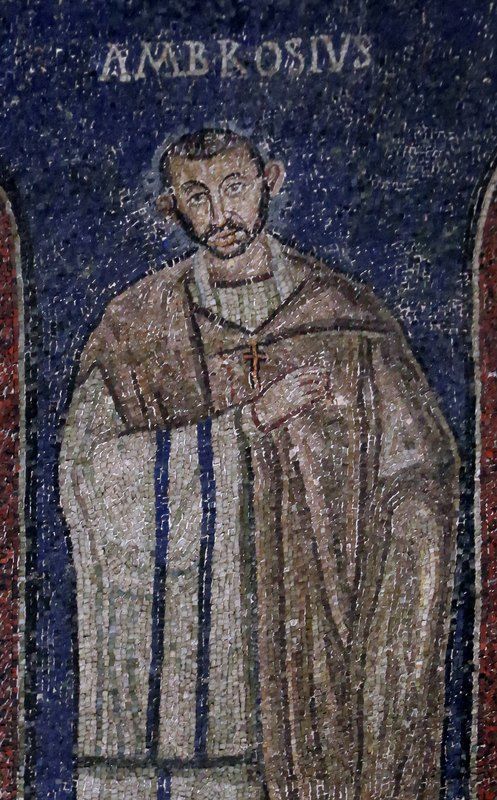
  <figcaption>Ambrose, mosaic, late fifth century. Milan, Sant'Ambrogio, chapel of San Vittore in Ciel d'Oro. Photo: Sailko, <a href="https://creativecommons.org/licenses/by/3.0/">CC BY 3.0</a>, via Wikimedia Commons.</figcaption>
</figure>

The oldest surviving image of Ambrose is in the small chapel of San Vittore in Ciel d'Oro, attached to the basilica. The chapel was the burial place of the martyr Victor, and Ambrose buried his brother Satyrus there, beside the martyr, around 378.

The chapel's mosaics are usually dated to the second half of the fifth century, two or three generations after Ambrose's death. The dome shows the martyr Victor in a golden sky, from which the chapel takes its name; on the walls below stand six Milanese saints, three on each side.

Ambrose stands between Gervasius and Protasius, the martyrs he had discovered; on the opposite wall are Nabor, Felix and Maternus. The inscription above his head reads simply AMBROSIUS, without the title of saint, and he carries none of the attributes later artists would give him.

He is shown as a man of middle age, with short dark hair, a short beard and moustache. The face is not idealised: the eyes are set at slightly different heights, and the features have an individuality unusual in the saints of the period.

For this reason the mosaic has often been taken as a likeness, close in time to people who had seen Ambrose. The claim cannot be proved, but the portrait is at least the earliest witness to how the church of Milan remembered its bishop.

He wears the dress of a late-antique cleric, not of a medieval bishop: a long white tunic with two dark stripes and a brown mantle, with a small cross hanging at his breast. There is no mitre, no crosier and no pallium.

The figure stands frontally on a dark blue ground, between red bands. The tesserae are set loosely, with visible gaps, and the modelling of the face is done with a few lines of darker stone.

Later images of Ambrose kept the beard and the frontal pose of this mosaic, but changed everything else. By the twelfth century he wore the full vestments of a bishop; by the fourteenth he carried the scourge that made him the warrior saint of Milan.

## The Golden Altar of Wolvinius

<figure>
  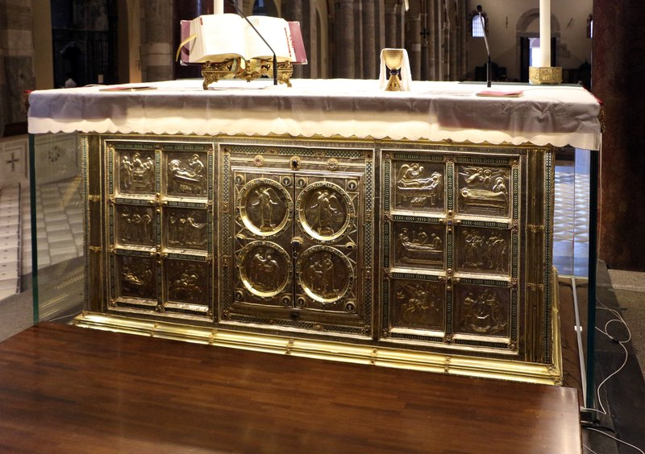
  <figcaption>Wolvinius, golden altar, back, 824–859, silver gilt, gold, enamels and gems. Milan, Sant'Ambrogio. Photo: Sailko, <a href="https://creativecommons.org/licenses/by/3.0/">CC BY 3.0</a>, via Wikimedia Commons.</figcaption>
</figure>

The golden altar of Sant'Ambrogio is the most important work of Carolingian goldsmithing in Italy. It was commissioned by Angilbert II, archbishop of Milan from 824 to 859, for the high altar of the basilica, above the tomb of Ambrose and the two martyrs.

The altar is a wooden chest covered on all four sides with plates of precious metal. The front, towards the nave, is of gold, with Christ in glory among the symbols of the evangelists and the apostles, and twelve scenes from the life of Christ. The short sides show saints and angels. The back, towards the apse and the clergy, is of silver gilt and is devoted to Ambrose.

In the centre of the back a pair of small doors, the *fenestella*, opened onto the tomb below. On either side, two panels of six reliefs each narrate the life of Ambrose in twelve scenes. The whole is framed by bands of cloisonné enamel in green, blue, white and red, and studded with gems.

A Latin inscription running round the altar celebrates the treasure of gold and gems, and declares that the relics within are more precious than all the metal. The work is signed on the back, in the medallion of the doors: Wolvinius, *magister phaber*, master smith.

The Lombard regional catalogue, following the literature, distinguishes two groups of masters. The back, with its firm contours, solid figures and empty spaces around them, is given to Wolvinius himself; the front, with figures blending into landscape and architecture, to other masters closer to Byzantine art and manuscript painting.

Wolvinius's name is Germanic, and the Lombard catalogue calls him a German master. The signature, unusual in the ninth century, makes him one of the very few early medieval artists known by name.

The altar has kept its form since the ninth century, with repairs. It was restored in 1982–1983 by the Soprintendenza of Milan and placed in a glass case designed by the architect Caccia Dominioni, which keeps it permanently visible and lit.

Its historiography runs from the studies of S. Tatum (1944) and of Carlo Bascapè to the monographs of Carlo Capponi (1996) and Sandrina Bandera (2006), and to [Carlo Bertelli](/scholars.html#bertelli-carlo)'s essays on the basilica (1995) and on the altar (2012).

## The Doors of the Fenestella

<figure>
  
  <figcaption>Wolvinius, golden altar, the doors of the fenestella: the archangels Michael and Gabriel; Ambrose crowning Angilbert and Wolvinius. Milan, Sant'Ambrogio. Photo: Sailko, <a href="https://creativecommons.org/licenses/by/3.0/">CC BY 3.0</a>, via Wikimedia Commons.</figcaption>
</figure>

The doors at the centre of the back carry four medallions. In the upper two stand the archangels Michael and Gabriel, named by inscriptions, with their hands opened towards the viewer as if guarding the opening below.

In the lower medallions Ambrose appears twice, larger than the figures before him. On the left he places a crown on the head of Archbishop Angilbert, who holds a model of the altar in his hands; the inscription names him as *domnus Angilbertus*.

On the right Ambrose crowns Wolvinius, who bows before him. The inscription gives the artist's name and his title, *magister phaber*. The patron and the maker are both received by the saint, who rewards them for the gift.

The pairing is exceptional. Donor images were common in the early Middle Ages; an image of the artist beside the donor, crowned by the saint himself, is almost unique. It has been called one of the first self-portraits of medieval art, though nothing guarantees that the features are Wolvinius's own.

Ambrose has the round halo given also to the archangels; Angilbert and Wolvinius, living men, have none. The scale makes the same distinction: the saint stands upright and towers over the archbishop and the smith, who bow to receive his crown.

The doors gave access to the tomb of Ambrose and the martyrs. Pilgrims and clergy could reach the relics through them, and the medallions framed that contact: the archangels guarding, the saint receiving the gifts of his church.

Small enamel busts sit in the corners of the doors, and the frames are set with gems and filigree. The enamel bands, with their repeated leaf motif, run across the whole back and bind the scenes together.

The central doors divide the back into two halves, each with six scenes. The life of Ambrose is thus arranged around his tomb, and the narrative ends, in the scenes of his death, a few centimetres from the place where his body lay.

## The Life of Ambrose on the Golden Altar: Youth and Election

<figure>
  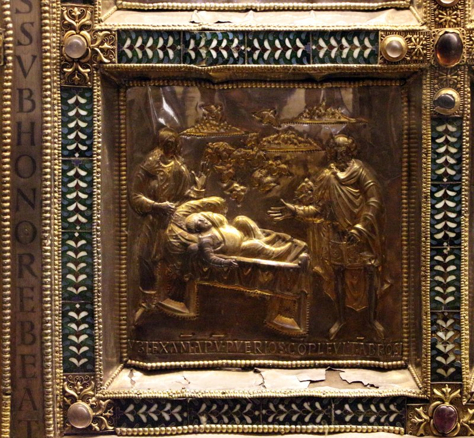
  <figcaption>Wolvinius, golden altar, the miracle of the bees. Milan, Sant'Ambrogio. Photo: Sailko, <a href="https://creativecommons.org/licenses/by/3.0/">CC BY 3.0</a>, via Wikimedia Commons.</figcaption>
</figure>

The twelve scenes follow the *Vita* of Paulinus closely, with one exception. Each carries a Latin inscription beginning *Ubi*, "where", in the manner of a caption: here Ambrose is ordained, here he preaches, here he dies.

The first scene is the miracle of the bees. Paulinus tells that when Ambrose was an infant, sleeping in his cradle in the courtyard of the praetorium, a swarm of bees settled on his face and went in and out of his mouth. His father, walking with his wife and daughter, forbade the nurse to drive them away, and the bees flew up so high they could no longer be seen. The father said: if this child lives, he will be something great.

The relief shows the cradle between the mother and the father, who brings a small child with him; the bees cover the space above, with three hives at the top. The inscription reads UBI EXAMEN APUM PUERI OS COMPLEVIT AMBROSI, "where a swarm of bees filled the mouth of the boy Ambrose".

The bees promised the honeyed eloquence of the future preacher, and they became one of Ambrose's attributes, especially the beehive in later images. The scene was also an image of election: like the infant prophets of the Bible, Ambrose was marked from the cradle.

<figure>
  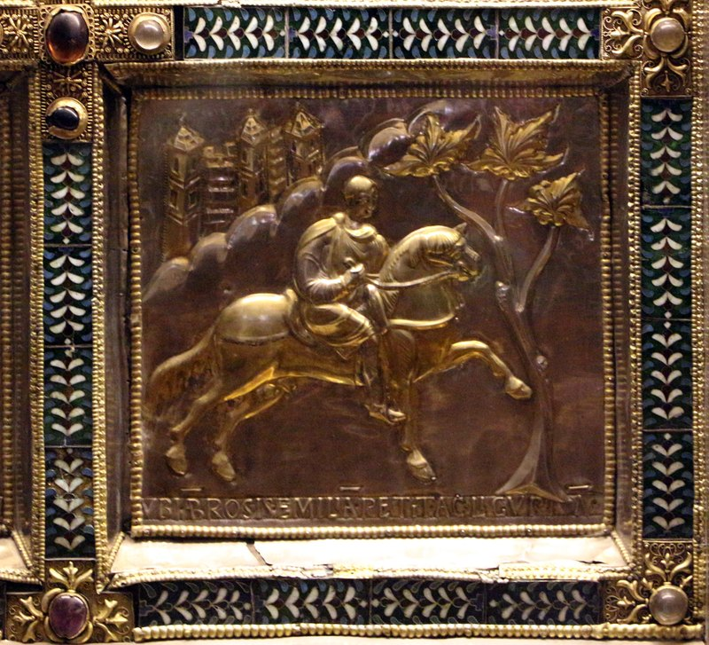
  <figcaption>Wolvinius, golden altar, Ambrose leaves for Aemilia and Liguria. Milan, Sant'Ambrogio. Photo: Sailko, <a href="https://creativecommons.org/licenses/by/3.0/">CC BY 3.0</a>, via Wikimedia Commons.</figcaption>
</figure>

The second scene shows Ambrose as a young official, riding out of a walled city towards his province. The inscription names Aemilia and Liguria, the province he governed from Milan. He rides bareheaded, in a short tunic and cloak, without a halo: he is not yet a saint. The young Ambrose of these first scenes is beardless and wears lay dress. The altar shows a career that begins in the world, at the service of the emperor, and is turned towards the Church by signs he cannot resist: the bees in the cradle, the Spirit on the road.

<figure>
  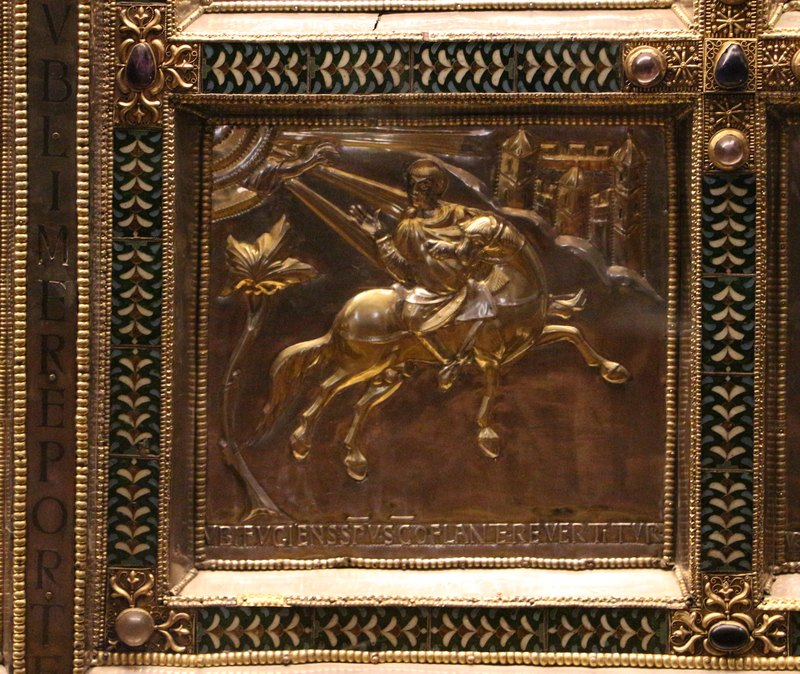
  <figcaption>Wolvinius, golden altar, Ambrose, fleeing, is turned back by the Spirit. Milan, Sant'Ambrogio. Photo: Sailko, <a href="https://creativecommons.org/licenses/by/3.0/">CC BY 3.0</a>, via Wikimedia Commons.</figcaption>
</figure>

The third scene illustrates Ambrose's flight after his election. Paulinus tells that he left Milan at night, meaning to go to Pavia, and at dawn found himself at the Porta Romana of Milan. The relief shows him turning back on his horse towards the city, while the hand of God, from a radiant arc, blows upon him. The inscription speaks of the fugitive returned by the breath of the Spirit.

<figure>
  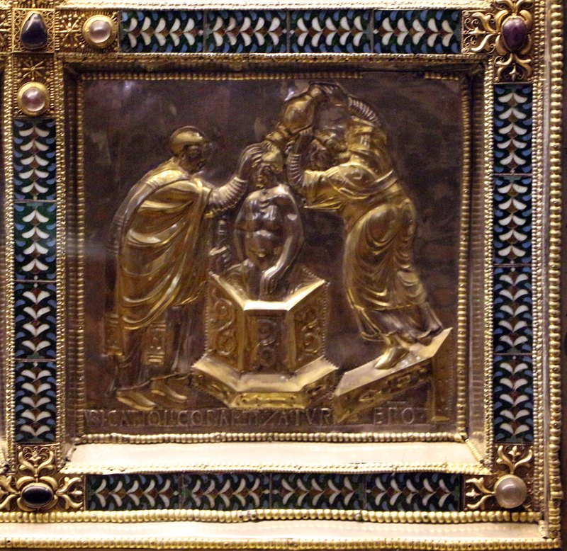
  <figcaption>Wolvinius, golden altar, the baptism of Ambrose. Milan, Sant'Ambrogio. Photo: Sailko, <a href="https://creativecommons.org/licenses/by/3.0/">CC BY 3.0</a>, via Wikimedia Commons.</figcaption>
</figure>

The fourth scene is his baptism. Ambrose stands naked in a hexagonal font, and a bearded bishop pours water over his head while a cleric lays his hand on him. The inscription stresses that he was baptised by a catholic bishop: Paulinus records that Ambrose insisted on it, so that no Arian should have a part in his baptism.

The baptism closes the first half of the narrative. In four scenes the altar has shown the infant marked by God, the official on his way to his province, the reluctant bishop-elect returned by force to Milan, and the catechumen made a Christian by an orthodox hand. Every scene prepares the ordination that follows.

## The Life of Ambrose on the Golden Altar: Bishop and Preacher

<figure>
  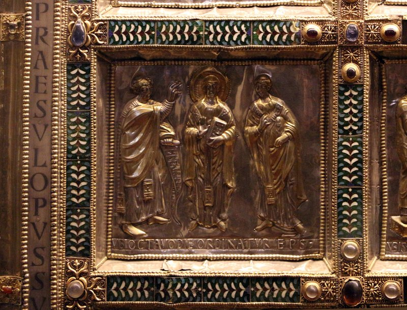
  <figcaption>Wolvinius, golden altar, Ambrose ordained bishop on the eighth day. Milan, Sant'Ambrogio. Photo: Sailko, <a href="https://creativecommons.org/licenses/by/3.0/">CC BY 3.0</a>, via Wikimedia Commons.</figcaption>
</figure>

The fifth scene shows the ordination. Ambrose, now with a halo, stands frontally with a book, between a bishop who blesses him and a cleric. The inscription reads UBI OCTAVO DIE ORDINATUR EPISCOPUS, "where on the eighth day he is ordained bishop", following Paulinus's account of the rapid passage from baptism to the episcopate.

The scene is the axis of the narrative. Before it, Ambrose is a layman marked by signs; after it, he is the bishop whose acts and miracles fill the remaining scenes. The halo appears with the ordination, and stays with him to the end.

<figure>
  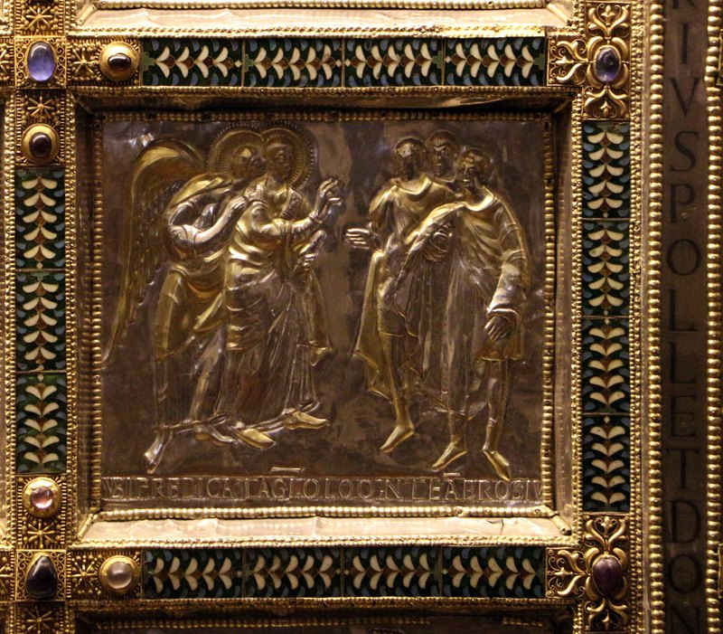
  <figcaption>Wolvinius, golden altar, Ambrose preaching, inspired by an angel. Milan, Sant'Ambrogio. Photo: Sailko, <a href="https://creativecommons.org/licenses/by/3.0/">CC BY 3.0</a>, via Wikimedia Commons.</figcaption>
</figure>

The sixth scene shows Ambrose preaching while an angel speaks into his ear. Paulinus tells that an Arian, hostile to Ambrose, saw an angel whispering to him as he preached, and was converted. The relief puts the angel close behind the bishop, and the listeners at the right, one of whom points to him. The inscription reads UBI PREDICAT ANGELO LOQUENTE AMBROSIUS.

The scene is the image of Ambrose as teacher: his words are not his own, but inspired. It is the forerunner of the Doctor of the Church of later art, though here he holds no book and wears no mitre.

The angel also answers the accusation of the Arians. The inspiration of Ambrose's preaching, shown to an enemy who was converted by it, proves the truth of the Nicene faith he defended: the scene is a theological argument in the form of a miracle.

<figure>
  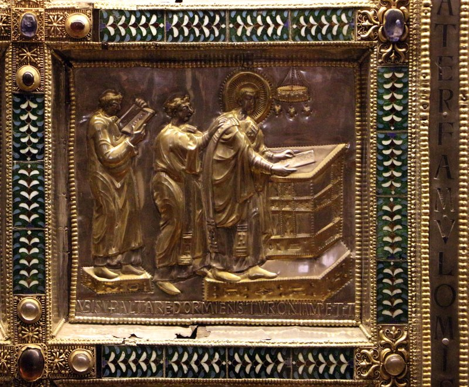
  <figcaption>Wolvinius, golden altar, Ambrose falls asleep at the altar and goes to Tours. Milan, Sant'Ambrogio. Photo: Sailko, <a href="https://creativecommons.org/licenses/by/3.0/">CC BY 3.0</a>, via Wikimedia Commons.</figcaption>
</figure>

<figure>
  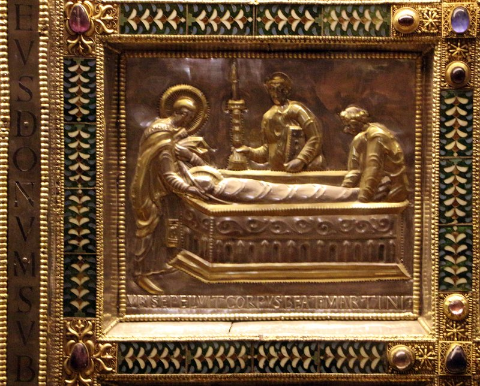
  <figcaption>Wolvinius, golden altar, Ambrose buries Saint Martin. Milan, Sant'Ambrogio. Photo: Sailko, <a href="https://creativecommons.org/licenses/by/3.0/">CC BY 3.0</a>, via Wikimedia Commons.</figcaption>
</figure>

The seventh and eighth scenes form a pair, and they do not come from Paulinus. They tell the legend of Ambrose at the funeral of Martin of Tours, first recorded by Gregory of Tours in the late sixth century. During mass, Ambrose fell asleep at the altar; the clergy waited, then woke him, and he told them that he had been at Tours, burying his brother Martin.

In the first relief Ambrose stands at the altar with his eyes closed, his hand on the book, while a cleric touches his shoulder to wake him: UBI SUPER ALTARE DORMIENS TURONIAM PETIT, "where, sleeping at the altar, he goes to Tours". In the second he lays the body of Martin in the tomb: UBI SEPELIVIT CORPUS BEATI MARTINI.

The legend is impossible in time: Martin died in November 397, seven months after Ambrose. Its presence on the altar shows how widely it had spread by the ninth century, and how the church of Milan welcomed a story that joined its bishop to the most venerated saint of Gaul. The two scenes also link the altar to the apse above it. The same legend appears at the two ends of the apse mosaic, so that clergy serving at the altar saw it twice: in silver gilt before them and in mosaic above.

## The Life of Ambrose on the Golden Altar: Miracles and Death

<figure>
  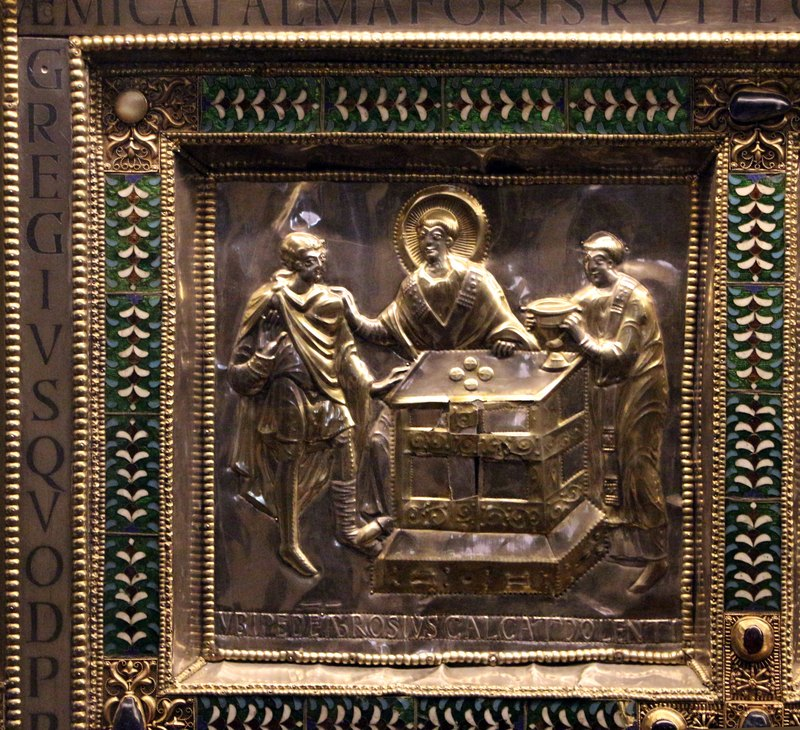
  <figcaption>Wolvinius, golden altar, Ambrose heals Nicentius by treading on his foot. Milan, Sant'Ambrogio. Photo: Sailko, <a href="https://creativecommons.org/licenses/by/3.0/">CC BY 3.0</a>, via Wikimedia Commons.</figcaption>
</figure>

The ninth scene illustrates one of the more curious miracles of the *Vita*. Paulinus tells of Nicentius, a former tribune and notary who suffered so badly in his feet that he rarely appeared in public. Coming to the altar to receive communion, he had his foot trodden on by Ambrose and cried out in pain; from then on, he was healed.

The relief shows the moment at the altar, with the hosts laid on it: Ambrose steps on the foot of Nicentius, who raises his hand in pain, while a cleric holds the chalice. The inscription reads UBI PEDE AMBROSIUS CALCAT DOLENTI, "where Ambrose treads with his foot on the sufferer".

The choice of this miracle is telling. It takes place at the altar, during the liturgy, and its setting is the same altar at which the clergy of Sant'Ambrogio stood before the relief. The healing power of the saint is located in the eucharist and in the place of his tomb.

<figure>
  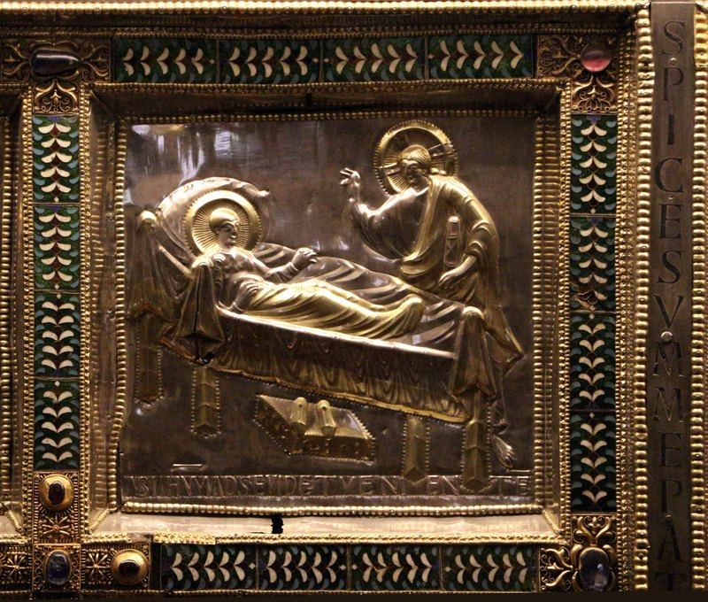
  <figcaption>Wolvinius, golden altar, Christ comes to the dying Ambrose. Milan, Sant'Ambrogio. Photo: Sailko, <a href="https://creativecommons.org/licenses/by/3.0/">CC BY 3.0</a>, via Wikimedia Commons.</figcaption>
</figure>

The last three scenes tell of his death. In the tenth, Ambrose lies in bed and Christ stands beside him. Paulinus reports that Bassianus, bishop of Lodi, praying with Ambrose in his last days, saw the Lord Jesus coming to him and smiling at him; a few days later Ambrose died.

<figure>
  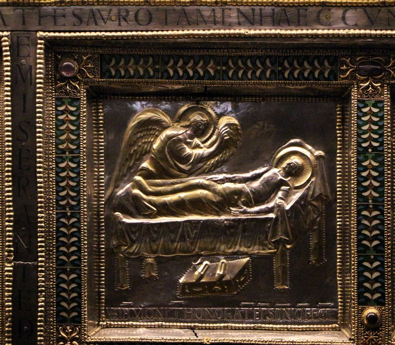
  <figcaption>Wolvinius, golden altar, an angel wakes Honoratus of Vercelli. Milan, Sant'Ambrogio. Photo: Sailko, <a href="https://creativecommons.org/licenses/by/3.0/">CC BY 3.0</a>, via Wikimedia Commons.</figcaption>
</figure>

In the eleventh, an angel bends over a sleeping bishop. Paulinus tells that Honoratus, bishop of Vercelli, resting in an upper room of the house, heard three times a voice saying: get up, hurry, he is about to depart. He came down and gave Ambrose the body of the Lord, and Ambrose died. The relief turns the voice into an angel; the inscription names Honoratus and the viaticum.

<figure>
  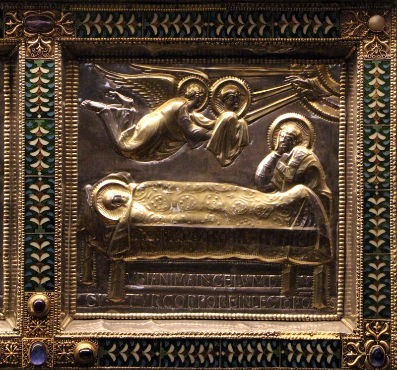
  <figcaption>Wolvinius, golden altar, the soul of Ambrose carried to heaven. Milan, Sant'Ambrogio. Photo: Sailko, <a href="https://creativecommons.org/licenses/by/3.0/">CC BY 3.0</a>, via Wikimedia Commons.</figcaption>
</figure>

The last scene shows the death itself. Ambrose lies under a rich coverlet; above, an angel carries his soul, a small haloed figure, towards the hand of God; at the foot of the bed a bearded saint rests his head on his hand in grief. The inscription reads UBI ANIMA IN CELUM DUCITUR CORPORE IN LECTO POSITO, "where the soul is carried to heaven, the body lying in the bed".

The cycle is thus built of two halves: election and ministry on one side, miracles and death on the other. Each scene has two or three figures, clearly set against an empty ground, with simple props: a bed, an altar, a font, a horse. The clarity of the compositions, readable at a distance by the clergy who served at the altar, is the mark of Wolvinius's style.

The narrative ends with the soul carried to heaven, beside the doors that opened onto the tomb. The body that the last scene shows lying in bed was the body that lay beneath the altar, and the cycle led the viewer from the story of the saint to his relics.

## The Apse Mosaic

<figure>
  
  <figcaption>Apse mosaic with Christ enthroned between Saints Protasius and Gervasius and scenes of Ambrose at Tours and Milan. Milan, Sant'Ambrogio. Photo: Dominik Matus, <a href="https://creativecommons.org/licenses/by-sa/4.0/">CC BY-SA 4.0</a>, via Wikimedia Commons.</figcaption>
</figure>

The apse of the basilica is covered with a large mosaic of Christ enthroned. He sits on a jewelled throne, blessing, with an open book inscribed EGO SUM LUX MUNDI, "I am the light of the world". The archangels Michael and Gabriel fly towards him, and the two martyrs of the basilica, Protasius and Gervasius, stand at his sides.

Below the throne three medallions show Ambrose's family and the saints of his house: his sister Marcellina, his brother Satyrus and Saint Candida. The inscription below begins CONDIDIT AMBROSIUS TEMPLUM, recalling that Ambrose founded the church, in which the sacred relics of the martyrs lie.

At the two ends of the apse, set in elaborate buildings, are the two scenes of the legend of Tours. At the left, in the city labelled as Tours, Ambrose takes part in the burial of Martin. At the right, in Milan, he stands at the altar, his cheek resting on his hand, falling asleep. The legend shown on the golden altar thus reappears at the scale of the apse.

The history of the mosaic is complicated. The Lombard regional catalogue summarises it in several phases. The composition may go back to the time of Ambrose, and was remade in the Carolingian period, from which some architectural details of the side scenes survive. Fragments of Ambrose's face resembling Saint Peter have been read as a statement of Archbishop Anspert (868–881), presenting Ambrose as a second Peter.

The building was damaged by subsidence between 1190 and 1198, and the mosaic was partly remade, probably early in the thirteenth century; the form of the throne and the presence of Saint Candida, whose cult spread from the eleventh century, belong to this phase. The figure of Satyrus was reworked again in the fourteenth century.

The mosaic was heavily restored in the nineteenth century, when the lower band of inscriptions was entirely redone. In 1943 a bomb destroyed a large area, including the figure of Christ, part of the throne and the left-hand angel. It was rebuilt after the war following the earlier iconography; a thin red line separates the surviving original parts from the restorations.

What the visitor sees today is therefore a reconstruction in which medieval and modern work cannot be separated by eye. The iconography is old; much of the surface is not. The mosaic is nonetheless the only monumental image of Ambrose's legend in the basilica that holds his body.

Its message joins the three themes of the cult of Ambrose: the martyrs he discovered, the family that shared his holiness, and the bishop whose miraculous presence at Tours placed Milan beside the great sanctuaries of Gaul. The literature on the mosaic includes the studies of Ferdinando Reggiori (1945, 1956, 1966) and Carlo Capponi (1997), and [Carlo Bertelli](/scholars.html#bertelli-carlo)'s chapter in the volume on the basilica (1995).

## Ambrose with the Scourge

In the high Middle Ages Ambrose became the symbol of the city of Milan, and the image of the bishop changed with it. The first step is the relief from the Porta Romana, carved in 1171, when the Milanese rebuilt their walls after the destruction of the city by Frederick Barbarossa. It is discussed on the site's page on [Anselmo](/Content/Artists/XII-c/Anselmo.html).

The relief shows Ambrose, in mitre and vestments, preceded by a cleric with a processional cross, driving out a line of eighteen men, women and children identified as Arians. He raises a whip against the last of them. The scene recalls the conflict of 385–386, but it was carved for a city that had just driven out an emperor: the Arians of the fourth century stood for the enemies of the twelfth.

The commune made Ambrose its emblem on its coins as well. From the middle of the thirteenth century Milan struck a silver *grosso*, the *ambrosino*, recorded in a document of Cremona of 30 March 1256. It shows the saint enthroned, with halo and crosier, blessing. Under Henry VII (1310–1313) Gervasius and Protasius appeared beside him, until the time of Giovanni Visconti; thereafter Ambrose stood alone, as Mario Limido has shown in his study of the saint on Milanese coins.

The decisive change came in 1339. On 21 February the troops of Azzone Visconti, led by his uncle Luchino, defeated at Parabiago the Company of Saint George of another uncle, Lodrisio. The Lombard chronicles tell that Ambrose appeared above the battle on horseback, dressed in white, scourging Lodrisio's soldiers. The day was commemorated with a mass and a procession from Milan to Parabiago until Charles Borromeo suspended it.

The scourge entered the official image of the saint soon after. On the coins of Bernabò and Galeazzo II Visconti (1355–1378), Ambrose holds the crosier in his left hand and a scourge in his right. Limido reads it as a warning more than a weapon: the patron saint as protector of the city and of its lords against their enemies.

<figure>
  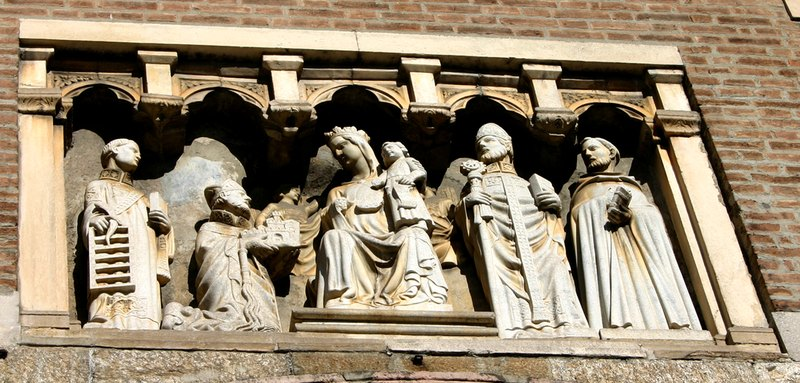
  <figcaption>Workshop of Giovanni di Balduccio, Madonna and Child with Saints Lawrence, Ambrose, Eustorgius and Peter Martyr, c. 1336–1338, marble copies of the originals now in the Castello Sforzesco. Milan, Porta Ticinese. Photo: Giovanni Dall'Orto, <a href="https://commons.wikimedia.org/wiki/Template:Attribution">attribution licence</a>, via Wikimedia Commons.</figcaption>
</figure>

The Visconti also placed the saint on the gates of their new walls. After Azzone rebuilt the walls of Milan around 1329, tabernacles with statues of the Virgin and the patron saints of each quarter were set over the gates. The series was designed by the Pisan sculptor [Giovanni di Balduccio](/Content/Artists/XIV-c/Giovanni-di-Balduccio.html), working in Milan on the Arca of Saint Peter Martyr in Sant'Eustorgio, and executed largely by his workshop.

On the Porta Ticinese, Ambrose kneels before the Virgin and offers her the model of the quarter, between Lawrence, with his gridiron, and the bishop Eustorgius; Peter Martyr closes the row. On the tabernacle of the Porta Orientale, now in the Castello Sforzesco, he kneels again, with Babila, Benedict and Dionysius. The originals of the Porta Ticinese statues are also in the Castello; those on the gate are copies.

<figure>
  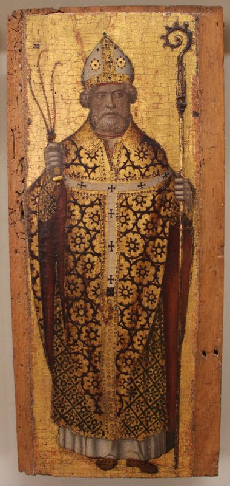
  <figcaption>Carlo Braccesco, Saint Ambrose, from the Four Doctors of the Church, 1480–1499, tempera and gold on panel, 44 × 15 cm. Venice, Ca' d'Oro, Galleria Giorgio Franchetti. Photo: Sailko, <a href="https://creativecommons.org/licenses/by-sa/3.0/">CC BY-SA 3.0</a>, via Wikimedia Commons.</figcaption>
</figure>

By the end of the Middle Ages the scourge had become Ambrose's standard attribute, even outside Milan. A small panel by Carlo Braccesco, one of four with the Latin Doctors of the Church, shows him in mitre and gold cope with the crosier in one hand and the scourge, with three thongs, in the other. The series was published by [Federico Zeri](/scholars.html#zeri-federico) in 1955. Braccesco worked in Liguria and Lombardy in the last quarter of the fifteenth century, beyond the period of this site; the panel is shown here as the end point of the image that began at the Porta Romana. The scourge, a medieval invention, became the sign by which every viewer recognised the bishop of Milan.

## Catalogue Entry

**Name:** Aurelius Ambrosius; Saint Ambrose of Milan; Sant'Ambrogio.

**Dates:** Born c. 339/340, probably at Trier; governor of Aemilia and Liguria c. 370; bishop of Milan from 7 December 374; died at Milan on 4 April 397.

**Sources:** Ambrose's own works, especially the letters; Augustine, *Confessions*; Paulinus of Milan, *Vita Ambrosii* (c. 422); for the Tours legend, Gregory of Tours.

**Cult:** Buried in the Basilica Martyrum, today Sant'Ambrogio, beside Gervasius and Protasius. Patron saint of Milan; one of the four Latin Doctors of the Church. Feasts on 7 December and 4 April.

**Attributes:** Episcopal vestments, mitre and crosier; book; bees or beehive; from the fourteenth century, the scourge.

**Principal images (VII–XIV centuries and before):**

- Mosaic portrait, late fifth century, Sant'Ambrogio, chapel of San Vittore in Ciel d'Oro.
- Golden altar, by Wolvinius and other masters, for Archbishop Angilbert II (824–859): twelve scenes of the life of Ambrose on the back; Ambrose crowning Angilbert and Wolvinius on the doors of the fenestella.
- Apse mosaic of Sant'Ambrogio: Christ between Gervasius and Protasius, with Ambrose at Tours and at Milan; several phases from the Carolingian period to the thirteenth century; destroyed in part in 1943 and rebuilt.
- Anselmus, Ambrose driving out the Arians, Porta Romana, 1171 (Castello Sforzesco).
- Milanese coins: the *ambrosino* (c. 1250–1310), the coins of Henry VII with Gervasius and Protasius, and the coins of Bernabò and Galeazzo II Visconti (1355–1378) with the scourge.
- Tabernacles of the gates of Milan by the workshop of Giovanni di Balduccio, 1330s–1350s (Porta Ticinese, Porta Orientale; Castello Sforzesco).

**Bibliography:** Paulinus of Milan, *Vita Ambrosii*; S. Tatum, "The Paliotto of Sant'Ambrogio in Milan", *Art Bulletin* 26, 1944; F. Reggiori, *La basilica di Sant'Ambrogio*, 1945 and 1966; N. B. McLynn, *Ambrose of Milan: Church and Court in a Christian Capital*, 1994; C. Bertelli (ed.), *La basilica di S. Ambrogio: il tempio ininterrotto*, 1995; C. Capponi, *L'altare d'oro di Sant'Ambrogio*, 1996; C. Capponi, *Il mosaico di Sant'Ambrogio*, 1997; B. Ramsey, *Ambrose*, 1997; S. Bandera, *L'altare d'oro di Sant'Ambrogio*, 2006; A. Cameron, *The Last Pagans of Rome*, 2011; C. Bertelli, "L'Altare di Volvinio", *Rivista dell'Istituto per la Storia dell'Arte Lombarda* 5, 2012; M. Limido, "Sant'Ambrogio guerriero"; Lombardia Beni Culturali, catalogue entries for the golden altar (3o210-01285), the apse mosaic (3o210-01283) and the tabernacle of the Porta Orientale (RL480-00013).
