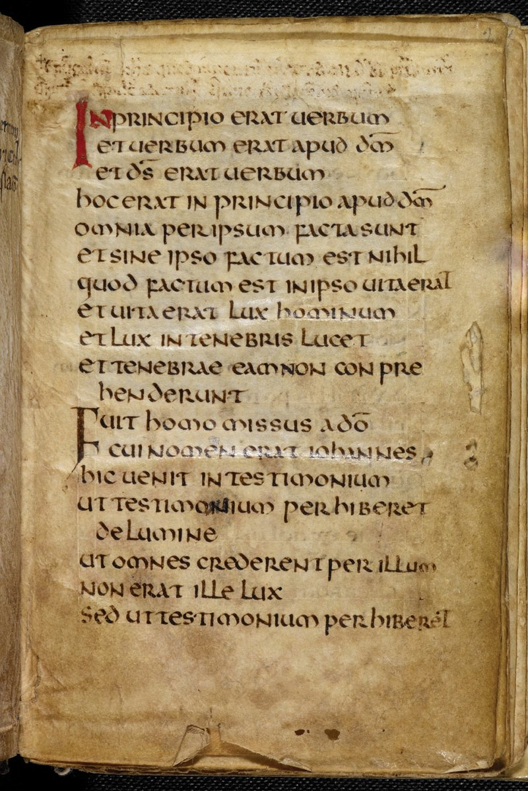
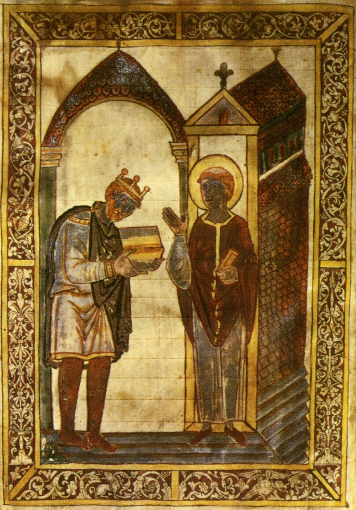
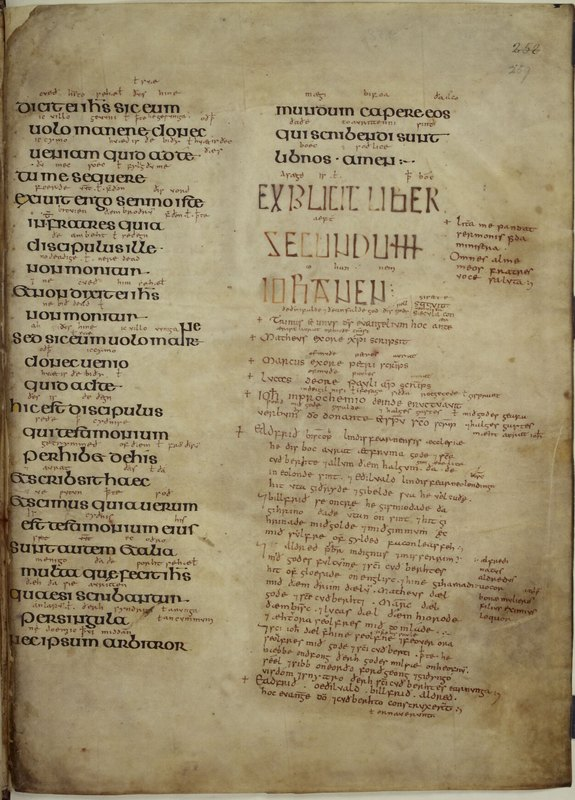
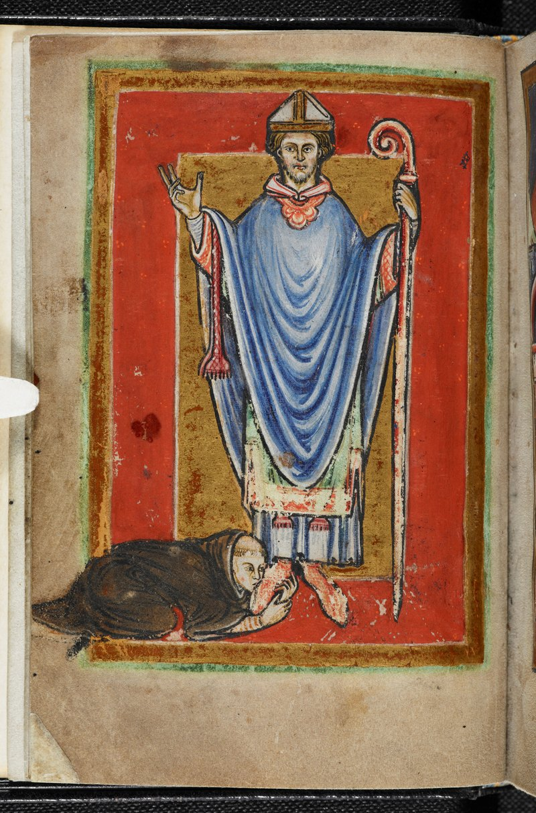
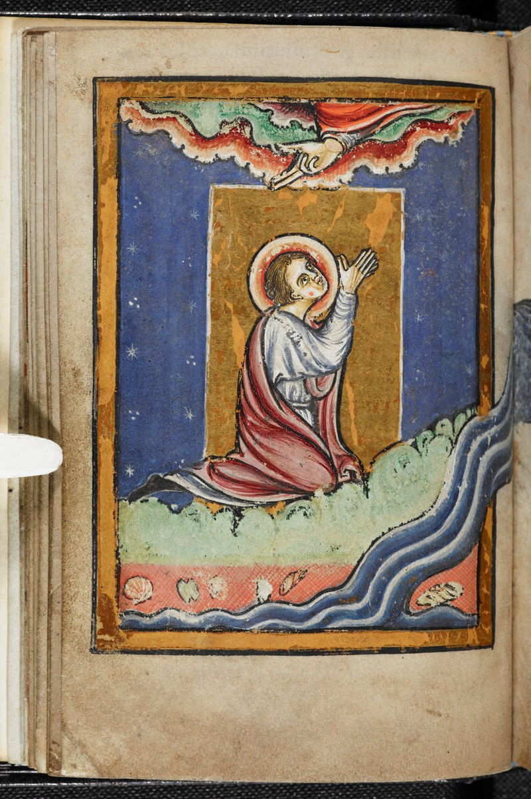
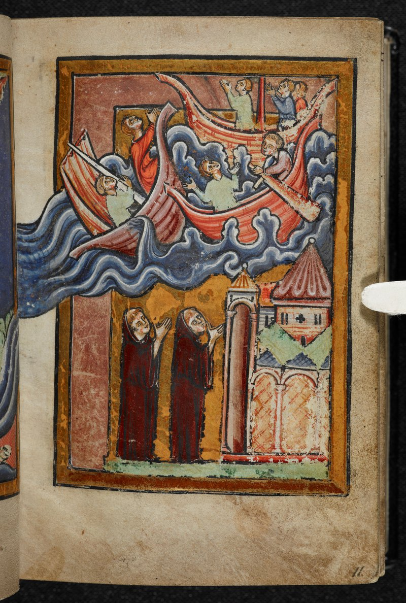
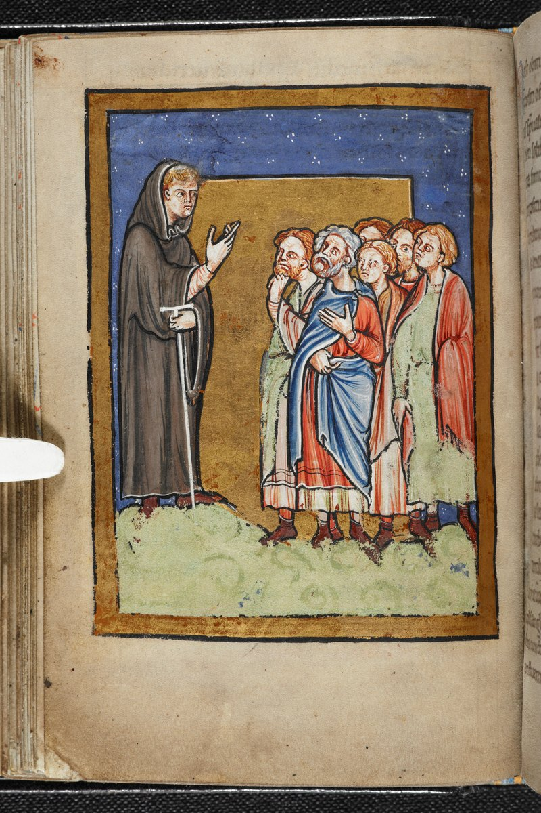
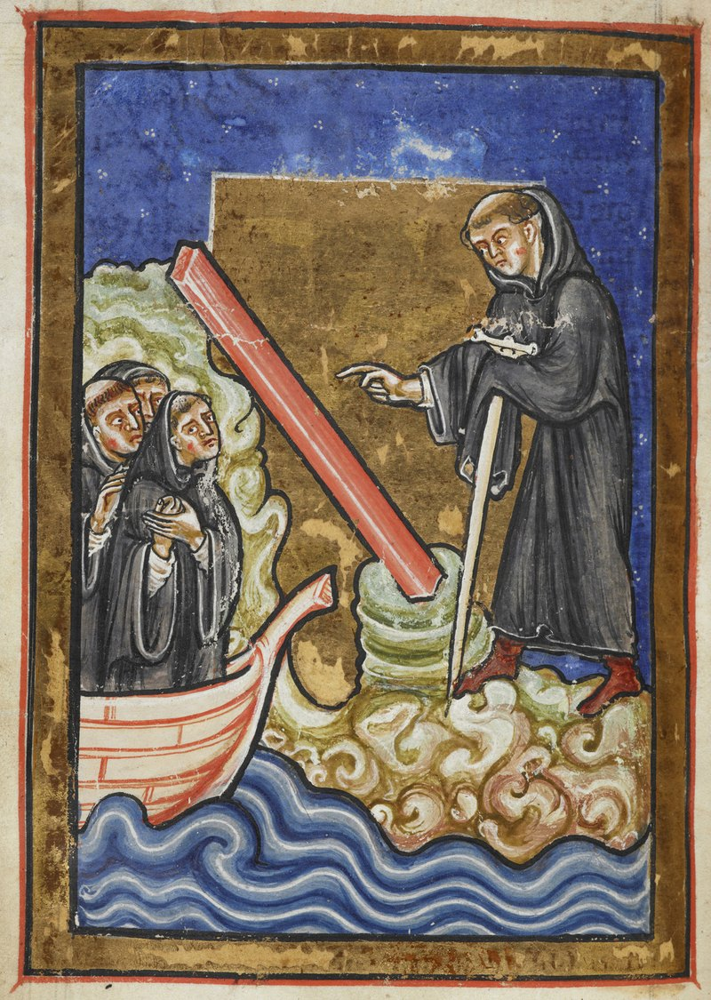
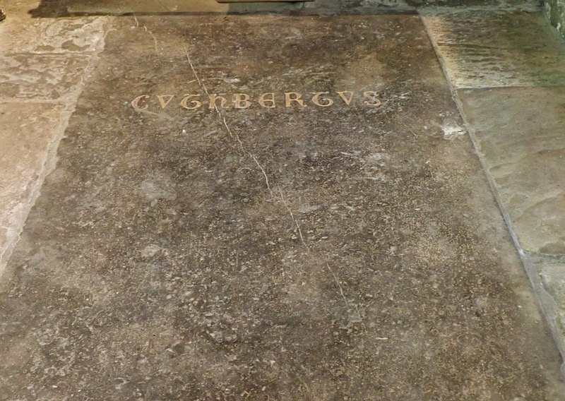
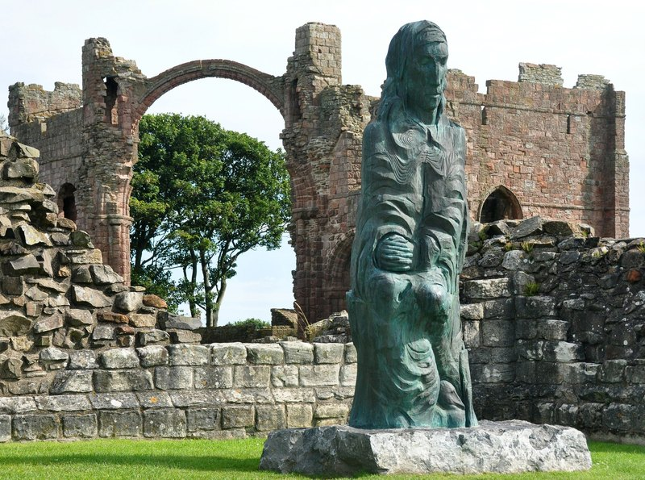

## The Monk and Bishop of Lindisfarne

*Saint Cuthbert* was born about 634 in Northumbria, the Anglian kingdom that stretched from the Humber to the Firth of Forth. His family is not named in any early source. The anonymous Life written at Lindisfarne shows him as a boy keeping sheep in the hills near the Leader Water, a tributary of the Tweed, not far from the monastery of Melrose.

In 651, watching the flocks at night, he saw a stream of light and angels carrying a soul to heaven. He learnt the next day that Aidan, the Irish bishop of Lindisfarne, had died that night. The vision decided his life: he went to Melrose and asked to be received as a monk.

Melrose was a daughter house of Lindisfarne, and Lindisfarne a daughter house of Iona, founded by Aidan in 635 at the invitation of King Oswald. Cuthbert was therefore trained in the Irish monastic tradition of Columba. His teacher was the prior Boisil, and the abbot was Eata, one of the twelve English boys Aidan had trained himself.

About 660 he went with Eata to found a new monastery at Ripon, where he served as guest-master. The foundation did not last: the sub-king Alhfrith gave Ripon to Wilfrid, who followed the Roman customs, and the monks from Melrose went home rather than change. In 664 Boisil died of the plague, and Cuthbert succeeded him as prior.

The same year the synod of Whitby decided for the Roman date of Easter. Lindisfarne accepted the decision; its Irish bishop Colman did not, and left. Eata became abbot of Lindisfarne and brought Cuthbert there as prior, to teach the new rule to a community divided by the change. Bede says he won them over by patience, leaving the chapter meeting when the arguments grew hot and coming back the next day to say the same things again.

In 676 he withdrew as a hermit to Inner Farne, a small island off the coast of Bamburgh. He built a cell inside a ring of stone and earth so high that he could see only the sky, with a guest-house by the landing place. There he lived for nine years, growing barley, praying, and receiving the visitors who crossed the sea to ask his advice.

In 684 a synod at Twyford, in the presence of King Ecgfrith and Archbishop Theodore, elected him bishop. He refused until the king himself came to Farne with the bishop Trumwine to bring him back. He was consecrated at York at Easter 685, first for Hexham, then by exchange with Eata for Lindisfarne. For two years he travelled through his diocese, preaching, confirming and healing.

At Christmas 686 he resigned and went back to Farne. He fell ill in February, and died there in the night of 20 March 687, in the presence of a few brothers, who signalled his death to Lindisfarne with two torches. His body was carried by boat to Holy Island and buried in a stone coffin on the right side of the altar of the church.

## The Sources: The Anonymous Life, Bede and the Historia

Cuthbert is known through three Lives written within forty years of his death. The first is the anonymous Life, composed by a monk of Lindisfarne between about 699 and 705. Its author had spoken with people who knew the saint, and he names many of them, with the places where the miracles happened.

The second and third are by Bede, the monk of Jarrow. He wrote a Life in Latin hexameters, finished before about 716, and then a prose Life, about 721, dedicated to Bishop Eadfrith and the community of Lindisfarne. Bede followed the anonymous Life closely, but he rewrote it in a polished Latin, added episodes from witnesses still living, and sent the text to Lindisfarne to be read and corrected before he published it.

The two prose Lives were edited together by [Bertram Colgrave](/scholars.html#colgrave-bertram) in *Two Lives of Saint Cuthbert* (1940), still the standard edition. Colgrave showed how Bede shaped his model: he cut the place-names and many of the witnesses, gave more weight to Cuthbert's role as a bishop of the Roman obedience, and turned the hermit's life into a model for the monks of his own time.

The Lives are hagiography, and their purpose is to show sanctity, not to record a career. The miracles follow biblical and patristic models: Cuthbert, like Antony of Egypt and Benedict, is fed by an eagle, served by animals, and commands the wind. The facts of his life, his offices and the dates of the synods, are nonetheless confirmed by Bede's *Ecclesiastical History*, finished in 731.

The fourth source is the *Historia de sancto Cuthberto*, written by the community itself at Chester-le-Street or Durham in the tenth or eleventh century. It is less a Life than a list of the lands given to the saint by kings and nobles, interspersed with miracles that protected them. It shows how the body of Cuthbert had become the legal owner of a great estate.

The fifth group is Durham's own: the *Libellus de exordio* of Symeon, about 1105, which tells the history of the community, and the collection of miracles compiled by Reginald of Durham in the second half of the twelfth century. Reginald records the cult as pilgrims knew it, with more than a hundred and forty miracles, many at the shrine itself.

A sixth text, the *Libellus de ortu sancti Cuthberti*, was written in the twelfth century and makes Cuthbert the son of an Irish king. It has no basis in the early sources, which say nothing of his parents, and is now read as a piece of later legend.

The modern study of the cult begins with the collection of essays edited by [Gerald Bonner](/scholars.html#bonner-gerald), [David Rollason](/scholars.html#rollason-david) and Clare Stancliffe, *St Cuthbert, His Cult and His Community to AD 1200* (1989), for the thirteenth centenary of his death. It includes [Benedicta Ward](/scholars.html#ward-benedicta) on his spirituality and the studies of the coffin, the relics and the manuscripts on which this entry depends.

## The Body and the Community

Eleven years after his death, in 698, the monks of Lindisfarne opened the grave to lift the bones into a shrine above the floor of the church. They found the body whole, the joints flexible, and the vestments as fresh as on the day of burial. Bishop Eadberht ordered new vestments and had the body placed in a light wooden coffin set on the floor of the sanctuary.

The incorruption was the foundation of the cult. A saint whose body was whole was believed to be present in it, and the body of Cuthbert was treated less as a relic than as a living lord, whose property was his, whose enemies he punished and whose community he led. The anonymous Life was written in the years just after the opening, to give the new cult its story.

Lindisfarne was attacked by the Vikings on 8 June 793, the first great raid on England, which Alcuin lamented in letters from the court of Charlemagne. The community survived, but in 875, when the Danish army settled in Northumbria, Bishop Eardwulf and Abbot Eadred left the island, taking with them the coffin of Cuthbert, the head of King Oswald, the bones of Aidan and other saints, and their books.

For seven years they wandered through Northumbria and Cumbria. The Durham tradition tells that they tried to cross to Ireland and that the Lindisfarne Gospels fell into the sea, to be found unharmed on the sand at Whithorn. In the early 880s they settled at Chester-le-Street, south of the Tyne, on land given by the Danish king Guthred, whose accession Cuthbert himself had chosen in a vision to Abbot Eadred.

The community stayed at Chester-le-Street for more than a century. There the body received the gifts of the West Saxon kings who were uniting England: Æthelstan came about 934, on his way to fight the Scots, and left books, vestments and lands. Here too the priest Aldred wrote his Old English gloss in the Lindisfarne Gospels, in the third quarter of the tenth century.

In 995, under the threat of a new Danish invasion, Bishop Aldhun took the body to Ripon. On the way back the cart stopped and could not be moved, which was read as a sign that Cuthbert wished to stay. The community settled on a high, wooded loop of the river Wear, where it built a stone church: this was the beginning of Durham.

<figure>
  
  <figcaption>Durham Cathedral from the north, begun 1093; central tower of the fifteenth century. Photo: Benjamin Smith, <a href="https://creativecommons.org/licenses/by-sa/4.0/">CC BY-SA 4.0</a>, via Wikimedia Commons.</figcaption>
</figure>

In 1083 Bishop William of Saint-Calais replaced the community of married clerks with Benedictine monks, and in 1093 he began the present cathedral. On 29 August 1104 the body was translated into a new shrine behind the high altar. The coffin was opened in the presence of the monks and of a sceptical abbot, and the body was again declared incorrupt.

The shrine stood for more than four centuries, the richest in the north of England. It was destroyed by the commissioners of Henry VIII in the years of the Dissolution, about 1539 to 1542. The account in the *Rites of Durham*, written in 1593, says that they found the body still whole, and that it was buried by the monks under the site of the shrine, where it lies today.

## The Treasures of the Coffin

On 17 May 1827 the canons of Durham opened the grave under the floor of the feretory. The librarian [James Raine](/scholars.html#raine-james) described what was found in *Saint Cuthbert* (1828): several coffins one inside another, a skeleton wrapped in silk, and with it objects of gold, silver, ivory and embroidery. The grave was opened again in 1899, when the remaining fragments of the oldest coffin were removed.

The oldest coffin is the one made in 698. It is a chest of oak boards incised, not carved, with figures in outline and their names in Latin letters and in runes. On the lid is Christ with the symbols of the four evangelists; on one end the Virgin and Child, on the other the archangels Michael and Gabriel; on the long sides the twelve apostles and five archangels.

[Ernst Kitzinger](/scholars.html#kitzinger-ernst) pieced together the 169 carved fragments in 1939, then at the British Museum, and published the coffin in *The Relics of Saint Cuthbert* (1956), edited by C. F. Battiscombe. He traced its iconography to Mediterranean sources: the Virgin with the Child on her lap is the earliest surviving image of the subject in English art. The names of the evangelists in runes and in Latin letters show a community that used both scripts.

Under the vestments was a small pectoral cross of gold and garnets, about 6 cm across, broken and repaired in antiquity. It is a work of the seventh century, close to the jewellery of the Sutton Hoo treasure. It may have been Cuthbert's own cross, buried with him in 687; no source says so, and the repair shows that it was worn for a long time.

With it were found an ivory comb, a portable altar of oak covered later with a plate of silver, and fragments of silks from Byzantium and the Near East. These objects belong to different dates: the comb and the wooden altar may be of the seventh century, while the silks were added at the later openings, as gifts to the saint.

The most famous book of the coffin is the St Cuthbert Gospel, a small copy of the Gospel of John, 138 × 92 mm, in its original binding of red goatskin over boards, with a raised plant scroll on the front. It was found in the coffin at the translation of 1104. It is the oldest European book whose binding survives intact.

<figure>
  
  <figcaption>The opening of the Gospel of John, St Cuthbert Gospel, fol. 1r, Wearmouth-Jarrow, c. 710–730. London, British Library, Add MS 89000. Image: public domain, via Wikimedia Commons.</figcaption>
</figure>

The Gospel was written at Wearmouth-Jarrow, the monastery of Bede, in the same uncial script as the Codex Amiatinus. Its script is now dated to about 710–730, after Cuthbert's death; it was probably made to be placed in the coffin. It went to Stonyhurst College in 1769, and was bought by the British Library in 2012 for nine million pounds (Add MS 89000).

The embroidered stole and maniple are the finest Anglo-Saxon needlework to survive. They show prophets and saints in gold thread on silk, and carry the inscriptions *Ælfflæd fieri precepit* and *pio episcopo Friðestano*: Queen Ælfflæd had them made for Frithestan, bishop of Winchester, between 909 and 916. They were probably among the gifts Æthelstan left at Chester-le-Street, and were put in the coffin there.

## The King and the Saint

<figure>
  
  <figcaption>King Æthelstan presenting the book to Saint Cuthbert, frontispiece of Bede's Lives of Cuthbert, c. 934. Cambridge, Corpus Christi College, MS 183, fol. 1v. Image: public domain, via Wikimedia Commons.</figcaption>
</figure>

The oldest surviving image of Cuthbert is the frontispiece of a book given to his shrine by King Æthelstan. The manuscript, now in the Parker Library of Corpus Christi College, Cambridge (MS 183), contains Bede's prose and metrical Lives of the saint, a mass and office for his feast, and lists of bishops, kings and genealogies.

Æthelstan, grandson of Alfred the Great, was the first king to rule all the English. In 934 he led an army north against the Scots and stopped at Chester-le-Street to pray at the shrine. His gifts were recorded by the community: books, vestments, gold and silver vessels and lands. MS 183 is the only one of the books that was written in England during his reign, in the mid-930s.

The picture shows the king on the left, crowned, bowing his head, holding out a book with a gold cover. Cuthbert stands on the right, before a church, with a halo, a dark red chasuble and a small book in his left hand. He raises his right hand toward the king, in blessing or in acceptance of the gift.

It is the earliest surviving portrait of an English king in a manuscript, and one of the earliest dedication pictures in English art. The model is Carolingian: in the Bibles and Gospel books of Charles the Bald, the king receives a book from its makers. Here the movement is reversed, and the king himself presents the book to the saint.

The two figures stand under a pointed arch and in front of a building with a red tiled roof, a column and a small gabled porch. The setting may be meant for the church at Chester-le-Street, or simply for a church in general; it is drawn with little regard for depth, the arch resting on one column and on nothing on the other side.

The border is a frame of gold acanthus scrolls on a dark ground, with small animals among the leaves. This kind of foliage came to England from Carolingian art at the beginning of the tenth century; here it appears in one of its early English examples, before the great Winchester manuscripts of the later tenth century.

The style of the figures is firmer and simpler than the border. The faces are drawn in outline, the folds of the king's tunic in a few curved lines, and the colours are laid flat. The painter seems to have been trained in a southern English scriptorium, perhaps at the court itself; the book's place of writing is not known.

For the community the picture was a record of a contract. The king honours the saint with a gift, and the saint, by accepting it, takes the king under his protection. The same relation is described in words in the *Historia de sancto Cuthberto*, which tells how Cuthbert appeared to King Alfred and promised him victory in return for his devotion.

## The Gospels of Lindisfarne

<figure>
  
  <figcaption>The end of the Gospel of John with the colophon of Aldred, c. 950–970, naming Eadfrith, Æthelwald, Billfrith and Aldred. Lindisfarne Gospels, fol. 259r. London, British Library, Cotton MS Nero D IV. Image: public domain, via Wikimedia Commons.</figcaption>
</figure>

The greatest work of art connected with Cuthbert is a book that does not show him at all. The Lindisfarne Gospels, now in the British Library (Cotton MS Nero D IV), were written and painted at Lindisfarne in the generation after his death, and were kept with his body for nine centuries.

What is known of their making comes from a note added at the end of the Gospel of John by the priest Aldred in the tenth century, when the community was at Chester-le-Street. Aldred writes that Eadfrith, bishop of the church of Lindisfarne, wrote the book "for God and for Saint Cuthbert and for all the saints together who are on the island".

Aldred adds that Æthelwald, bishop after Eadfrith, bound it, that the anchorite Billfrith made the ornaments of gold, silver and gems for the cover, and that he, Aldred, glossed it in English. The note was written more than two centuries after the book, but most scholars accept its information on Eadfrith and Æthelwald, who were bishops of Lindisfarne in succession.

Eadfrith was bishop from 698 to 721, and he was the bishop at whose request Bede wrote the prose Life. The Gospels are usually dated to the years around 715–720; Janet Backhouse preferred about 700, while [Michelle P. Brown](/scholars.html#brown-michelle-p), in *The Lindisfarne Gospels: Society, Spirituality and the Scribe* (2003), argued for about 715–720.

Brown also read the book as part of the cult of Cuthbert. In her reading, the making of a great Gospel book by the bishop himself, as a single long act of prayer, was the monastic counterpart of the elevation of 698: the community honoured its saint with the book that would stand on the altar above his body.

The decoration of the book is treated in the entry on [Eadfrith of Lindisfarne](/Content/Artists/VII-c/Eadfrith-Lindisfarne.html). It joins the ornament of Irish and Anglo-Saxon metalwork, the spirals, trumpets, interlace and birds, with evangelist portraits taken from Italian models, and with a text of the Vulgate close to that of the Codex Amiatinus.

The Gospels followed the body to Chester-le-Street and Durham, and were part of the treasure of the shrine until the Dissolution. In the seventeenth century they belonged to Sir Robert Cotton, whose library passed to the nation in 1702. They are the most famous of the treasures of Cuthbert's community and the one most widely known today.

The book shows what the cult of Cuthbert could produce within a generation of his death. The same community that wrote the anonymous Life, made the coffin and elevated the body also produced one of the masterpieces of European book painting; the saint's presence explains the scale of the effort.

## The Illustrated Life from Durham

<figure>
  
  <figcaption>Cuthbert as bishop, with a monk at his feet, frontispiece to Bede's prose Life of Saint Cuthbert, Durham, last quarter of the twelfth century. London, British Library, Yates Thompson MS 26, fol. 1v. Image: public domain, via Wikimedia Commons.</figcaption>
</figure>

The fullest picture cycle of Cuthbert's life is in a small book made at Durham in the last quarter of the twelfth century, now in the British Library as Yates Thompson MS 26. It contains Bede's prose Life and other texts about the saint, with a framed miniature for almost every chapter.

The book belonged to the priory of Durham and was probably kept near the shrine. It later passed through private hands and was bought in 1906 by the collector Henry Yates Thompson; at his sale in 1920 it was bought by the British Museum, and it took his name when the Yates Thompson shelfmark was created after his widow's bequest of other manuscripts in 1941. Its pictures are among the most reproduced images of any English saint.

The cycle follows a model older than the book. An earlier illustrated Life, made at Durham around 1100 or in the first decades of the twelfth century, its exact date disputed, and now at Oxford (University College, MS 165), has drawings of the same scenes in much the same order. The Durham painters of the later twelfth century turned these drawings into painted miniatures with gold grounds and rich colour.

The frontispiece shows Cuthbert as a bishop: frontal, in mitre, chasuble and alb, with a crosier in his left hand and his right hand raised in blessing. He stands on a gold panel in a red field. A monk in a dark habit lies at his feet and kisses them; he is often taken for Bede, the author, offering his work to the saint.

The image is a deliberate contrast with the hermit of the Life that follows. In the miniatures of the text Cuthbert wears the black habit of a monk for most of his life, and the mitre only in the chapters of his episcopate. On the frontispiece he is shown as the community of Durham saw him: the bishop whose see they had inherited.

<figure>
  
  <figcaption>Cuthbert praying on the bank of the Tyne (chapter 3), Bede's prose Life of Saint Cuthbert, Durham, last quarter of the twelfth century. London, British Library, Yates Thompson MS 26, fol. 10v. Image: public domain, via Wikimedia Commons.</figcaption>
</figure>

The third chapter tells an episode of Cuthbert's youth. The monks of a monastery near the mouth of the Tyne were bringing timber down the river on rafts when a wind drove them out to sea. The brothers prayed from the shore, while a crowd of peasants on the other bank mocked them. Cuthbert, still a layman, rebuked the crowd, knelt and prayed, and the wind turned and brought the rafts safely to land.

The painter spread the story across two facing pages. On the left, Cuthbert kneels on a green bank, with a halo though he is not yet a monk, and lifts his hands toward the hand of God, which comes down from a band of coloured clouds. The river flows out of the frame at the bottom and across the gutter to the next page.

<figure>
  
  <figcaption>The rafts driven out to sea and the brothers praying at the monastery (chapter 3), Bede's prose Life of Saint Cuthbert, Durham, last quarter of the twelfth century. London, British Library, Yates Thompson MS 26, fol. 11r. Image: public domain, via Wikimedia Commons.</figcaption>
</figure>

On the right-hand page the river reaches the sea. The rafts, drawn as small boats crowded with men, are tossed on high waves at the top of the picture; below, two brothers stand praying in front of the buildings of their monastery. The continuous river joins the two pages into a single scene, so that the prayer on the left and its answer on the right are read together.

## Preacher and Hermit

<figure>
  
  <figcaption>Cuthbert preaching to the people (chapter 9), Bede's prose Life of Saint Cuthbert, Durham, last quarter of the twelfth century. London, British Library, Yates Thompson MS 26, fol. 22v. Image: public domain, via Wikimedia Commons.</figcaption>
</figure>

As prior of Melrose, Bede says, Cuthbert went out to preach in the villages of the hills, often staying away a week or a month, choosing the remote places that other teachers avoided. The people came to him to confess, because they believed he could read their hearts.

The miniature shows him in the black habit of a monk, leaning on a long staff, his right hand raised in speech. A crowd of laymen stands before him, in brightly coloured robes, some holding their hands to their chins. The contrast between the dark, still figure of the monk and the restless, many-coloured crowd gives the scene its force.

The setting is reduced to three bands: a starry blue sky, a gold panel and a strip of green ground. This is the common formula of the book. It frames each scene as a sign rather than a place, and leaves room for the gestures that carry the story: a raised hand, a pointing finger, a bowed head.

In the book the preaching scene stands among the chapters of Cuthbert's years at Melrose, between his entry into the monastery and his move to Lindisfarne. For the monks of Durham, who served the parishes of the saint's lands, the image was a model of their own pastoral work: the monk who leaves the cloister to teach the people of the hills.

<figure>
  
  <figcaption>Cuthbert finds a beam brought by the sea for his building on Farne (chapter 21), Bede's prose Life of Saint Cuthbert, Durham, last quarter of the twelfth century. London, British Library, Yates Thompson MS 26, fol. 45v. Image: British Library, <a href="https://creativecommons.org/publicdomain/zero/1.0/">CC0</a>, via Wikimedia Commons.</figcaption>
</figure>

The twenty-first chapter belongs to the years on Farne. Cuthbert wanted to build a small shelter by the shore, and asked the brothers to bring him a beam twelve feet long. They forgot. When they came back, the sea had brought to the very spot a beam of exactly the length he had asked for.

The painter shows the moment of discovery. Cuthbert stands on the foam with his staff and points down at the red beam rising out of the sea, while three brothers in the prow of their boat stare at it in alarm. The beam crosses the picture on a diagonal, the only straight line among the waves.

The faces are the strongest part of the work. The eyes are large and dark, the cheeks marked with a spot of red, and each brother looks at the miracle with a different degree of fear. The black habits are modelled with grey and white highlights, and the waves are drawn as rows of blue scrolls outlined in white.

The style belongs to English painting of the last decades of the twelfth century, the generation of the Winchester Bible and the great Psalters, when figures became heavier and more solid under Byzantine influence. The Durham painters used it on a small scale, with rubbed gold grounds that have flaked over the centuries and show the parchment beneath.

## The Shrine at Durham

<figure>
  
  <figcaption>The tomb of Saint Cuthbert in the feretory of Durham Cathedral. Photo: Rob Farrow, <a href="https://creativecommons.org/licenses/by-sa/2.0/">CC BY-SA 2.0</a>, via Wikimedia Commons.</figcaption>
</figure>

The shrine of Cuthbert stood in the feretory, a raised space behind the high altar of Durham Cathedral, from the translation of 1104 to the Dissolution. Nothing of it survives. Its appearance is known from the *Rites of Durham*, a description of the cathedral before the Reformation written down in 1593 by a former member of the household.

According to the *Rites*, the coffin lay in a chest raised on a base of green marble, with niches where the sick knelt to pray. Over it hung a painted wooden cover, raised and lowered by a rope on pulleys, with six silver bells that rang when it was lifted, so that the people in the church knew the shrine was open.

Around the shrine were cupboards with relics and gifts: crosses, images, rings and jewels left by pilgrims, and the banner of Saint Cuthbert, which was carried into battle against the Scots, at Neville's Cross in 1346 and Flodden in 1513. The shrine was one of the richest in England; its destruction was carried out by the king's commissioners, who took the gold, silver and jewels for the Crown.

Today the place of the grave is marked by a plain slab of dark stone in the floor of the feretory, inscribed only CUTHBERTUS in gilded letters. It marks the grave in which the body was laid after the destruction of the shrine, and is still a place of pilgrimage.

<figure>
  
  <figcaption>Sir Ninian Comper, tester over the shrine of Saint Cuthbert, with Christ in majesty and the symbols of the evangelists, 1949–1950. Durham Cathedral, feretory. Photo: Tilman2007, <a href="https://creativecommons.org/licenses/by-sa/4.0/">CC BY-SA 4.0</a>, via Wikimedia Commons.</figcaption>
</figure>

Above the slab hangs a tester, a painted and gilded canopy, designed by the architect Sir Ninian Comper and made in 1949–1950. It weighs about half a tonne and hangs on pulleys like the medieval cover described in the *Rites*. Comper based it on what he believed the cover of the sixteenth century would have looked like.

The underside shows Christ in majesty on a gold ground with raised rays, young and beardless, with open arms, in a red tunic and an ermine-lined blue mantle. Two red seraphs stand at his sides, and in the corners the symbols of the four evangelists hold their books. The names of the twelve apostles run along the sides of the frame.

The subject recalls the lid of the coffin of 698, where Christ is also shown with the four evangelist symbols. Whether Comper intended the reference is not recorded; the two images, thirteen centuries apart, nonetheless frame the body of Cuthbert with the same theme, Christ in glory among the witnesses of the Gospel.

The coffin fragments, the cross, the comb, the altar and the embroideries are now displayed in the cathedral, in the exhibition of the Treasures of Saint Cuthbert opened in 2017 in the claustral buildings. The Gospel of John is in the British Library; the Lindisfarne Gospels return to the north for exhibitions.

## Holy Island

<figure>
  
  <figcaption>Fenwick Lawson, Cuthbert of Farne, bronze, 2000, in front of the ruins of the priory church. Lindisfarne, Holy Island. Photo: Nilfanion, <a href="https://creativecommons.org/licenses/by-sa/3.0/">CC BY-SA 3.0</a>, via Wikimedia Commons.</figcaption>
</figure>

Nothing visible survives of the monastery of Aidan and Cuthbert on Lindisfarne. Its churches were of wood, and the site was abandoned in 875. Excavations have found only fragments: grave-markers with names and crosses in Insular script, now in the museum on the island, and traces of buildings under the later priory.

The ruins that stand today are those of the Benedictine priory founded from Durham in the twelfth century, as a cell of the cathedral priory. Its church, of red and grey sandstone, was built in the first half of the twelfth century in the style of Durham Cathedral, with incised spiral and chevron patterns on the piers that copy those of the mother church.

The most striking feature is the so-called rainbow arch, a single diagonal rib of the crossing vault that has survived the collapse of the rest. It spans the gap between two piers of the crossing, high above the ruined nave, and has become the emblem of the island.

The priory was dissolved in 1537. Its buildings were used as a store for the garrison of the castle built on Beblowe Crag in the sixteenth century, and fell into ruin. They are now in the care of English Heritage, with a museum on the history of the monastery.

In front of the ruins stands a statue of Cuthbert by the Durham sculptor Fenwick Lawson, *Cuthbert of Farne*, a hollow bronze about three metres high, dated 2000 and unveiled on 20 March 2001, the feast of the saint. Lawson shows him seated and hooded, his hands folded over his knees, his body rising from a rough stump as if carved from a tree.

The figure is a modern image of the hermit, not of the bishop. It reflects the way Cuthbert is remembered today: less the lord of a great church than the solitary of Farne, who lived among the sea birds and asked that they be left in peace. The eider ducks of the Farne Islands are still called *cuddy ducks* after him.

Lawson also made *The Journey*, a bronze group of monks carrying the coffin of Cuthbert, now in Durham. The two works, one on the island and one in the city, mark the two ends of the long journey of the community, and the two sides of the saint, hermit and patron.

Inner Farne, where Cuthbert lived and died, lies a short distance off the coast at Bamburgh, south of Holy Island. A small chapel of the fourteenth century stands near the site of his cell; the monks of Durham kept a small cell on the island, in his memory, until the Dissolution.

## Catalogue Entry

**Name:** Cuthbert; Saint Cuthbert of Lindisfarne; Cuthbertus.

**Dates:** Born c. 634 in Northumbria; monk of Melrose from 651; prior of Melrose 664 and of Lindisfarne c. 665; hermit on Inner Farne from 676; bishop of Lindisfarne 685–686; died on Inner Farne on 20 March 687.

**Sources:** Anonymous Life, Lindisfarne, c. 699–705; Bede, metrical Life (before c. 716) and prose Life (c. 721), and *Ecclesiastical History* (731); *Historia de sancto Cuthberto* (tenth or eleventh century); Symeon of Durham, *Libellus de exordio* (c. 1105); Reginald of Durham, miracles (second half of the twelfth century); *Rites of Durham* (1593).

**Cult:** Buried at Lindisfarne; body found incorrupt in 698; carried by the community from 875; at Chester-le-Street from the 880s to 995; at Durham from 995; translated into the shrine of the Norman cathedral on 29 August 1104; shrine destroyed c. 1539–1542, body reburied in the feretory. Feasts on 20 March and 4 September.

**Attributes:** Monastic habit or episcopal vestments; the crowned head of King Oswald; otters, eider ducks, sea birds; a beam from the sea.

**Principal images and works (VII–XIV centuries):**
- Oak coffin with incised Christ and evangelist symbols, Virgin and Child, archangels and apostles, 698 (Durham Cathedral).
- Pectoral cross of gold and garnets, seventh century, found in the coffin in 1827 (Durham Cathedral).
- St Cuthbert Gospel, Wearmouth-Jarrow, c. 710–730, found in the coffin in 1104 (British Library, Add MS 89000).
- Lindisfarne Gospels, written by Eadfrith for God and Cuthbert, c. 715–720 (British Library, Cotton MS Nero D IV).
- Stole and maniple made for Bishop Frithestan by order of Queen Ælfflæd, 909–916 (Durham Cathedral).
- Bede's Lives of Cuthbert with the portrait of Æthelstan, c. 934 (Cambridge, Corpus Christi College, MS 183).
- Illustrated prose Life, Durham, c. 1100 or early twelfth century (Oxford, University College, MS 165).
- Illustrated prose Life, Durham, last quarter of the twelfth century (British Library, Yates Thompson MS 26).

**Bibliography:** B. Colgrave, *Two Lives of Saint Cuthbert*, 1940; J. Raine, *Saint Cuthbert, with an Account of the State in which his Remains were Found upon the Opening of his Tomb in Durham Cathedral, in the Year MDCCCXXVII*, 1828; C. F. Battiscombe (ed.), *The Relics of Saint Cuthbert*, 1956, with E. Kitzinger on the coffin; G. Bonner, D. Rollason and C. Stancliffe (eds.), *St Cuthbert, His Cult and His Community to AD 1200*, 1989; M. P. Brown, *The Lindisfarne Gospels: Society, Spirituality and the Scribe*, 2003; T. Johnson South (ed.), *Historia de sancto Cuthberto*, 2002; British Library, Medieval Manuscripts Blog, "A Menagerie of Miracles: The Illustrated Life of St Cuthbert", 2013; Parker Library, Corpus Christi College, notice of MS 183; Durham Cathedral, notice of the shrine cover; Art UK, *Cuthbert of Farne* by Fenwick Lawson.
