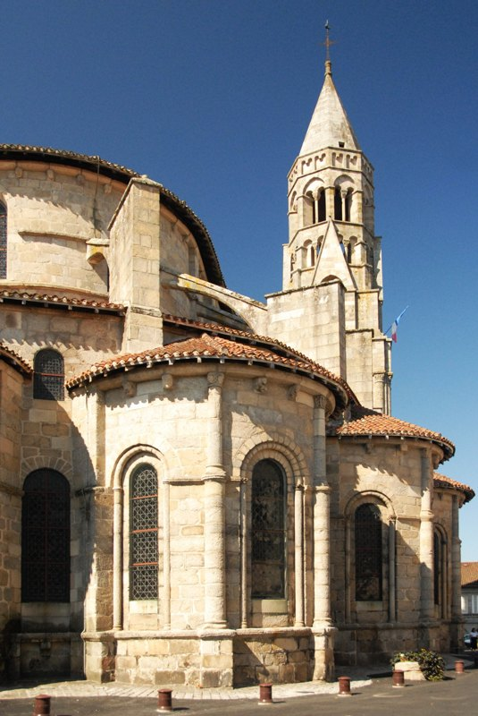
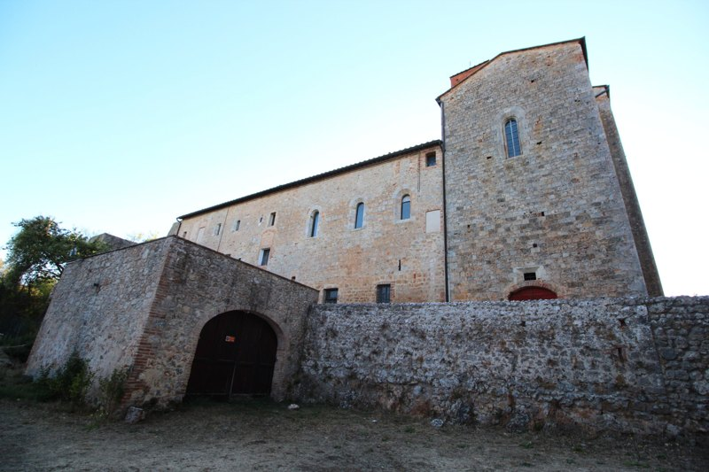
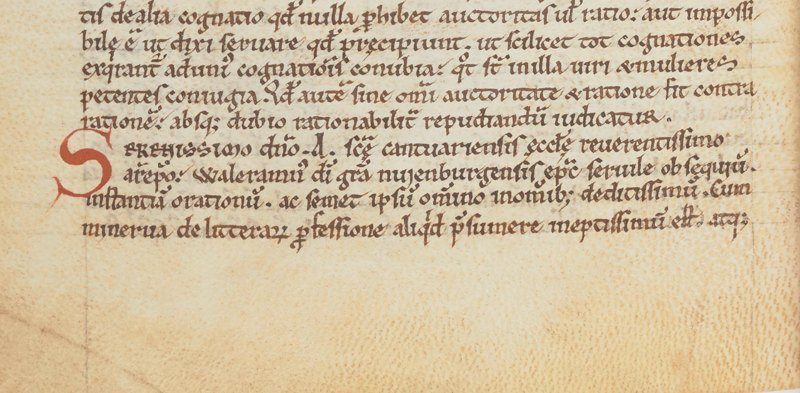

## A Saint Known through His Cult

*Saint Leonard of Noblac* is one of the most widely venerated saints of the Middle Ages and one of the least documented. No letter, chronicle, calendar or church dedication earlier than the eleventh century mentions him. Everything that is told of his life comes from a *Vita sancti Leonardi* written by an anonymous author in the eleventh century, at or for the community that kept his tomb at Noblac, in the Limousin, east of Limoges. Modern historians agree that this text cannot be used as a source for a sixth-century life: it tells us how the eleventh century imagined its saint, not who he was.

The paradox is that the saint without a history became, within a few decades of the writing of the *Vita*, one of the great saints of Europe. From the early twelfth century his cult spread from Noblac across France, into England and the Empire, and into Italy, and in the later Middle Ages his churches, chapels, hospitals and confraternities could be counted by the hundred. He was invoked by prisoners and captives, by women in labour and, especially in the Alpine lands, by farmers for the health of their horses and cattle.

For the history of art and of religion, Leonard is therefore a figure of reception rather than of biography. His importance lies in the texts that shaped his image, in the shrine at Noblac that became a station on the road to Santiago, in the crusader who carried his name across Europe, and in the images that represented him, in France as a monk with chains, in Italy as a young deacon. This page follows that history.

The older version of this page treated the legend as a life and expanded it with general accounts of the Merovingian court, of monastic formation and of the saint's supposed travels. That material has been removed. The legend is summarised below as what it is: the founding story of a cult.

## The Legend

According to the *Vita*, Leonard was a Frankish nobleman at the court of Clovis, converted with the king at Christmas 496 and baptised by Remigius of Reims, who stood as his godfather. From Remigius he obtained the privilege of visiting prisoners and freeing those he found deserving, and many captives were released through him. Offered a bishopric by the king, he refused it, and entered the monastery of Micy near Orléans, then under the direction of Mesmin (Maximinus). His brother, in a later development of the story, was Lifard (Liphard), the saint of Meung-sur-Loire.

Seeking solitude, Leonard left Micy and settled as a hermit in the forest of Pauvain, in the Limousin. There, the legend continues, a Frankish king hunting in the forest with his pregnant queen found her in danger in childbirth; Leonard's prayers brought her safely through, and in gratitude the king granted him as much land as he could ride around on a donkey in one night. On this land he founded a community, which drew followers and freed prisoners, who came with their chains to serve him. The place took the name *Nobiliacum*, Noblac, which the hagiographer derived from the "noble" gift of the king.

Leonard is said to have died at Noblac on 6 November, a date fixed in tradition as 559. His feast has been kept on that day ever since the cult spread.

The elements of the legend are recognisable. The nobleman who renounces the court, the saint linked to Clovis and Remigius, the founder of the Frankish Church, the hermit in the forest, the land granted by a grateful king and measured by a ride, are motifs that the hagiography of the eleventh century used for many saints. They served to give the community of Noblac an ancient and royal origin, a title to its land and a powerful patron. The two miracles that defined the cult, the freeing of prisoners and the help of women in labour, were already present in the first *Vita*.

## Noblac and the Pilgrimage

The town that grew around the tomb, now Saint-Léonard-de-Noblat, became one of the major sanctuaries of the Limousin. The community that served the shrine was organised as a chapter of canons, and its collegiate church was rebuilt in the Romanesque period, from the eleventh century into the twelfth. The church preserves the tomb of the saint in the choir, which was the focus of pilgrimage.

Noblac stood on the *Via Lemovicensis*, the route to Santiago de Compostela that runs from Vézelay through Limoges to the Pyrenees, and the *Pilgrim's Guide* in the twelfth-century *Liber Sancti Jacobi* recommended a visit to Leonard's body. Pilgrims on their way to Galicia stopped at his tomb, and the reputation of the saint travelled with them. In 1998 the collegiate church was inscribed on the UNESCO World Heritage List as part of the Routes of Santiago de Compostela in France.

The prisoners freed through his intercession were expected, according to the miracle stories, to come to Noblac and leave their chains at the tomb. The fetters hung in the church as ex-votos were the visible proof of his power, and they became the attribute with which he was represented. The church thus served as an archive of miracles in iron, in a form that later shrines of Leonard in Germany and Austria would imitate.

The collegiate church is also an important building in its own right. Its east end, with an ambulatory and radiating chapels, follows the plan of the pilgrimage churches of the period, designed to let pilgrims circulate around the relics. Its bell tower, rising in several stages of decreasing size with gables at the corners, is one of the finest examples of the Limousin type and the most visible sign of the town's prosperity in the twelfth century.

## Bohemond and Walram of Naumburg

The cult became international through a crusader. Bohemond, prince of Antioch, one of the leaders of the First Crusade, was captured by the Danishmend Turks in 1100 and released in 1103, after a ransom had been paid. He attributed his release to Leonard, and when he came to the West in 1106 to raise troops he visited Noblac and made an offering at the tomb. His gratitude, the most famous miracle of liberation of the age, made Leonard known across the Latin world, and gifts that followed contributed to the building of the Romanesque church.

The visit was recorded by a German bishop, Walram of Naumburg, who was present and who wrote a *Vita et miracula sancti Leonardi*, including the account of Bohemond's visit, probably for Gertrude of Brunswick. The text survives in a single twelfth-century manuscript at Trier and is known under two titles, *Scriptum Galeranni episcopi de miraculo Boimundi* and *Vita et miracula sancti Leonardi*. It is notable for its report of Bohemond's sharp criticism of the Byzantine emperor Alexios I Komnenos. Walram's account dates from between 1106 and his death in 1111, not from 1103.

Walram was a figure of the Investiture Controversy, a former canon of Bamberg who became bishop of Naumburg in 1090 or 1091 and later went over to the papal side. He also corresponded with Anselm of Canterbury on the differences between the Latin and Greek churches over the bread of the Eucharist, and Anselm's reply on the sacraments survives in the collections of his letters. That correspondence places the author of Leonard's later *Vita* in the circle of the most important theologians of the age.

Through Bohemond and Walram, the saint of a regional shrine became a saint of the crusading world. The liberation of a prince from captivity in Asia Minor showed that Leonard's power extended over all captives, and his cult spread quickly in the twelfth century among those exposed to captivity: crusaders, knights, merchants and, later, prisoners of every kind.

## The Spread of the Cult

In England Leonard became one of the most popular saints of the later Middle Ages, with numerous dedications and hospitals, among them the great hospital of St Leonard at York. In France his cult extended far beyond the Limousin. In the Empire it was particularly strong in Bavaria and Austria, where Leonard became the patron of farmers and livestock, and the chains of the prisoners were reinterpreted as the chains of the stable.

The Bavarian shrines developed their own forms of devotion. At Inchenhofen, promoted by the Cistercians of Fürstenfeld, pilgrims offered iron figures of animals and votive chains; at other Bavarian shrines of Leonard a chain was even hung around the outside of the church. Processions on horseback in honour of Leonard on or around 6 November, still held in several Bavarian towns such as Bad Tölz, preserve the memory of this agricultural patronage.

In Italy the cult was early and widespread. Churches, hospitals and hermitages dedicated to *San Leonardo* are found from the Alps to Sicily and Sardinia, often on roads and at bridges, where hospitals for pilgrims and travellers were placed under his protection. In Tuscany two foundations are particularly important for the images discussed on this page: San Leonardo in Arcetri, outside the gates of Florence, and the hermitage of San Leonardo al Lago, near Siena.

The geography of the cult thus follows the lines of medieval mobility. Leonard was a saint of roads, pilgrims, prisoners and travellers, and his dedications mark the routes along which people moved and the places where they needed protection.

## The Image of Leonard

The representation of Leonard varied with the regions of his cult. North of the Alps he is usually shown as a monk or an abbot, with a crosier or a book, holding a chain or fetters. In Italy he is more often a young deacon, tonsured and dressed in the dalmatic, the vestment of the deacon, sometimes with a book, and in the fourteenth and fifteenth centuries with fetters or manacles in his hand. The Italian image reflects a tradition in which Leonard, like Stephen and Lawrence, was regarded as a deacon.

In the Limousin itself, the saint's own region, the earliest images show him not as an attribute-bearing figure but in action. In the church of Saint-Étienne at Lubersac, in Corrèze, a wall painting of the thirteenth century on the southern arch of the transept crossing, the oldest painting in the church, represents Leonard freeing a chained prisoner. The saint, nimbed and dressed in a long robe, is named by an inscription, *S(anctus) Leonard(us)*, and bends to take the hands of a kneeling captive. The image condenses the miracle that defined his cult in the region of Noblac: the chains are not yet an emblem held by the saint, but the bonds from which he releases the prisoner.

The earliest important Italian image of the saint discussed here is the dossal of the Maestro del Dossale di Yale, a Florentine painter of the second half of the thirteenth century, now at Yale. Leonard stands at the left of the enthroned Virgin, in a red dalmatic, holding a book and raising his hand; he has no chains and is identified by an inscription. The panel was probably painted for San Leonardo in Arcetri, and the presence of the saint beside the Virgin reflects the dedication of its church.

In Siena, the hermitage of San Leonardo al Lago, belonging to the Augustinian hermits of Lecceto, was decorated in the third quarter of the fourteenth century by Lippo Vanni with frescoes of the life of the Virgin. The cycle is not about Leonard, but it is the most important group of paintings in a church dedicated to him in Tuscany, and it shows how a hermitage of the saint could be decorated with the full resources of Sienese painting.

Figures of Leonard in polyptychs of the fourteenth century are less common than those of the great universal saints, and depend on local dedications and confraternities. George Kaftal, in his repertory of the iconography of the saints in Tuscan painting, recorded his attributes and the scenes of his legend in the painting of the region. The rarity of his image in major altarpieces contrasts with the density of his dedications, a reminder that the popularity of a cult and its place in monumental painting did not always coincide.

## Historiography

Modern study of Leonard began with the critical editions of hagiographical texts by the Bollandists, which separated the eleventh-century *Vita* and the later miracle collections and showed that nothing in them could be traced back to the sixth century. The *Catholic Encyclopedia* of 1910 summed up this conclusion when it stated that his earliest life "has no historical value whatever".

The interest of historians has since shifted from the question of Leonard's existence to the history of his cult: the role of the canons of Noblac, the significance of Bohemond's pilgrimage, the place of Leonard among the saints invoked by prisoners, and the transformation of his patronage in the agricultural world of the Alps. Walram's text, in particular, has been studied as a source for the politics of the crusade and for relations between Bohemond and Byzantium.

For the art historian, the essential tools remain the repertories of iconography, Kaftal's volumes for Italy, and the studies of the individual works that represent the saint. For the Yale dossal, <a href="/scholars.html#offner-richard">Richard Offner</a> and <a href="/scholars.html#siren-osvald">Osvald Sirén</a> associated it with the workshop of the Magdalen Master, and the catalogue of the Yale collection now attributes it to a follower of Meliore called the Master of the Yale Dossal. <a href="/scholars.html#kaftal-george">George Kaftal</a>'s repertory places it among the Tuscan images of the saint.

The study of Leonard is therefore a study of how a saint without a documented life acquired, through texts, a shrine, a famous miracle and the roads of pilgrimage, a presence in the devotion and the art of all Europe. The images that follow document that presence at its sources and in its Italian reception.

## Catalogue Entry

### The Collegiate Church of Saint-Léonard-de-Noblat (Haute-Vienne)

<figure>
  
  <figcaption>Collegiate church of Saint-Léonard-de-Noblat, the east end with the radiating chapels and the bell tower, eleventh–twelfth century. Photo: Jochen Jahnke, <a href="https://creativecommons.org/licenses/by-sa/3.0/">CC BY-SA 3.0</a>, via Wikimedia Commons.</figcaption>
</figure>

The collegiate church of Saint-Léonard-de-Noblat stands at the centre of the town that grew around the saint's tomb. The view from the east shows the chevet, with its radiating chapels set around the apse and stepping up towards the choir, and behind it the bell tower that dominates the town and the surrounding country.

The building was rebuilt in the Romanesque period, from the eleventh century into the twelfth, when the community of canons that served the shrine was at the height of its prosperity. The gifts that followed Bohemond's pilgrimage of 1106 contributed to this work, and the size and quality of the church reflect the wealth that the cult brought to Noblac.

The plan of the east end, with an ambulatory and radiating chapels, was designed for the circulation of pilgrims around the relics. It belongs to the family of pilgrimage churches of the routes to Santiago, in which the faithful could move around the choir, visiting the chapels and approaching the tomb without disturbing the liturgy of the clergy.

The bell tower, built in the twelfth century, rises in stages of decreasing size. Its upper storeys are octagonal, with arched openings and small gables set diagonally at the corners, a solution characteristic of the Limousin belfries, and it ends in a stone spire. It is one of the most accomplished examples of the type and the emblem of the town.

The church is built in the local granite, whose hardness explains the sobriety of its carved decoration. The capitals and corbels of the chevet are simple, and the effect of the building rests on its masses, the rhythm of its chapels and the elegance of its tower rather than on sculpture.

In 1998 the collegiate church was inscribed on the UNESCO World Heritage List as part of the Routes of Santiago de Compostela in France. The inscription recognises the role that Noblac played on the *Via Lemovicensis*, and the part of Leonard's shrine in the network of sanctuaries that marked the road to Galicia.

### San Leonardo al Lago (Monteriggioni, near Siena)

<figure>
  
  <figcaption>The hermitage and church of San Leonardo al Lago, near Siena, twelfth–fourteenth century. Photo: Mongolo1984, <a href="https://creativecommons.org/licenses/by-sa/4.0/">CC BY-SA 4.0</a>, via Wikimedia Commons.</figcaption>
</figure>

The hermitage of San Leonardo al Lago stands on a wooded hill near Siena, in the territory of Monteriggioni, close to the former lake that gave it its name. It belonged to the Augustinian hermits, the community connected with the nearby hermitage of Lecceto, one of the centres of the eremitic movement in the Sienese countryside.

The photograph shows the tall church, built of stone with a high gabled wall and a narrow arched window, joined to the long conventual building of stone and brick. A precinct wall with a vaulted gateway encloses the complex, which preserves the austere appearance of a medieval hermitage.

The dedication to Leonard reflects the spread of his cult in Tuscany. Leonard was a hermit before he was a founder, and a hermitage in a forest was a fitting place for his name. His patronage of prisoners and of the poor also suited communities of hermits who offered shelter to travellers on the roads around Siena.

The church was rebuilt and enlarged in the fourteenth century, when the community, protected by the commune of Siena, was able to commission a major cycle of frescoes for its presbytery. The building thus combines the simplicity of an eremitic foundation with the ambition of a Sienese patron.

The interior of the church is known above all for the frescoes of Lippo Vanni, painted in the third quarter of the fourteenth century, which are among the most important works of the painter and of Sienese painting after the plague of 1348.

The hermitage has had a long and varied later history, and the fabric shows traces of successive phases. Its isolated position, outside the main routes of modern traffic, has preserved its medieval character and its frescoes, now visited as one of the minor treasures of the Sienese countryside.

### Lippo Vanni, The Presentation of the Virgin (San Leonardo al Lago)

<figure>
  
  <figcaption>Lippo Vanni, The Presentation of the Virgin in the Temple, c. 1360–1370. Fresco. Monteriggioni, San Leonardo al Lago, presbytery. Photo: LigaDue, <a href="https://creativecommons.org/licenses/by-sa/4.0/">CC BY-SA 4.0</a>, via Wikimedia Commons.</figcaption>
</figure>

The presbytery of San Leonardo al Lago is decorated with a cycle of the life of the Virgin by the Sienese painter Lippo Vanni, painted around 1360–1370. The fresco of the Presentation of the Virgin in the Temple fills one of the lunettes under the vault, framed by bands of geometric ornament.

The young Mary, dressed in white, climbs a long flight of steps to the temple, where the high priest, in rich vestments, bends to receive her. At the foot of the stairs her mother Anne, in a dark mantle, follows her with a group of women; at the right Joachim and other bearded men watch. The temple is an open structure of slender columns crowned by a domed lantern, seen in a perspective that leads the eye to the central figure.

The composition follows a Sienese model. The Presentation was one of the scenes of the life of the Virgin painted in the great cycles of the cathedral of Siena and the hospital of Santa Maria della Scala, and Lippo Vanni drew on the architectural settings and the narrative clarity developed by Pietro and Ambrogio Lorenzetti in the first half of the century.

Around the lunette, the painter placed smaller figures: female saints in the frieze below, one labelled *Maria Magdalena*, others in the panels of the pilasters, and personifications of virtues in medallions on the arch. The decoration of the whole space, with its ornamental bands and painted architecture, gives the presbytery the character of a richly adorned chapel.

The cycle is not devoted to Leonard but to the Virgin, to whom the Augustinian hermits had a special devotion. Its presence in a church of Leonard shows that the dedication of a church did not dictate the programme of its frescoes: the titular saint was honoured by the altar and the name, while the walls served the devotions of the community that lived there.

Lippo Vanni was one of the leading Sienese painters and illuminators of the third quarter of the fourteenth century. His frescoes at San Leonardo al Lago, with their bright colours, elegant figures and spatial settings, are among his principal works, and they document the continuity of the Lorenzettian tradition in Siena after the Black Death.

### Maestro del Dossale di Yale, Virgin and Child between Saints Leonard and Peter (New Haven, Yale University Art Gallery)

<figure>
  
  <figcaption><a href="/Content/Artists/XIII-c/Maestro-del-Dossale-di-Yale.html">Maestro del Dossale di Yale</a>, Virgin and Child Enthroned between Saints Leonard and Peter, with Scenes from the Life of Saint Peter, c. 1265–1270. Tempera and gold on panel, 106 × 160 cm. New Haven, Yale University Art Gallery. Image: public domain, via Wikimedia Commons.</figcaption>
</figure>

The dossal at Yale is the most important early Italian image of Saint Leonard. It was painted in Florence in the second half of the thirteenth century by an anonymous painter now known as the Maestro del Dossale di Yale, and it was probably made for the church of San Leonardo in Arcetri, on the hill south of Florence.

At the centre the Virgin, in a dark blue mantle marked with stars, sits enthroned and nurses the Child, a type known as the *Virgo lactans*. Two angels lean towards her from above. At the left stands Leonard, at the right Saint Peter with his keys, the two saints of the altar for which the panel was made.

Leonard is a young man with a tonsure, dressed in the red dalmatic of a deacon, holding a book and raising his right hand in blessing or speech. He has no chains: his identity is given by the inscription beside his head, *LEO NAR(DUS)*. The image shows that in thirteenth-century Florence the saint was represented as a deacon, before the fetters became his usual attribute in Italian painting.

The narrative scenes at both sides belong to Peter, the other titular saint: among them the calling of Peter and Andrew, the fall of Simon Magus, Peter freed from prison by an angel, the handing over of the keys, the healing of a cripple and the martyrdom of Peter and Paul. The figure behind a grille at the lower left is Peter in prison, not one of Leonard's captives, though the subject of liberation from chains links the two saints.

The panel is damaged, with horizontal cracks and losses along the bottom, but its colours and gold remain bright. Its style, with large heads, linear drapery and strongly patterned surfaces, belongs to the Florentine painting of the generation before Cimabue, and it was long associated with the workshop of the Magdalen Master by <a href="/scholars.html#offner-richard">Offner</a> and <a href="/scholars.html#siren-osvald">Sirén</a>, before the Yale catalogue assigned it to a separate follower of Meliore.

The dossal documents the presence of Leonard's cult on the outskirts of Florence by the thirteenth century, and it shows how a saint of the Limousin, known in Tuscany through the roads of pilgrimage, was given a place of honour beside the Virgin in a local church.

### Walram of Naumburg to Anselm of Canterbury (Paris, BnF, Latin 2478, fol. 120v)

<figure>
  
  <figcaption>The end of Anselm of Canterbury's reply on the sacraments and the beginning of a letter of Walram of Naumburg to Anselm, from a collection of Anselm's letters, twelfth century. Paris, Bibliothèque nationale de France, Latin 2478, fol. 120v. Source: gallica.bnf.fr / Bibliothèque nationale de France.</figcaption>
</figure>

This page from a twelfth-century collection of the letters of Anselm of Canterbury contains a text by the author of Leonard's later *Vita*. In the lower part, after a large red initial S, begins a letter addressed by Walram, bishop of Naumburg, to Anselm: *Serenissimo domino A(nselmo) sancte Cantuariensis ecclesie reverentissimo archiepiscopo Walerannus Dei gratia Nuenburgensis episcopus*.

The upper part of the page belongs to Anselm's reply to Walram on the sacraments of the Church. Anselm discusses the use of unleavened and leavened bread in the Eucharist, which divided the Latin and the Greek churches, and the Greek prohibition of marriage between kin, concluding that a practice without authority or reason may be rejected. The exchange belongs to the years after the schism of 1054, when such differences were the subject of controversy.

Walram, a former canon of Bamberg, was bishop of Naumburg from 1090 or 1091 until his death in 1111. At first a supporter of Emperor Henry IV in the Investiture Controversy, he later went over to the papal side, and his correspondence with Anselm belongs to this context of reconciliation with Rome.

The same bishop was present at Noblac when Bohemond of Antioch visited the tomb of Leonard in 1106, and he wrote the *Vita et miracula sancti Leonardi* that recorded the visit. The page therefore shows the author of one of the key texts of Leonard's cult in the company of the greatest theologian of his time.

The manuscript is written in a regular Romanesque minuscule with many abbreviations, in a single column, with red initials marking the beginnings of letters. It is one of the collections in which Anselm's correspondence was gathered and copied in the twelfth century, and it transmits Walram's letter together with Anselm's answers.

The page cannot illustrate Leonard himself, of whom no early image survives. It illustrates instead the world in which his legend was written down and spread: a world of bishops, theologians and crusaders, in which the liberation of a prince from captivity could become, through the pen of a German bishop, a miracle known throughout Latin Christendom.
