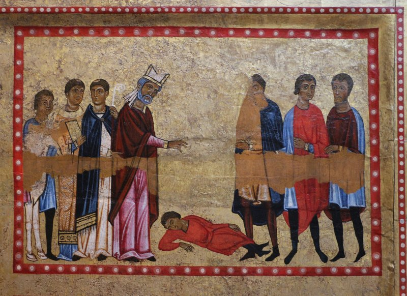
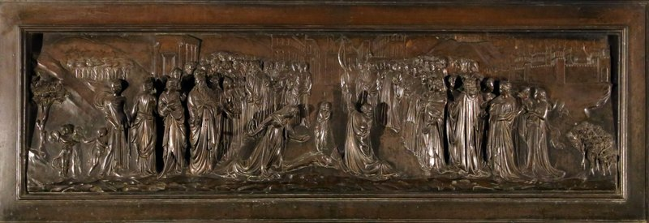
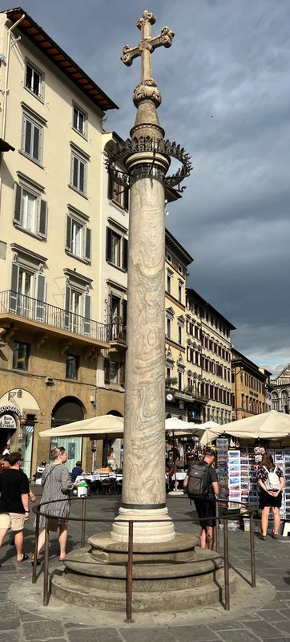
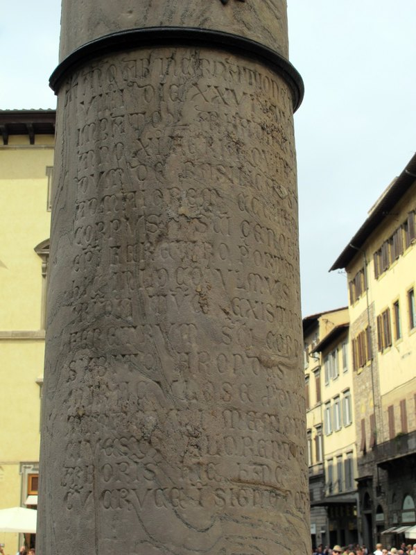
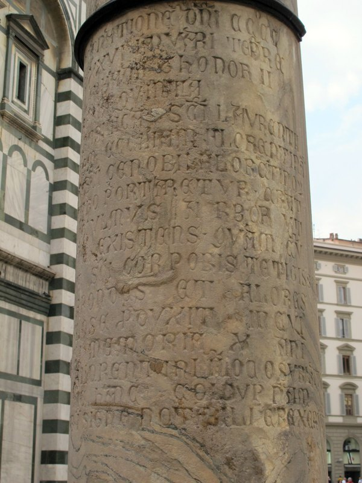

## A Bishop Known from One Sentence

*San Zanobi*, in Latin Zenobius, is the patron saint of Florence and the bishop whom the city honoured as its apostle. His cult is one of the oldest and most continuous in Florence, and his image runs through its art from the thirteenth century to the Renaissance.

Of the historical Zenobius almost nothing is known. The only ancient witness is a single sentence in the *Life of Ambrose* written by Paulinus of Milan about 422. Telling of Ambrose's stay in Florence, Paulinus adds that the holy man Zenobius was now bishop of the city. Everything else comes from much later texts.

The story of his life was first written down in the eleventh century by Lorenzo, archbishop of Amalfi, who died in 1049. The *Dizionario Biografico degli Italiani*, in the entry by [Francesca Roversi Monaco](/scholars.html#roversi-monaco-francesca), records that Lorenzo wrote it at the request of the canons of the Florentine cathedral; [Alessandro Ciandella](/scholars.html#ciandella-alessandro) dates it about 1039.

Lorenzo's Vita began a series of rewritings that enlarged the story and introduced inconsistencies. The fifteenth-century version of Saint Antoninus, archbishop of Florence, is one of them. The Zenobius of devotion is the figure of these texts: a noble convert, a disciple of Ambrose and of Pope Damasus, a bishop who raised the dead.

The previous version of this entry presented that legend as history. It gave his birth in 337 into the Girolami family, his baptism, his archdeaconate, his service in Rome and a legation to Constantinople in 381 as facts. It also called him the first bishop of Florence, although a bishop Felix of Florence attended the Roman council of 313.

It named Saint Antoninus as the author of the earliest coherent account of his life, placed the translation of his relics in 429–430 and the miracle of the elm in 417, and misdescribed Botticelli's panels. Its section on scholarship attributed to several art historians contributions on Zenobius that cannot be traced.

The account that follows separates the historical bishop from the legend, then treats the relics and the miracle of the elm, the cult in Florence, the image of the saint and Botticelli's panels. The catalogue examines the dossal of the Maestro del Bigallo, Botticelli's panels, the images of the cathedral and Palazzo Vecchio, and the column of Piazza San Giovanni.

All the works are illustrated by photographs published on Wikimedia Commons or by the Metropolitan Museum of Art under free licences. Two of Botticelli's panels, in the National Gallery and in Dresden, are described in words only.

## The Bishop and the Legend

The historical Zenobius was bishop of Florence in the early fifth century. He governed a church that had existed for at least a century: a bishop Felix is recorded at the council of Rome in 313. Florence was then a modest Roman city, and its Christian community was led from the basilica of San Lorenzo, outside the walls.

Paulinus's sentence connects Zenobius with Ambrose of Milan, who visited Florence in 393–394 and dedicated a basilica there. The legend developed this connection into a relationship of master and disciple. It is plausible that the future bishop knew Ambrose, but no source says so.

His death is placed between 417 and 429, and tradition fixes it on 25 May, the day of his feast. The year cannot be determined: the hagiographical texts give dates that do not agree with each other or with the chronology of the popes and emperors they name.

Lorenzo of Amalfi's Vita gave the bishop a full biography. Zenobius was born in Florence of a noble pagan family, was converted and baptised against the will of his parents, whom he later converted, and was educated under a bishop Theodore. He met Ambrose and served Pope Damasus, who made him bishop.

The Vita also gave him two companions, the deacon Eugenius and the subdeacon Crescentius, who appear beside him in almost every later image. Both were venerated as saints in Florence, and their relics were kept with his.

The miracles are the core of the legend. Zenobius raised five dead persons: the son of a noblewoman from Gaul, left in his care while she went on pilgrimage to Rome; a young man carried to burial; a messenger who died crossing the Apennines with relics sent by Ambrose; a boy killed by a cart; and a kinswoman of Eugenius.

He also freed two young men possessed by demons after their mother had cursed them, and restored the sight of a blind beggar. These episodes, rather than any episode of his government, became the subjects of the painters.

Local tradition added a family. The Girolami of Florence claimed descent from his kin, kept chapels dedicated to him and gave his name, Zanobi, to their sons. This claim, recorded from the later Middle Ages, explains the patronage of some of the works that illustrate his life.

## The Relics and the Elm

Zenobius was buried in San Lorenzo, the first cathedral of Florence. His relics were later moved to Santa Reparata, the church on the site of the present cathedral, which became the seat of the bishop. The translation is generally placed in the ninth century, although its date is disputed.

The most famous miracle of the legend took place during that translation. As the bier was carried through the square in front of the Baptistery, it touched a dead elm, and the tree at once put forth leaves and flowers, although it was winter. The day was remembered as 26 January.

A column was set up in Piazza San Giovanni to mark the place where the elm had stood. It existed by 1333, when it was overthrown by the great flood of that year. Ciandella notes that when it was set up again it received a new inscription, with errors, and that the original may have been lost.

The inscription on the column states that, while the body of Saint Zenobius was being carried from San Lorenzo to the greater church of Florence, a dry elm standing on this spot, touched by the bier, put forth leaves and flowers, and that the citizens set up the column with a cross in memory of the miracle when the tree was taken away.

The inscription dates the event to 26 January, a Thursday, in the reign of the emperors Arcadius and Honorius. The date does not fit the ninth-century translation, and the names of the emperors do not fit any year after 408, when Arcadius died. The text records a tradition, not a document.

The elm left other relics. A crucifix in San Giovannino dei Cavalieri is said to have been carved from its wood, and an inscription added to the dossal of the Maestro del Bigallo claims that the panel itself was made from it. Both are traditions attached to the miracle.

The relics remained in Santa Reparata and passed into the new cathedral of Santa Maria del Fiore, built on its site from the end of the thirteenth century. In 1432 the Opera del Duomo commissioned Lorenzo Ghiberti to make a bronze shrine for them, completed in 1442.

The shrine stands in the chapel of San Zanobi in the cathedral. Its reliefs show his miracles, and it remains the focus of his cult. On 26 January the Fiorita di San Zanobi, with flowers laid at the column, renews the memory of the elm each year.

## The Cult in Florence

Zenobius became, with John the Baptist and Saint Reparata, one of the patron saints of Florence. He was the city's own saint, a Florentine bishop buried in Florence, and the protector to whom the citizens turned in danger. He was invoked in particular against possession and diseases of the head.

His cult was centred on the cathedral. The canons of Santa Reparata commissioned his first Vita, and the chapters and confraternities of the cathedral kept his feasts. The Opera del Duomo, which built Santa Maria del Fiore, gave his relics their final setting in Ghiberti's shrine.

The commune also claimed him. In the 1480s Domenico Ghirlandaio painted Zenobius enthroned between his deacons in the Sala dei Gigli of Palazzo Vecchio, the seat of government, beside the lions and the arms of the city. The bishop became an image of civic as well as religious identity.

Many churches and chapels in Florence and its territory were dedicated to him. Scandicci, near Florence, has an ancient church and a grotto associated with him, and adopted him as its patron in 1983. Legends of his passage were attached to places along the roads of the Apennines.

The cult produced its own texts. Ciandella has published Italian lives and offices of the fourteenth and fifteenth centuries, and the music of his feasts in Trecento Florence has been recorded. These texts spread the legend of Lorenzo of Amalfi in the vernacular.

The two feasts structured the year of his cult. On 25 May the city celebrated his death; on 26 January, the translation and the elm. The second, with its flowers in midwinter, became the more popular, and it still survives in the Fiorita.

Families attached themselves to him. The Girolami, who claimed his kinship, named their sons after him, and a member of the family, Zanobi Girolami, may have been the patron of Botticelli's panels. A plaque on Palazzo Valori in Borgo degli Albizi marks the place where he raised the son of the pilgrim from Gaul.

The many losses suffered by the places of his cult are recorded by Ciandella: the church of San Pier Maggiore, destroyed in the eighteenth century; the Girolami tower, destroyed in the Second World War; and liturgical books damaged in the flood of 1966.

## The Image of Zanobi

The image of Zenobius was fixed early. He is shown as an old bishop with a grey or white beard, wearing the mitre and holding the crosier, often enthroned. The two deacons, Eugenius and Crescentius, stand or kneel beside him.

The earliest surviving image of this type is the dossal of the [Maestro del Bigallo](/Content/Artists/XIII-c/Maestro-del-Bigallo.html), painted about 1230–1250 and now in the Museo dell'Opera del Duomo. The bishop sits enthroned at the centre between the two deacons, with four scenes of his miracles at the sides.

The scheme of the bishop enthroned between his deacons was repeated for two and a half centuries. Giovanni del Biondo, about 1380, painted it for a pillar of the cathedral, adding the Virtues; Domenico Ghirlandaio, in the 1480s, set it within a Renaissance arch in Palazzo Vecchio.

The miracles provided the narrative images. The dossal of the Bigallo shows four scenes; the predella of Giovanni del Biondo shows the raising of the pilgrim's son and the flowering elm; Ghiberti's shrine shows three miracles in bronze; Botticelli's panels set eleven episodes in the streets of Florence.

The raising of the son of the noblewoman from Gaul is the most frequent subject. It appears on the dossal, in Giovanni del Biondo's predella, on Ghiberti's shrine and in Botticelli's London panel, and it was commemorated by the plaque in Borgo degli Albizi.

The flowering elm is the second attribute. It identifies Zenobius in later images, and it gave the city a living emblem: the column in Piazza San Giovanni and the flowers of the Fiorita. In the Renaissance a flowering branch sometimes accompanies his figure.

The images of the saint reflect the institutions that commissioned them. The dossal and the panel of Giovanni del Biondo belonged to the cathedral; the shrine to the Opera del Duomo; the fresco of Palazzo Vecchio to the commune; Botticelli's panels, probably, to a private family.

The previous version of this entry illustrated a panel with Zenobius, a devotee and the Annunciation, attributed to Jacopo di Cione. The attribution could not be confirmed, and the panel is not discussed here.

## Botticelli's Panels

About 1500 Sandro Botticelli painted four panels with scenes from the life of Zenobius. They are now divided between the National Gallery in London, which has two, the Metropolitan Museum of Art in New York and the Gemäldegalerie in Dresden. All four are about 66 centimetres high and between 139 and 182 wide.

The panels read from left to right like a continuous narrative. The first London panel (NG3918) shows four scenes of his early life: Zenobius refusing the bride chosen by his parents, his baptism by the bishop Theodore, the baptism of his mother Sophia, and his consecration as bishop by Pope Damasus.

The second London panel (NG3919) shows three miracles: the exorcism of two young men cursed by their mother, the raising of the son of the noblewoman from Gaul, and the healing of a blind beggar before the church of San Pier Maggiore.

The New York panel shows three more miracles: the raising of a young man on his way to burial, the raising of the messenger who died crossing the Apennines with relics, and the raising, with water and salt blessed by the saint, of a kinswoman of the deacon Eugenius.

The Dresden panel shows the last miracle, the raising of a boy killed by a cart, and the death of Zenobius. The cycle thus follows the life of the saint from his conversion to his death, in the order of the legend.

The panels are *spalliere*, paintings set into the wooden panelling of a room. Their original setting is unknown. An old claim that they came from a confraternity of San Zanobi is now considered unlikely, and they were probably made for a private house.

[Ellen Callmann](/scholars.html#callmann-ellen) proposed in 1984 that they were painted for the wedding of a son of the Girolami family, probably that of Zanobi Girolami in 1500. [Alessandro Cecchi](/scholars.html#cecchi-alessandro), in 2005, preferred a wedding of 1497. Both readings connect the panels with the family that claimed the saint's kinship.

Botticelli set the miracles in an idealised Florence of classical palaces, porticoes and open squares, with the hills of the countryside in the distance. The legend of the fifth-century bishop became a picture of the Renaissance city, in which the patron saint walks the streets of his own people.

## Catalogue Entry

### The Dossal of the Maestro del Bigallo

<figure>
  
  <figcaption>Maestro del Bigallo, dossal of San Zanobi with Saints Eugenius and Crescentius and four scenes, c. 1230–1250, tempera and gold on panel, 109 × 274 cm. Florence, Museo dell'Opera del Duomo, inv. 9152. Photo: Sailko, <a href="https://creativecommons.org/licenses/by/3.0/">CC BY 3.0</a>, via Wikimedia Commons.</figcaption>
</figure>

The dossal of the Maestro del Bigallo is the earliest surviving image of Zenobius and the most important. It is a long, low panel, 109 by 274 centimetres according to the catalogue of the Fondazione Zeri, painted in tempera on a gold ground. [Miklós Boskovits](/scholars.html#boskovits-miklos) dated it about 1230, within the episcopate of Giovanni da Velletri (1205–1230); the catalogue of the Fondazione Zeri and the national catalogue place it in 1240–1250.

At the centre Zenobius sits enthroned between his two deacons. At the sides, four framed scenes, two on each side, tell his miracles. The whole is enclosed in a broad border of blue and red ornament set with raised gilt bosses.

The panel is a dossal, an image set on or behind an altar, of the long rectangular form common in Tuscany in the thirteenth century. Its format, with a central figure and side scenes, is that of the dossals of saints, such as those of Saint Francis, painted in the same decades.

The work is now in the Museo dell'Opera del Duomo, inv. 9152. It was made for the altar over the relics of Zenobius in the crypt of Santa Reparata, the cathedral that preceded Santa Maria del Fiore. Its later history is unknown until the eighteenth century: it was in the collection of the Marchese Tacoli Canacci at Parma from 1786, and in the Galleria Nazionale of Parma from 1865 to 1928, before it returned to Florence and to the cathedral.

The attribution to the Maestro del Bigallo, the anonymous painter named after a crucifix in the Museo del Bigallo, is accepted in the literature. [Edward B. Garrison](/scholars.html#garrison-edward) catalogued it in his index of Italian Romanesque panel painting (1949, no. 363), and [Angelo Tartuferi](/scholars.html#tartuferi-angelo) discussed it in *La pittura a Firenze nel Duecento* (1990).

The panel has been restored, and the restoration was published in 2016 in a volume edited by Marco Ciatti, whose title quotes its inscription: *Fatta dell'olmo della piazza*. The gold ground is worn, and in several of the side scenes broad bands of loss cross the figures at mid-height, where the paint has flaked away to the preparation.

A later inscription in Italian, painted beside the throne, claims that the panel was made from the wood of the elm that flowered at the touch of the saint's bier. It records the tradition of the miracle, not the origin of the panel.

The dossal establishes the image of Zenobius that later painters would follow: the old bishop enthroned, frontal and severe, between the two young deacons, and his miracles told in small scenes around him.

### Zanobi Enthroned and the Inscription of the Elm

<figure>
  
  <figcaption>Maestro del Bigallo, dossal of San Zanobi, Zenobius enthroned, c. 1230–1250. Florence, Museo dell'Opera del Duomo. Photo: Sailko, <a href="https://creativecommons.org/licenses/by/3.0/">CC BY 3.0</a>, via Wikimedia Commons (detail).</figcaption>
</figure>

Zenobius sits frontally on a wooden throne with turned supports and two large red cushions. He is an old man with a grey beard and a lined face, his eyes looking out at the viewer, under a white mitre and a large gilt halo modelled in raised gesso.

He wears a red cope over a pink tunic, painted in broad planes with dark folds, and holds a long white crosier with a spiral head that crosses his body diagonally. His feet, in gold shoes, rest on a blue footstool.

The figure is larger than the deacons and much larger than the figures of the scenes. The hierarchy of scale makes him the image of the bishop in majesty, the patron to whom the altar was dedicated.

Beside his head, in red letters, is his name: ZANO BIUS, Zanobius, the Florentine form of Zenobius. The inscription identifies the saint for a viewer who might otherwise take him for any bishop.

At the left of the throne, beside the deacon, a later hand has written several lines in black Gothic letters, in Italian. They begin QUESTA TA[VO]LA FU FATA DE L'OLMO DE[LLA] PIA[Z]A, "this panel was made from the elm of the square", and end with a date in Roman numerals beginning MCCCXXV, in the fourteenth century.

The inscription was added about a century after the panel was painted. It reflects the growing importance of the miracle of the elm in the fourteenth century, when the column of Piazza San Giovanni was set up again after the flood of 1333.

The claim it makes is a pious tradition. It turned the dossal into a relic of the miracle, and it may explain why the panel was preserved and venerated in the cathedral. The previous version of this entry cited a scientific analysis of the wood, for which no source could be found.

The deacons stand at each side: at the left a young deacon in an orange dalmatic holding a book, at the right a young deacon in blue and white holding a censer. They are Eugenius and Crescentius, the bishop's companions in the legend.

### The Boy before the Bishop

<figure>
  
  <figcaption>Maestro del Bigallo, dossal of San Zanobi, a boy brought before the bishop, c. 1230–1250. Florence, Museo dell'Opera del Duomo. Photo: Sailko, <a href="https://creativecommons.org/licenses/by/3.0/">CC BY 3.0</a>, via Wikimedia Commons (detail).</figcaption>
</figure>

The upper scene at the left of the dossal shows Zenobius seated on a folding stool, the seat of a bishop giving judgement or receiving visitors. Two young clerics stand behind him, one holding his crosier.

Before him stands a small boy in a light blue tunic and dark hose, his hands joined at his waist. At the right are two women, one with a white head-cloth and dark mantle, the other veiled in white with a red mantle, and a young man in a red cloak.

The national catalogue identifies the scene as the pilgrim from France entrusting her son to Zenobius, the beginning of the miracle of the son of the noblewoman from Gaul. In the legend the mother, setting out on pilgrimage to Rome, left her son in the care of the bishop, and on her return found him dead.

Read in this way, the scene shows the moment when the boy is presented to Zenobius by his mother and her companions. The scene below it would then show the second part of the same story, the raising of the dead child.

The composition is simple and symmetrical: the bishop and his clerics at the left, the family at the right, the child between them. The figures stand in a row against the gold, without setting or landscape, in the manner of thirteenth-century narrative panels.

The bishop's face, with its grey beard and the fillets of his mitre falling behind, repeats the face of the central figure. The painter gives Zenobius the same type in every scene, so that he is recognisable at once.

A broad band of loss crosses the scene at mid-height, where the paint has fallen away to the brown preparation. The heads and the lower parts of the figures are well preserved, and the colours of the mantles are still bright.

The red border with white dots, repeated in all four scenes, frames each episode as a separate picture, to be read in turn by the viewer standing before the altar.

### The Raising of the Dead Boy

<figure>
  
  <figcaption>Maestro del Bigallo, dossal of San Zanobi, the raising of a dead boy, c. 1230–1250. Florence, Museo dell'Opera del Duomo. Photo: Sailko, <a href="https://creativecommons.org/licenses/by/3.0/">CC BY 3.0</a>, via Wikimedia Commons (detail).</figcaption>
</figure>

The lower scene at the left shows a boy in a blue tunic lying dead on the ground between two groups. At the left stand two women; at the right Zenobius, followed by his clergy, bends forward and stretches his hand over the child.

The nearer woman, in a dark blue mantle over an ochre dress, holds one hand to her breast and stretches the other towards the boy. She is the mother, returning to find her son dead and asking the bishop to restore him.

Zenobius bends towards the child with an open hand, the gesture of command by which he raises the dead. Behind him a cleric in black and white holds the crosier, and a deacon in an ochre dalmatic patterned in white holds a book.

The national catalogue identifies the scene as the raising of the son of the pilgrim from France, the most famous of the miracles, and the sequel to the scene above. The two scenes together tell the whole story.

The painter has placed the dead boy at the centre, low on the ground, so that the eye passes from the mother's hand to the bishop's hand across his body. The empty gold between the groups stresses the distance that the miracle must cross.

At the far left a figure is largely lost, and only the lower part of a dark robe survives. The rest of the scene is in good condition, with its crackled gold and the fine white patterns of the deacon's dalmatic.

The same miracle appears in Giovanni del Biondo's predella, in Ghiberti's shrine and in Botticelli's London panel. The dossal is the earliest image of it, and the one closest to the text of the legend.

In Florence the miracle was located in Borgo degli Albizi, where a plaque on Palazzo Valori still marks the place. The dossal shows it without any setting, as an event of the sacred history of the city rather than of its streets.

### The Raising of the Messenger of Saint Ambrose

<figure>
  
  <figcaption>Maestro del Bigallo, dossal of San Zanobi, the raising of the messenger of Saint Ambrose, c. 1230–1250. Florence, Museo dell'Opera del Duomo. Photo: Sailko, <a href="https://creativecommons.org/licenses/by/3.0/">CC BY 3.0</a>, via Wikimedia Commons (detail).</figcaption>
</figure>

The upper scene at the right shows a young man in a red tunic lying on the ground with his eyes closed, between Zenobius and his clergy at the left and three young men at the right.

The bishop stretches his hand towards the young man with the same commanding gesture as in the raising of the boy. Behind him stand three clerics, one with the crosier and one with a book.

The three young men at the right wear the short tunics, cloaks and dark hose of laymen. They stand in a close group, watching the bishop. Their dress is that of young men of the city, perhaps the companions of the dead messenger.

The national catalogue identifies the scene as the raising of the messenger of Saint Ambrose, who died crossing the Apennines with relics that Ambrose was sending to Florence. Botticelli painted the same miracle in the New York panel, with the coffin of relics beside the dead man.

The composition mirrors that of the lower left scene. The bishop and his clergy stand on one side, the lay people on the other, and the dead figure lies between them on the ground. The painter repeated a formula that made each miracle immediately legible.

The young man is laid with his head towards the bishop, one arm under his head, the other on his body. His red tunic stands out against the gold, the strongest note of colour in the scene.

The scene has suffered more than the others. A broad band of loss crosses all the figures at mid-height, and the face of the first young man at the right is partly lost. The heads of the clerics and the lying figure are well preserved.

The double border of this scene, with an inner red frame and the outer band of the dossal, shows how the scenes were set into the gold ground of the panel.

### The Exorcism

<figure>
  
  <figcaption>Maestro del Bigallo, dossal of San Zanobi, the exorcism of a possessed young man, c. 1230–1250. Florence, Museo dell'Opera del Duomo. Photo: Sailko, <a href="https://creativecommons.org/licenses/by/3.0/">CC BY 3.0</a>, via Wikimedia Commons (detail).</figcaption>
</figure>

The lower scene at the right shows an exorcism. Zenobius stretches out his right hand towards a young man in a blue tunic, and a small black winged demon flies out of him above his head.

The possessed young man stands bent forward, his hands bound behind his back with red cords. The cords show that he had been restrained by his family, as the possessed were in the Middle Ages, and that the bishop's word frees him.

Behind the bishop stand his clergy: a deacon in an ochre dalmatic with a book, a cleric in black and white with the crosier, and a bearded layman. At the right are the young man's kin, a woman in a white head-cloth and a red dress, and young men, one of whom points towards the scene.

The national catalogue identifies the scene as Zenobius freeing a possessed boy. It is a different miracle from the exorcism of the two young men cursed by their mother, which Botticelli painted in the second London panel.

The black demon is drawn as a small dark silhouette with wings, rising from the young man's head towards the gold ground. It is the only figure in the dossal that breaks the rhythm of standing figures.

The scene is the best preserved of the four. The gold is crackled but complete, and the colours of the robes, red, blue, ochre and black, are fresh. The patterned dalmatic of the deacon is painted with fine white lines.

Zenobius was invoked in Florence to free the possessed, and the scene corresponds to that devotion. Botticelli later placed the exorcism of the two sons at the beginning of the second London panel.

The four scenes of the dossal, the boy entrusted to the bishop, his raising, the raising of Ambrose's messenger and the exorcism, present Zenobius above all as a worker of miracles for the families of his city.

### Botticelli, Four Scenes from the Early Life of Saint Zenobius

<figure>
  
  <figcaption>Sandro Botticelli, Four Scenes from the Early Life of Saint Zenobius, c. 1500, tempera on wood, 66.7 × 149.2 cm. London, National Gallery, NG3918. Photo: public domain, via Wikimedia Commons.</figcaption>
</figure>

The first of Botticelli's four panels shows the early life of Zenobius in four scenes, read from left to right. The panel measures 66.7 by 149.2 centimetres and is in the National Gallery, London, which acquired it with the Mond Bequest in 1924.

At the left, Zenobius, a young man in a pink cloak, turns away from the bride his parents had chosen for him. She stands among a group of women in white veils, and he walks off towards the right, his hands joined.

In the second scene he is baptised. He kneels, half-naked, over a large bronze basin, and the bishop Theodore pours water over his head, surrounded by clerics in white surplices and red caps.

In the third scene, under a portico with orange columns, his mother Sophia is baptised in the same way, bending over a basin while the bishop pours the water. The scene recalls the legend of the conversion of his parents.

At the right, Zenobius, now bearded, kneels before Pope Damasus, who sits under a green canopy, and receives the mitre from two bishops. It is his consecration as bishop of Florence, the end of his early life.

Botticelli set the scenes in an imagined Florence of classical buildings, with a street opening onto the hills. The architecture divides the panel into separate episodes and also links them in a single space.

The figures are long and slender, with flowing draperies of pink, blue, red and white, typical of Botticelli's late style. The painting has the clear colours and the fine line of his work about 1500.

The scenes follow the legend of Lorenzo of Amalfi and its successors: the refusal of marriage, the baptism, the conversion of the mother and the consecration by Damasus. Botticelli painted the legend as the history of a Florentine family.

### Botticelli, Three Miracles of Saint Zenobius

<figure>
  
  <figcaption>Sandro Botticelli, Three Miracles of Saint Zenobius, c. 1500, tempera on wood. New York, The Metropolitan Museum of Art. Photo: The Metropolitan Museum of Art, public domain (<a href="https://creativecommons.org/publicdomain/zero/1.0/">CC0</a>).</figcaption>
</figure>

The New York panel shows three miracles in a single square of an imagined Florence. At the left rises a grey classical building, at the right a pink palace with a loggia, and between them the view opens onto hills and cypresses.

At the left Zenobius meets a funeral procession. A young man lies on a bier covered with a blue sheet, among weeping clerics with processional crosses and banners, and the bishop, kneeling, raises him to life.

In the centre the bishop kneels beside a young man lying dead on the ground, next to an open wooden coffin containing relics. Horses stand behind. It is the messenger who died crossing the Apennines with the relics sent by Ambrose, raised by the saint with the help of the relics.

At the right the subdeacon Eugenius, in white, sprinkles a woman who sits up on a green mat, while men in red and yellow stagger back in amazement. She is the kinswoman of Eugenius who had died without the last rites.

In the loggia behind, the same story begins: Zenobius, seated on his bed, gives Eugenius a cup of water and salt that he has blessed. The panel thus shows the same figure twice, in the background and in the foreground, in the manner of continuous narrative.

The scenes are full of grief and astonishment: clerics weeping with their hands to their faces, men throwing up their arms, a kneeling servant covering his face. Botticelli's late style gives the miracles an intense, almost agitated emotion.

The square, with its classical architecture and its empty pavement, is a stage on which the miracles take place before the citizens. It presents Florence as the city of the saint, transfigured by his presence.

The panel is in the Metropolitan Museum of Art, which publishes its image as public domain under its Open Access programme. The previous version of this entry described its scenes as if they belonged to the London panel.

### Giovanni del Biondo, the Panel of San Zanobi

<figure>
  
  <figcaption>Giovanni del Biondo (attributed), San Zanobi enthroned with Saints Eugenius and Crescentius, c. 1380, tempera and gold on panel, 240 × 110 cm. Florence, Santa Maria del Fiore. Photo: public domain, via Wikimedia Commons.</figcaption>
</figure>

The panel of San Zanobi hangs on the first pillar on the left of the nave of Santa Maria del Fiore. The Opera del Duomo attributes it to Giovanni del Biondo and dates it about 1380; it measures 240 by 110 centimetres.

Zenobius sits enthroned in the centre, in episcopal vestments of white patterned with gold, holding the crosier and a book. He is flanked by the figures of Humility and Charity, and he tramples Pride and Cruelty under his feet.

The deacons Eugenius and Crescentius kneel at the foot of the throne, smaller than the bishop. In the roundel of the gable Christ blesses, holding an open book with the Alpha and the Omega.

The predella shows two episodes of the legend: the raising of the son of the pilgrim from Gaul, and the flowering of the elm during the translation of the saint's body. They are the two miracles most closely tied to the places of the city.

The patron and the original location of the panel are unknown. The Opera del Duomo suggests that it was painted either for the cathedral or for the altar of the locksmiths' guild in Orsanmichele. In the seventeenth century it was venerated by a chaplaincy of the cathedral dedicated to Saint Mary and Saint Zenobius.

In 1842, during the renovation of the cathedral by Gaetano Baccani, the panel was restored and altered so that it would match a painting of Saint Antoninus on the opposite pillar. The Medici arms on the base were added then.

The panel adds to the scheme of the Bigallo dossal the allegory of the Virtues and the Vices. Zenobius becomes the model of the humble and charitable bishop who overcomes pride and cruelty.

The photograph shows the panel in its setting on the pillar, with its nineteenth-century bracket. It is the image of the saint that visitors to the cathedral still see.

### Ghiberti, the Shrine of San Zanobi

<figure>
  
  <figcaption>Lorenzo Ghiberti, shrine of San Zanobi, the raising of a child, 1432–1442, bronze. Florence, Santa Maria del Fiore, chapel of San Zanobi. Photo: Sailko, <a href="https://creativecommons.org/licenses/by/3.0/">CC BY 3.0</a>, via Wikimedia Commons (detail).</figcaption>
</figure>

In 1432 the Opera del Duomo commissioned [Lorenzo Ghiberti](/endnotes.html#fn-lorenzo-ghiberti) to make a bronze shrine for the relics of Zenobius. The work was completed in 1442 and placed in the chapel of San Zanobi in Santa Maria del Fiore, where it remains.

The shrine is decorated with reliefs of the saint's miracles. The relief shown here tells the raising of a child in a single continuous composition, crowded with figures and set before a city.

At the left children play among trees on a hillside, an image of the life the dead child had lost. In the centre a woman kneels with her arms outstretched towards a small child standing before her, restored to life, while Zenobius kneels in prayer.

The crowd stands at both sides in long draped robes, some in profile, some turned towards the miracle. Behind them, in very low relief, rise buildings, a classical temple and the walls and towers of a city among hills.

The relief shows the technique Ghiberti developed in the same years for the Gates of Paradise of the Baptistery: figures in high relief in the foreground, becoming lower and lower towards the background, so that the bronze suggests depth and space.

The subject is most probably the raising of the son of the noblewoman from Gaul, the miracle that the dossal of the Bigallo had shown two centuries earlier. Ghiberti set it in a landscape and a city, before the eyes of the Florentines.

The shrine gave the cult of Zenobius its most precious object. It placed the relics of the patron saint at the heart of the new cathedral, beneath the dome then being completed by Brunelleschi.

The bronze is darkened, and the relief is seen in the low light of the chapel. The photograph shows the crowding of the figures and the depth of the landscape that Ghiberti achieved.

### Ghirlandaio, Zanobi Enthroned in Palazzo Vecchio

<figure>
  
  <figcaption>Domenico Ghirlandaio, Saint Zanobi enthroned between Saints Eugenius and Crescentius, c. 1482–1484, fresco. Florence, Palazzo Vecchio, Sala dei Gigli. Photo: Sailko, <a href="https://creativecommons.org/licenses/by/3.0/">CC BY 3.0</a>, via Wikimedia Commons.</figcaption>
</figure>

Domenico Ghirlandaio painted Zenobius enthroned on a wall of the Sala dei Gigli in Palazzo Vecchio, the seat of the government of Florence, about 1482–1484. The room takes its name from the gold lilies of France that cover its blue walls.

The bishop sits in the centre within a painted triumphal arch, raising his right hand in blessing and holding the crosier. He wears a jewelled mitre and a red cope, and sits on a throne with a green back against a striped curtain.

The two deacons stand at either side in rich dalmatics, their hands joined or laid on the breast. The scheme of the Bigallo dossal, the bishop between his deacons, is translated into the language of the Renaissance.

Above the throne, in a lunette, the Virgin and Child appear between two kneeling angels, painted as a white relief on a gold ground. Medallions with the heads of Roman emperors flank the arch, and garlands of fruit run along it.

At the left, behind the deacon, a distant view of the city shows the dome of the cathedral. The saint is placed between the image of the city and the government that met in the room.

At the edges of the fresco appear the heraldic lions and the arms of Florence. The image is a political as well as a religious statement: the patron saint watches over the magistrates and the city.

A marble doorframe of the same period cuts into the lower right of the fresco. The photograph shows the fresco as it is seen in the room, with its later architecture.

The fresco is the last of the great images of Zenobius before Botticelli's panels. It shows the saint at the height of his civic role, in the decades of Lorenzo de' Medici.

### The Column of San Zanobi

<figure>
  
  <figcaption>The column of San Zanobi, fourteenth century. Florence, Piazza San Giovanni. Photo: Chabe01, <a href="https://creativecommons.org/licenses/by-sa/4.0/">CC BY-SA 4.0</a>, via Wikimedia Commons.</figcaption>
</figure>

The column of San Zanobi stands in Piazza San Giovanni, on the north side of the Baptistery, near the cathedral. It marks the place where, according to the legend, the elm flowered when the saint's bier touched it.

It is a tall marble column with grey and white veining, set on a round stepped base and surrounded by an iron railing. It carries a conical capital and a stone cross with trilobed arms.

An iron ring of leaves surrounds the top of the shaft. It recalls the leaves and flowers of the elm, and it is the focus of the Fiorita, when flowers are brought to the column on 26 January.

The column existed by 1333. In that year the great flood of the Arno overthrew it, and it was set up again; Ciandella notes that it then received a new inscription, with errors, and that the original may have been lost.

The column stands on the route between San Lorenzo and the cathedral, the route of the translation of the relics. It turns the legend into a mark in the topography of the city.

The monument is one of several columns that marked sacred places in medieval Florence. Its cross and its inscription made it both a memorial of the miracle and a sign of the sanctity of the square in front of the cathedral.

The photograph shows the column in its present setting, among the houses of the square, with the cathedral at the right edge.

The column is still the place where the city remembers its bishop each year, as it has done since the fourteenth century.

### The Inscription of the Column

<figure>
  
  <figcaption>The column of San Zanobi, the inscription, first part. Florence, Piazza San Giovanni. Photo: Sailko, <a href="https://creativecommons.org/licenses/by-sa/3.0/">CC BY-SA 3.0</a>, via Wikimedia Commons (detail).</figcaption>
</figure>

<figure>
  
  <figcaption>The column of San Zanobi, the inscription, second part. Florence, Piazza San Giovanni. Photo: Sailko, <a href="https://creativecommons.org/licenses/by-sa/3.0/">CC BY-SA 3.0</a>, via Wikimedia Commons (detail).</figcaption>
</figure>

The upper part of the shaft is carved with a long inscription in Gothic capitals that runs around the column. The letters are worn, and the marble is veined, so that the text is difficult to read on the spot.

The inscription begins: *Anno ab incarnatione Domini*, followed by the year in Roman numerals and *die XXVI ianuarii*, the 26th of January, *tempore imperatorum Arcadii et Honorii*, in the time of the emperors Arcadius and Honorius, on a Thursday.

It continues: *dum de basilica sancti Laurentii ad maiorem ecclesiam Florentinam corpus sancti Zenobii Florentinorum episcopi feretro portaretur*, while the body of Saint Zenobius, bishop of the Florentines, was being carried on a bier from the basilica of San Lorenzo to the greater church of Florence.

*Erat hic in loco ulmus arbor arida tunc existens*, there was in this place an elm tree, then dry; *quam cum feretrum sancti corporis tetigisset, subito frondes et flores miraculosa produxit*, which, when the bier of the holy body touched it, suddenly and miraculously put forth leaves and flowers.

*In cuius miraculi memoria christiani civesque Florentini in loco sublatae arboris hanc columnam cum cruce in signo notabili erexerunt*: in memory of this miracle the Christian citizens of Florence set up this column with a cross, as a notable sign, in the place of the tree that had been removed.

The date is impossible. Arcadius died in 408, and the translation of the relics took place, according to most historians, in the ninth century. The inscription combines the death of the saint in the early fifth century and the later translation into a single event.

Ciandella observes that when the column was set up again after the flood of 1333 it received a new inscription containing errors. The text we read is that fourteenth-century inscription, not a record contemporary with the events it describes.

The inscription is nevertheless the fullest statement of the legend of the elm in stone. It fixed the miracle, its date and its place in the memory of the city, and it is still read by those who come to the column for the Fiorita.
